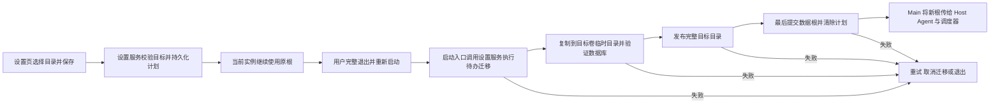

# 可配置数据存储目录

## 目录与状态归属

OpenZWork 的默认业务数据根为 `{home}/.openzwork`，设置中的数据存储路径改变它的基础目录，保留 `.openzwork` 后缀。`setting.json` 固定在用户 HOME 的 `.openzwork/v2/setting.json`，作为启动指针；用户全局 AGENTS、Skills、项目配置和 Electron userData 的既有位置不随此设置改变。

Main 只读取已提交的数据根并传递给 Host/Agent/调度器。配置解析、迁移计划与文件复制由 services 的设置与路径入口负责；CLI 会话事实和 Host 组织态仍由原有 owner 管理。

## 保存与重启时序

原实现运行中只复制 `v2` 就提交新根，而 Main 已将 CLI DB、记忆与工作区也绑定到新根，造成复制范围不足；保存后继续写旧根还会产生遗漏。修复后保存只持久化迁移计划，当前运行实例继续使用原根。

`AppSettings.pendingDataBaseDirMigration` 是内部启动计划：`id` 为 UUID，`sourceBaseDir` 为保存时生效的绝对基础目录，`targetBaseDir` 为用户选定的绝对基础目录。公开的 `dataBaseDir` 在迁移成功前保持原值。旧设置无此字段时行为不变；用户重新选择原生效路径可以取消计划。

迁移必须在业务 Host、Agent 和调度器启动前执行。启动失败不静默切到空库；取消迁移只清除计划并继续使用原根，原数据保留。目标目录已发布但指针提交失败时，通过同一计划 ID 的完成标记重试指针提交，不能合并另一份数据。完成标记仅用于本次重试，不能当作普通已有目标的覆盖许可。

源根封存标记使用原子写入；进程在写入中退出时，保留上一次完整标记或尚未封存的原状态，同一计划可继续重试。

## 复制范围与失败语义

- 复制 `v2`、`cli`、`workspace`、`agent-memory` 及关联的 `clipboard`、`git-checkpoint-index`、`backup`、`tmp`、`cache`、`mailbox`、`security`，覆盖会话正文、工具输出、用户级子代理记忆、信任记录和引用文件。
- 不复制固定 HOME 的 `v2/setting.json`、它的锁和临时文件；CLI 用户配置 `cli/config.json` 及其临时/备份文件仍留 HOME。Server/发行 runtime、全局 Skills/commands/AGENTS 不在搬迁清单中。
- 应用的 `v2/*.sqlite` 与 `cli/db/db.sqlite` 用备份接口生成含已提交 WAL 的一致副本并执行 `quick_check`，不把 live WAL/SHM 当普通文件拼接；工作区中的普通文件即使以 `.sqlite` 命名也按原文件复制。Main 与独立 CLI 在启动业务前登记同根使用租约，迁移取得排他门禁后检查存活使用者；有使用者时保留计划并提示退出相关进程后重试。正常退出释放租约，崩溃租约按 PID 回收。旧版本进程无法参与新门禁，迁移前也须完整退出。
- 目标 `.openzwork` 必须不存在或为空；非空目标拒绝，不合并 SQLite，也不按逐文件“目标优先”处理。源和目标不得相同或互相嵌套；符号链接别名按真实路径检查。
- 使用目标卷上的临时目录完成复制，成功后发布；失败只清理当前操作创建的临时目录，不删除源或其他目标数据。
- 保留工作区中的符号链接；历史 `v2/agent-config` 内可重建的共享资源链接继续跳过。不能以 Windows 不能创建链接为由静默丢掉工作文件链接，失败应保留原根。
- 在 staging 中转换本机业务数据的结构化路径：Host 任务/项目/定时定义的本地目录，CLI 会话 cwd、附件、本应用工具输出与运行快照。只转换迁移清单内的旧根路径，不替换用户消息、命令、脚本或任意 JSON 字符串；外部项目、远端 workspaceIdentity 与远端目录保持原值。路径派生的本地 workspace key、project ID、旧会话文件 hash 和项目记忆目录同步转换；会话 ID、消息 ID 和业务内容保持原值。
- CLI 存储转换由 CLI adapter 的离线 `storage-relocate` 命令执行，services 通过既有 startup-storage 子进程入口等待严格完成回执；Host 组织态由 project-storage 转换。共享路径映射与租约模块不拥有业务 SQL。所有转换针对目标副本，出错不发布目标。没有 CLI 转换端口而存在 CLI 数据时明确失败。
- 完成后新根独立承载业务读取和写入。源根保留为快照，并登记迁移去向，参与门禁的旧根写者拒绝继续启动；重试仅接受同一迁移计划。固定 HOME 设置中的本地工作区引用与数据根指针一起提交。连续 A→B→C 以当前根为源，不依赖 A 或 B 可访问。
- 冷恢复给模型的本地附件说明和后台 Bash 输出提示同步转换：只改与结构化引用一致的应用生成路径行，保留降级原因、读取提示、预览与用户内容。验收调用真实生成器与 file-part hydration，避免只证明磁盘文件可读却仍把旧地址交给模型。
- 此功能保持 Desktop 数据根同源：`ZCODE_DATA_BASE_DIR`、`ZCODE_STORAGE_DIR`、`ZCODE_SESSION_DB_PATH` 同时由 Main 下发。固定 HOME 用户资源、独立 CLI 的显式配置优先级和远端 authority 保留。

## Windows 安装目录保护

禁止选择当前应用安装目录及其子目录，也保护 Program Files/LocalAppData 中 OpenZWork、OpenZWork Preview 与历史 ZCode 安装目录。比较使用 Windows 大小写不敏感路径规则，不误伤同名前缀的普通目录。NSIS 的现有数据目录检测继续按当前安装器实现保护既有数据。

## 界面与验收

设置页显示当前保存的目标；保存提示“迁移计划已保存，重启 OpenZWork 后复制数据”。保存失败时保留原展示状态，错误信息给出可恢复动作。重新打开设置仍能看到待迁移目标。

| 场景                                         | 验收要求                                                                       |
| -------------------------------------------- | ------------------------------------------------------------------------------ |
| 保存后继续在原实例写入，再完整重启           | 保存时不提前复制，重启复制包含后续提交；旧数据保留                             |
| 真实 Host/CLI SQLite、记忆、工具附件与工作区 | 隔离旧根后恢复历史会话、读取工具输出和附件、召回默认工作区记忆；新写入只落新根 |
| 非空目标、嵌套路径、权限或复制失败           | 不提交新根，不覆盖目标，原数据可继续使用                                       |
| 指针提交失败后重试                           | 同一计划识别已完成复制，只提交指针；不同计划不能复用旧目标                     |
| 并发使用者、连续 A→B→C                       | 活跃使用者阻止迁移；迁移后旧根拒绝新业务写者；C 在 A/B 隔离后可读写            |
| 项目、全局用户资源与远端                     | 不随本机业务数据根迁移；手机继续复用已有 Host                                  |

根 UT 验证真实临时 SQLite 与第二次服务启动；桌面 E2E 场景覆盖保存待重启状态和完整启动链。自动化通过与真实安装包/Windows/SSH 验收分别报告。
