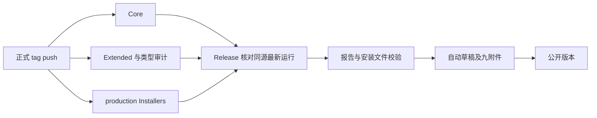

# OpenZWork 构建与发布流程

当前入口为 [GitHub Actions](../../.github/workflows/) 与 [OpenZWork Releases](https://github.com/BlueSkyXN/OpenZWork/releases)。应用采用手动安装更新。历史上游 GitLab、OSS、CDN 灰度发布与官方自动更新链不属于本仓当前发行流程。

## 候选验证

1. 固定最终分支提交，完成 `CI`、`Extended checks (non-blocking)` 与 Desktop Main/E2E 类型审计。
2. 在同一分支触发 `Installers`，不提供 `release_tag` 或 `release_commit`：

   ```bash
   gh workflow run installers.yml -R BlueSkyXN/OpenZWork --ref <candidate-branch>
   ```

3. 回读实际 `headSha` 与各 job 结果。源码变化后，重新验证最终提交。
4. 检查 macOS arm64、Windows x64、Linux x64 的构建日志、artifact 名称、大小、有效期和摘要。下载、解包、安装分别记录执行情况。

默认构建生成 Preview 候选，输出到 Actions artifacts。`CI` 与 `Extended` 由 PR 事件触发；Installers 自动 push 入口仅覆盖 `main` 和 `wp**`，其它候选分支需要手动触发。

## 正式包与 Release

推送正式 tag 后，CI、Extended 和 Installers 自动验证同一提交，全部成功后由 Release 工作流公开版本。无修订号沿用 `vX.Y.Z-openzwork`；修订版使用 `vX.Y.Z+openzwork.N`。tag、实际 checkout SHA 和根 `package.json` 完整版本必须一致。编号与 Latest 比较见 [发行版本规则](../spec/openzwork-release-version.md)。

根目录 release-it 负责 CHANGELOG、commit/tag/push。修订版先将完整发行号写入 `package.json.version` 并完成验证，再执行 `pnpm release --no-increment`，保留 `+openzwork.N`；已经准备好版本提交时，也可以直接推送对应的正式 tag。无修订号的官方基准升级仍可使用 `pnpm release <version>`。自有修订不使用 `patch` 自动增加官方基准。使用用户自己的 Git 凭据推送；GitHub `GITHUB_TOKEN` 创建的事件通常不会再次触发其它工作流。

正式构建使用 OpenZWork production 身份，当前工作流关闭 macOS/Windows 签名。每个平台生成 `RELEASE-MANIFEST.json`，记录 source tag、source commit/tree、workflow commit、版本、身份与安装包 SHA256。

| Runner      | 目标安装格式               |
| ----------- | -------------------------- |
| macOS arm64 | DMG、ZIP                   |
| Windows x64 | NSIS EXE                   |
| Linux x64   | AppImage、DEB、RPM、pacman |

三份工作流并行执行，完成事件唤起 Release 协调器。它只选择该 tag/SHA 的最新运行，任一检查缺失、失败或运行中均不公开。Extended 虽名为 non-blocking，在正式发行中仍是必需门禁。

runner 验证测试报告、来源及文件摘要后，自动创建或续传草稿。已有草稿正文保留；否则使用 GitHub 按 tag 生成的版本说明。七个安装文件、`PROVENANCE.json`、`SHA256SUMS` 回读一致后公开。旧版本晚完成时保留较新的 Latest。本机无需下载安装包。



失败时重跑原检查的失败 job，成功后的完成事件会再次触发发布。协调器失败或待发布任务被 GitHub 并发队列替换时，可手动恢复：

```bash
gh workflow run release.yml -R BlueSkyXN/OpenZWork -f release_tag=v3.16.2+openzwork.1
```

只读取门禁与发布状态时，额外传 `-F verify_only=true`。已公开版本重放直接返回完成；同名附件有冲突则失败，不覆盖或删除。不同版本的发布串行执行；GitHub 并发组最多保留一个待运行任务。

旧版本可以继续使用 Installers 的手动正式构建与精确运行编号发布入口。`release_tag`、`release_commit` 固定来源；`publish_installer_run`、`core_run`、`extended_run` 与 `release_notes` 指定既有证据和说明。手动发布仍要求已有草稿。Preview 包不能通过改名转成正式包。

## 命令边界与重试

- `pnpm release` 使用 [.release-it.mjs](../../.release-it.mjs)；它只负责版本提交与正式 tag，后续发布交给 GitHub Actions。CLI 子包的独立版本命令不受影响。
- 合并和候选构建不创建正式 tag。推送正式 tag 启动自动发布；服务器部署另行处理。
- 检查失败时保留运行编号、实际进程退出码与未完成测试数量。重跑成功只能说明该次运行通过；稳定性问题的修复需要根因及回归证据。
- 新提交产生后，旧提交的通过记录与安装包继续作为历史记录，最终候选以新的统一 SHA 验收。

## 设计来源

当前 GitHub Actions 编排由 OpenZWork 分支新增：核心 CI 首次加入于 `2934deb7`（2026-09-21），Installers 于 `58de1928`（2026-09-23），Core/Extended 分层于 `ec3bcdbe`（2026-10-19），正式 tag 构建于 `0e657d60`（2026-10-22），云端校验发布器于 `ffada416`（2026-10-25）。上游 v3.16.2 的公开源码树 `3c5b2276` 中没有这三份 GitHub Actions 文件。

底层 `packages/desktop/scripts/bundle.mjs`、electron-builder 配置、release-it 与大量测试来自 ZCode，再按 OpenZWork 的身份、移除范围与平台支持进行适配。GitHub Actions、第三方 Actions、Node、pnpm、Vitest 和 Electron/electron-builder 属于复用工具。公开上游文档还描述了 GitLab/独立发布平台方案；当前 GitHub 工作流的归属不能用于推断官方内部 CI/CD 的全部实现。
