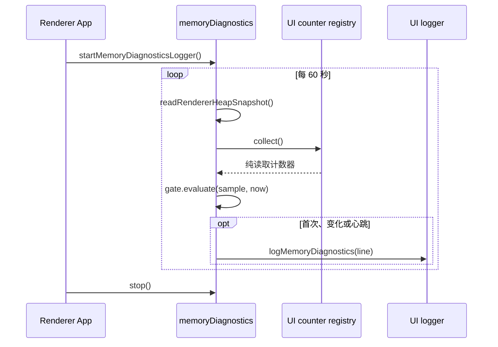

# 进程内存本地诊断日志

本地内存诊断通过 heap、native 内存和领域计数器定位增长来源。共享门控与格式化逻辑位于
`packages/shared/src/memoryDiagnostics.ts`。

## 当前接入范围

| 进程         | 当前实现                                                                                                                           |
| ------------ | ---------------------------------------------------------------------------------------------------------------------------------- |
| renderer     | `App.tsx` 启动 `startMemoryDiagnosticsLogger`；每 60 秒采样 `performance.memory` 与 UI 计数器，经门控后调用 `logMemoryDiagnostics` |
| utility_host | `hostMemoryDiagnosticsLog.ts` 保留采样器实现，尚未在 Host 启动入口接入                                                             |
| main         | `mainMemoryDiagnostics.ts` 保留注册表，main 入口注册窗口、task bus、broadcast、guest 计数器；尚未接入周期采样写盘                  |
| agent_node   | 协议 server 与 V4 gateway 保留计数器读取方法；尚未接入内存诊断样本写盘                                                             |

当前可直接检查 renderer 的内存日志。其他进程需要完成启动、停止与写盘接入后，才能提供
对应角色的持续观测数据。

## 采样与门控

renderer 每次采样读取 `performance.memory` 和已注册的纯读取计数器。浏览器没有 heap API
时仍可采集领域计数器。首次、超过变化阈值或达到心跳周期的样本才写盘：

- 首次样本：`reason=first`。
- `heapUsedKb` 相对上次写盘值变化超过 5%，或 `rssKb` / `externalKb` 变化超过 10%，
  或任一计数器变化：`reason=changed`。
- 距上次写盘已满 300 秒：`reason=heartbeat`。

共享门控支持四类 `role`：`main`、`renderer`、`utility_host`、`agent_node`。
各采样器的读取、计数器收集或写盘失败只丢当前样本。renderer 的 `stop()` 清理采样定时器。



## 日志格式

```text
[memory] role=renderer reason=changed heapUsedKb=91234 heapTotalKb=120000 projection.stores=2 shiki.tokensCache=14
```

固定字段顺序为 `role`、`reason`、`rssKb`、`heapUsedKb`、`heapTotalKb`、`externalKb`、
`arrayBuffersKb`；缺失字段省略。计数器按 `<provider>.<key>` 命名，按字典序输出，数值取整。
renderer 通过 `packages/ui/src/logger.ts` 的 `logMemoryDiagnostics` 写入桌面日志桥；
Web 端没有该桥时不写桌面日志。

新增计数器使用 `registry.register(name, provider)`，provider 只读取 Map / Set 大小或
数组长度，不做 IO，不改变业务状态。日志字段只放数字与有限枚举，不包含路径、请求正文、
凭据或 session / task 标识。

## 判读与验证

先按 `role` 查找 `heapUsedKb` 的增长，再比较同一行的领域计数器。Node 角色完成接入后，
还可结合 `rssKb`、`externalKb` 与 `arrayBuffersKb` 分析 native / ArrayBuffer 内存。

验证门控时覆盖首次、阈值上下界、计数器变化、300 秒心跳与单个 provider 抛错；
验证采样器时覆盖停止后不再采样、读取或写盘失败不影响业务。进程接入验收还需确认
真实启动入口调用采样器，以及进程退出时回收定时器。

## CLI 分配诊断（3.18.1 / 4.0.0）

CLI 进程使用受控堆分配采样定位高内存热点，诊断文件写入 `~/.openzwork/cli/memory-diagnostics`（自定义数据根下跟随对应 CLI 目录）：

- 每轮最多一个采集/写盘操作，忙时丢本轮，不排队。单次同步采样/投影超过 25ms 或节点数超限，本进程永久降级为纯指标；采样异常同样降级，不向任务抛错。启动和退出不等待磁盘采集。
- Inspector adapter 在同步调用边界计时，recorder 只累计 adapter 的同步耗时与本轮指标/投影耗时；`await` 后恢复前的其他业务工作不计入诊断预算。25ms 是完成后的熔断判据，不能中断已在执行的 V8 操作，不声明硬实时上限。
- 降级后的记录保留最后一次有效热点及其采集时间，避免纯指标轮转覆盖已有证据。当轮结果已完成有界投影但实际耗时超预算时，保存这份有效结果后熔断；节点超限或堆压力下未取得有效投影时，仍只保留此前结果。
- sampler 可选 `degradation` 保存首次降级的 `reason`、`at`、`durationMs`；原因限定为 `start-budget`、`start-failed`、`profile-budget`、`profile-node-limit`、`heap-pressure`、`write-backpressure`、`profile-error`。后续纯指标轮次不覆盖这些字段；旧记录没有此字段仍可导出。
- 堆使用达到上限的 80% 后同样降级，不在临近 OOM 时物化 profile。写盘在途而采样窗口到期时释放 profiler，慢磁盘不能导致采样状态无限积累。
- `stop` 仅停止既有采集资源，不等待在途写盘；不修改进程退出、重启、信号、协议关闭、stderr drain 或进程树回收，不新增退出取样、强制 GC 或 heap snapshot。远端 CLI 在远端记录，手机复用 Host，不增加重复采集器。

诊断证据回归：`node packages/desktop/scripts/cli-diagnostic-evidence-smoke.mjs` 使用实际 Inspector、文件保存和本地 ZIP 归档，验证忙碌调度不误停采、真实分配位置、受限堆 OOM/未捕获异常、大日志尾部及崩溃安全投影、正常/异常退出与诊断失败。
