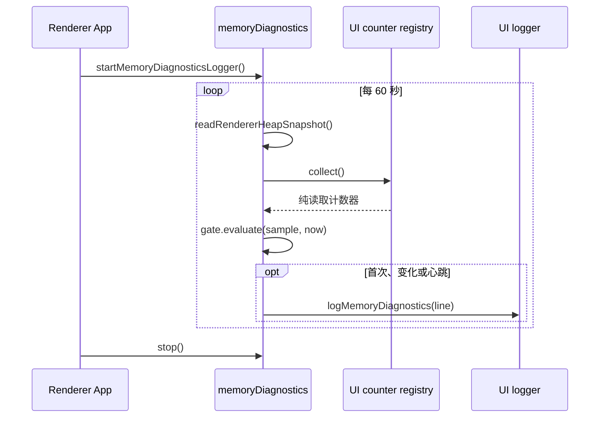

# 进程内存本地诊断日志

本地内存诊断通过 heap、native 内存和领域计数器定位增长来源。共享门控与格式化逻辑位于
`packages/shared/src/memoryDiagnostics.ts`。

## 当前接入范围

| 进程         | 当前实现                                                                                                                           |
| ------------ | ---------------------------------------------------------------------------------------------------------------------------------- |
| renderer     | `App.tsx` 启动 `startMemoryDiagnosticsLogger`；每 60 秒采样 `performance.memory` 与 UI 计数器，经门控后调用 `logMemoryDiagnostics` |
| utility_host | `hostMemoryDiagnosticsLog.ts` 保留采样器实现，尚未在 Host 启动入口接入                                                             |
| main         | `mainMemoryDiagnostics.ts` 保留注册表，main 入口注册窗口、task bus、broadcast、guest 计数器；尚未接入周期采样写盘                  |
| agent_node   | 协议 server 与 V4 gateway 保留计数器读取方法；尚未接入内存诊断样本写盘                                                             |

当前可直接检查 renderer 的内存日志。其他进程需要完成启动、停止与写盘接入后，才能提供
对应角色的持续观测数据。

## 采样与门控

renderer 每次采样读取 `performance.memory` 和已注册的纯读取计数器。浏览器没有 heap API
时仍可采集领域计数器。首次、超过变化阈值或达到心跳周期的样本才写盘：

- 首次样本：`reason=first`。
- `heapUsedKb` 相对上次写盘值变化超过 5%，或 `rssKb` / `externalKb` 变化超过 10%，
  或任一计数器变化：`reason=changed`。
- 距上次写盘已满 300 秒：`reason=heartbeat`。

共享门控支持四类 `role`：`main`、`renderer`、`utility_host`、`agent_node`。
各采样器的读取、计数器收集或写盘失败只丢当前样本。renderer 的 `stop()` 清理采样定时器。



## 日志格式

```text
[memory] role=renderer reason=changed heapUsedKb=91234 heapTotalKb=120000 projection.stores=2 shiki.tokensCache=14
```

固定字段顺序为 `role`、`reason`、`rssKb`、`heapUsedKb`、`heapTotalKb`、`externalKb`、
`arrayBuffersKb`；缺失字段省略。计数器按 `<provider>.<key>` 命名，按字典序输出，数值取整。
renderer 通过 `packages/ui/src/logger.ts` 的 `logMemoryDiagnostics` 写入桌面日志桥；
Web 端没有该桥时不写桌面日志。

新增计数器使用 `registry.register(name, provider)`，provider 只读取 Map / Set 大小或
数组长度，不做 IO，不改变业务状态。日志字段只放数字与有限枚举，不包含路径、请求正文、
凭据或 session / task 标识。

## 判读与验证

先按 `role` 查找 `heapUsedKb` 的增长，再比较同一行的领域计数器。Node 角色完成接入后，
还可结合 `rssKb`、`externalKb` 与 `arrayBuffersKb` 分析 native / ArrayBuffer 内存。

验证门控时覆盖首次、阈值上下界、计数器变化、300 秒心跳与单个 provider 抛错；
验证采样器时覆盖停止后不再采样、读取或写盘失败不影响业务。进程接入验收还需确认
真实启动入口调用采样器，以及进程退出时回收定时器。
