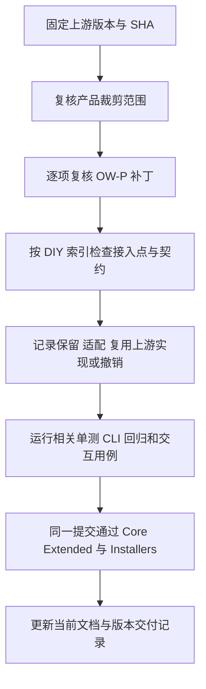

# OpenZWork 自定义功能与维护

本页供开发与版本整合时定位规则、接入点和回归。功能规则由各 spec 维护，已发行版本见 [Releases](https://github.com/BlueSkyXN/OpenZWork/releases)，构建与发布步骤见[发行流程](git/release-build-publish-separation.md)。

当前上游整合基线为 ZCode `3.16.2` / `3c5b227649371507ddc4eb46ac5133afe6db1cab`，来源见[整合规范](spec/upstream-v3.16.2-integration.md)。每次同步上游，在同步 PR 中记录新的版本、SHA、下表逐项结论及对应测试结果；同版本重推也按 SHA 复核。根 `package.json.version` 记录 OpenZWork 完整发行号。

## 三类改动的维护位置

| 类型               | 权威位置                                                                                          | 更新时的动作                                                                         |
| ------------------ | ------------------------------------------------------------------------------------------------- | ------------------------------------------------------------------------------------ |
| 上游来源缺陷       | [下游补丁清单](upstream/downstream-patches.yaml)及其[登记规则](spec/downstream-patch-registry.md) | 保留编号、修复处与回归标记；核对上游是否等效修复，决定保留、适配或退役               |
| 产品裁剪与兼容边界 | 当前整合 spec、对应功能 spec、[裁剪检查](../tests/private-cleanup/cleanup.test.cjs)               | 检查被移除的账号、遥测、CUA、厂商默认配置等是否重新出现；边界变化先更新产品规则      |
| OpenZWork 自有功能 | 下表中的功能 spec、模块 contract、[核心测试清单](../tests/ci/core-tests.json)及 E2E 覆盖矩阵      | 复核真实入口、状态所有者、持久化和冷恢复；自有缺陷在所属功能内修复，不占用 OW-P 编号 |

## DIY 功能索引

表中的测试名用于定位已有回归；完整必跑范围由对应 spec、核心测试清单及 CI 工作流维护。E2E 状态统一以[覆盖矩阵](testing/conversation-session-e2e-coverage-matrix.md)为准；`pending` 用例升级时显式执行，审核后按 [E2E 生命周期](../.agents/skills/e2e-case-lifecycle/SKILL.md)准入。

| 功能 / 权威规则                                                    | 状态所有者与关键接入点                                                                              | 核心回归入口                                                                                                                                                  | 交互验收                                                                   |
| ------------------------------------------------------------------ | --------------------------------------------------------------------------------------------------- | ------------------------------------------------------------------------------------------------------------------------------------------------------------- | -------------------------------------------------------------------------- |
| [系统提示词设置](spec/system-prompt-settings.md)                   | SettingService 保存设置；CLI ContextBuilder 生成默认目录与运行提示词；设置页保存草稿与并发比较      | `system-prompt/contract.test.ts`、`systemPromptSettingsLoading.test.ts`；CLI `system-prompt-settings.test.ts`、`context-builder.test.ts`、协议回归            | `system-prompt-settings.test.ts`：pending                                  |
| [原生会话指标与显示偏好](spec/native-conversation-metrics.md)      | CLI usage/step part 是指标事实；V4 投影与 hydration 恢复；UI 指标模块和偏好 store 控制显示          | `conversation-metrics/contract.test.ts`、`conversationMetrics.test.ts`、`conversationMetricsPreferences.test.ts`；CLI 指标与冷恢复回归按 spec                 | `conversation-session-native-metrics.test.ts`：pending                     |
| [对话 Markdown 复制](spec/conversation-controls.md)                | `conversation-export` 只读转换；任务菜单、分组菜单和会话页头经 `useTaskListItemContextActions` 接入 | `conversation-export/contract.test.ts`、`conversationCopyHook.test.ts`、任务菜单与页头测试                                                                    | `conversation-session-openzwork-controls.test.ts`：pending                 |
| [侧栏筛选与项目活动排序](spec/conversation-controls.md)            | 侧栏偏好统一持久化；`ProjectDirectoryProvider` 组织项目顺序；分组保留自身组织语义                   | `sidebarTaskFilters.test.ts`、`sidebarFiltersInteraction.test.ts`、`projectDirectoryProvider.test.ts`                                                         | 同上，覆盖筛选、排序与重启                                                 |
| [标准 Provider 模板](spec/standard-provider-templates.md)          | `config/provider/zcode-builtin.json` 保存三个中性协议模板；Personal 配置服务保存用户配置            | `standard-provider-config.test.ts`、Provider resolver/config-service 测试、裁剪检查 WP-08                                                                     | 浏览器 `standard-provider-templates.test.mjs`：pending                     |
| [业务数据目录迁移](desktop/configurable-data-directory.md)         | SettingService 保存待迁移计划；启动入口执行；Host/CLI 各自转换所属数据，最后提交新根                | `dataDirectoryMigration.test.ts`、`dataDirectoryTrueMigration.test.ts`、data-directory/project-storage/startup-storage 合同；CLI `storage-relocation.test.ts` | `openzwork-data-directory.test.ts`：pending                                |
| [V1 远控与三种连接方式](web-remote-control/v1-connection-modes.md) | Main 负责配对和 attachment；已有 Host/CLI 拥有会话；官方网页版本由 V1 配置决定                      | `webRemoteControlManagerExternalRelay.test.ts`、`webRemoteControlSharedHostAttachments.test.ts`、`webRemoteControlLegacyTasks.test.ts`                        | `web-remote-v1-connections.test.ts`：pending；官方网页验证按 spec 显式启用 |
| [设置页布局与远控快捷入口](spec/settings-visual-polish.md)         | 共享设置页复用指标、提示词与远控的原有 owner；布局不另存业务状态                                    | 对应功能的 UI contract、加载状态、入口接线测试                                                                                                                | `settings-visual-polish.test.ts`：pending                                  |
| [外部会话导入](spec/external-session-import.md)                    | services 扫描、解析和编排；CLI 创建会话；Host task index 保存来源指纹                               | `externalSessionImportRepo.test.ts`、`externalSessionImportFlow.test.ts`、`zcodeLegacyTaskCompatTaskIndex.test.ts`                                            | 当前实现 services/shared，UI 多来源入口尚未接入                            |

## 日常修改

1. 先在所属 spec 明确预期行为、唯一状态所有者、兼容边界与验收场景，再修改实现。涉及状态或异步流程时更新同一份图。
2. 沿现有模块公开入口接入。上游文件中的菜单、配置回调、协议字段等接点变化时，同时核对调用方和持久化/恢复端。
3. 回归验证真实关键边界：保存后回读、索引关闭重开、源/目标切换、失败保持原状态。新增稳定回归登记到已有 Core 或 CLI CI 入口。
4. 功能入口、测试路径或状态变化时更新本索引。详细验证记录集中保留在覆盖矩阵或版本交付记录，并注明 SHA、平台、运行编号和未验证项。

## 同步上游

官方出现相似能力时，先比较状态归属、指标口径、偏好、恢复与兼容行为，再提出复用方案。产品取舍、兼容策略或持久化格式变化须单独说明；代码没有冲突也要检查入口是否仍被调用。

## 文档分工

| 文档                          | 维护内容                                                                  |
| ----------------------------- | ------------------------------------------------------------------------- |
| 中英文 README                 | 当前版本、用户入口、初始化步骤与升级必需信息；工具版本与 `mise.toml` 一致 |
| 功能 spec / 模块 contract     | 当前产品规则、职责、接口、关键接入点与回归要求                            |
| 本索引                        | 自定义功能和维护入口，不复制完整规格与历史测试日志                        |
| 覆盖矩阵 / Release / 交付记录 | 某个 SHA 的验证结果、平台、运行编号、已知限制和发行事实                   |
| 历史候选与旧设计              | 标明适用版本和后续入口，保留当时事实；当前 README 指向现行规则            |

现有验证命令和范围见[根协作规则](../AGENTS.md)及[提交前检查说明](testing/pre-push-hook.md)。正式发布使用同一 tag/SHA 的门禁，人工试装与手机/跨 Host 验收在覆盖矩阵单独记录。
