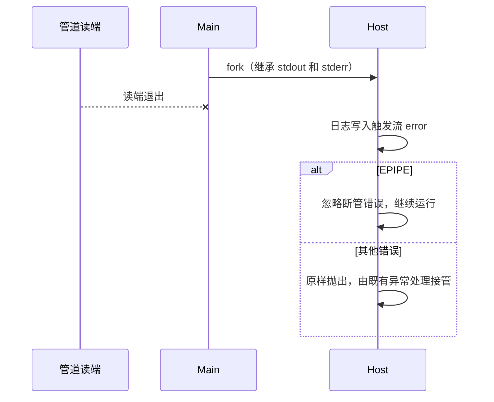

# Host 写日志遇到断开的管道后退出（OW-P039）

登记：[下游补丁清单](downstream-patches.yaml)的 `OW-P039`。

## 问题与所有者

Main 通过 `utilityProcess.fork` 启动 Host，未指定 `stdio`，因此 Host 继承 Main 的 stdout 和 stderr。输出是管道且读端先退出时，Host 的日志写入可能触发异步 `EPIPE`。3.18.2 的 Main 有自己的流错误处理，Host 没有；未捕获的断管会进入 Host 的致命异常处理。

## 规则

1. 在 Host 入口首次写日志前，给 stdout、stderr 各装一个 `error` 监听。逻辑归 `hostBrokenPipeGuard.ts`，入口只接线，不导入 Main 的 logger。
2. 只忽略错误码为 `EPIPE` 的错误，其他错误以原对象抛出，沿用 `hostUncaughtExceptionGuard.ts` 的分派。不增加 Host 重启或改变其他清理路径。
3. 新文件只作单文件架构准入，不收编整个 Host 目录。补丁标记留在入口、实现与回归，准入理由只描述架构边界。
4. 上游 Host 提供等效护栏时，撤除重复实现和接线，保留回归。

## 验收

- 固定核心套件对 stdout、stderr 分别关闭实际子进程的读端，再命令子进程写入。无护栏必须收到准确的未捕获 `EPIPE`；有护栏时写入回调仍收到 `EPIPE`，子进程继续执行并正常退出。
- 对两路分别注入非 `EPIPE` 错误，即使消息中含 `EPIPE`，仍由原致命处理接收同一对象。
- 隔离 Electron Utility Process 探针验证继承管道的行为；完整桌面窗口另验：读端提前退出后仍能使用依赖 Host 的窗口操作。
