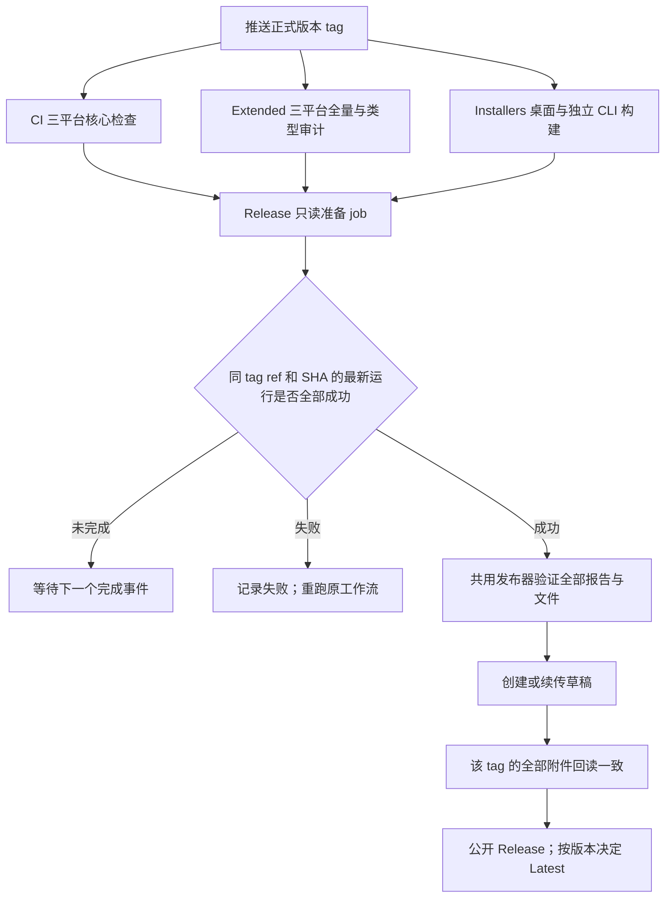

# 正式 tag 自动发布 GitHub Release

## 产品规则

推送正式 tag 表示启动该版本发行：无修订号沿用 `vX.Y.Z-openzwork`，带修订号使用 `vX.Y.Z+openzwork.N`。tag 必须与根 `package.json` 完整版本一致，解析与排序遵循 [OpenZWork 发行版本](openzwork-release-version.md)。日常 PR、main 和 wp 分支继续按原规则检查或构建 Preview。

根 `pnpm release` 沿用 release-it 的版本与 CHANGELOG 更新、commit/tag/push，按完整发行号选择对应 tag；GitHub Release 仍由 CI/CD 创建。CLI 子包的独立版本入口不变。tag push 的 `before` 为零 SHA，核心工作流不将其传入显式架构基线，沿用检查器的默认分支基线发现。

CI、Extended 和 Installers 在 tag 上各运行一次。Release 工作流由这三者的完成事件触发，只有同一 tag、同一源码 SHA 的三项最新运行全部成功，才调用既有发布器。Extended 的 non-blocking 名称只描述日常核心检查的独立性；它是正式发布的必需门禁，包括完整单测和 Main/E2E 类型审计。

Extended 的七组单测按[平台与分片并行规范](../ci/extended-ci-parallel.md)执行。每个平台汇总其全部分片（macOS 两个、Linux 三个、Windows 四个）后仍输出 `extended-tests-<platform>`；发布器继续验证同源码来源、完整七组 summary 和逐组 JSON。缺失、失败或来源不一致的分片会使汇总及工作流失败。

正式发行的附件范围由 tag 源码中 `package.json` 的 `openzworkRelease.cliArchives` 决定。启用后，`Installers` 构建 macOS arm64、Linux x64 和 Windows x64 的独立 CLI，Release 上传 `OpenZWork-CLI-<版本>-<平台>.tar.gz`。用 Node.js 24.14.0 运行解压目录中的 `node zcode/bin/zcode.mjs` 可进入 TUI。

启用 CLI 附件的构建使用 `pnpm build:zcode --archive-only`，输出运行包和摘要。该模式默认写入 `dist/zcode-archive/`。自托管下载继续使用 `pnpm build:zcode --base-url <url>` 生成安装脚本和版本索引。显式提供下载根时，macOS 与 Linux 的构建会另外保留这一份自托管目录，并复用构建结果生成平台附件。历史 tag 的附件范围由其源码决定。

CLI tar 的创建与解包命令必须按实际选中的 tar 实现处理 Windows 绝对归档路径。Git GNU tar 会把 `D:\...` 中的盘符解析成远程主机，需要显式携带 `--force-local`；Windows System32 tar 支持盘符路径但不支持该参数，不能携带。解包目录由子进程 `cwd` 提供，不再传给 `-C`。该要求由独立 CLI 分发回归测试锁定。

Windows smoke 验收会在当前进程加载 `node-pty` 的 `conpty.node`；该 native 模块在进程退出前保持文件锁。验收结束后的临时目录清理因此按 best-effort 处理：仅 Windows 的 `EPERM` 允许保留锁定文件，其他平台或清理错误仍使验收失败。Windows ConPTY 关闭 socket 时可能先触发 exit event，此时 node-pty 尚未写入数值退出码；键盘退出验收接受这一平台事件，其他平台仍要求退出码为 0。

Windows 的 WebSocket close 事件可能不随本地 `close()` 调用收敛。smoke 在发起正常关闭后限时等待，超时仅终止测试客户端 socket，不改变服务端；HTTP、server-info、workspace、WebSocket 连接和 Web 子进程退出仍须通过。

下载、校验、上传全部在 GitHub runner 完成。新流程要求七个桌面安装文件、三个 CLI 包、来源清单和校验和。历史 tag 按原九附件范围校验。

Windows 安装包构建使用系统自带的 tar.exe 解压预构建工具 ZIP。解压结果须能通过已有的二进制目标检查，runner 上 PowerShell 归档模块的版本不参与构建。

### 独立包内容与启动

正式附件按构建主机的平台和架构选择 OpenTUI、Node FFI、PTY 的原生文件。Linux 优先使用与所装 node-pty 同版本的原生模块。校验器核对包内目标与来源清单，拒绝其他目标的原生 TUI/PTY、编译中间文件和已裁剪的 CUA 插件。Node 24 的 OpenTUI 依赖 koffi 与 unsafe-pointer。面向自托管的 install.sh 仍使用原下载布局。

解压后在项目目录执行解压路径下的 `zcode`（Windows 为 `zcode.cmd`）。启动器使用 PATH 中的 Node.js，保留参数、退出码和工作目录。每个平台在同一次构建中验收实际压缩包的 PTY 启动、resize、退出与 Web 启动；空用户目录的首启界面必须进入无可用模型状态，配置文件路径在终端布局中的显示位置不作为平台门禁。

Web 启动顺序为 `启动器 → HTTP 子进程准备凭据 → 子进程监听成功 → IPC 通知启动器 → 显示地址并按需打开浏览器`。启动失败时向 stderr 报告原因并返回非零。启动器仅为新环境调用既有凭据准备流程，已绑定的来源和现存密文遵循原有恢复语义。

## 所有者与事件顺序

- 正式桌面构建显式检出完整的 tag ref，将标签本身取入浅克隆。源码校验对照标签指向、实际 HEAD 和请求的完整 SHA。
- 三份原工作流拥有测试和构建步骤；通过明确的运行标题 `Release <tag> / <workflow>` 标识 tag 运行，不复用同提交的分支 Preview。
- CLI 构建 job 解包并运行实际的终端与 Web 启动验收，随后将报告及压缩包归档。发布器从同一次 Installers 运行读取三个 CLI 归档，核对源码、平台、报告、文件大小与摘要，再写入 `PROVENANCE.json` 和 `SHA256SUMS`。
- 工作流身份按固定的 workflow 文件路径核对。GitHub 的 run `name` 可能返回静态工作流名，也可能返回完整运行标题；两种均可接受，但 tag 选择仍须同时匹配完整 `display_title`、`head_branch === tag`、源码 SHA、仓库与 push 事件。缺失或不匹配的 ref 不作为发行门禁；同 SHA、同标题的 main 运行也不能代替 tag 运行。
- 自动完成事件先核对 `head_branch` 与标题解析出的 tag，一致后才读取 tag 和发行状态。手动恢复继续选择真实 tag 运行；更晚的无关分支运行不覆盖既有 tag 门禁，真正的新 tag 运行失败仍阻止发布。
- `Release` 的只读准备 job 从事件或手动输入解析 tag，回读当前 tag SHA、根版本与最新运行，输出唯一一组来源编号。普通分支、PR、外仓运行不进入发布选择。
- 发布 job 仅执行受信工作流提交中的脚本，不执行下载 artifact 中的代码。`workflow_run` 使用默认分支上的工作流，checkout 保持事件工作流来源，不 checkout 触发者提供的分支。
- 所有发布入口共用仓库级并发组且不取消正在上传的任务。最终写入仍由 `publish-github-release.mjs` 负责；读取运行、逐份验证报告、归档和安装文件后，才创建或续传草稿。
- tag 是版本身份。轻量和 annotated tag 均解析到 commit；事件记录与当前 tag 指向不一致时失败。发布前再次核对 tag，流程不移动 tag。

## 恢复、版本说明与幂等

1. 选择每种工作流最新的 tag 运行；新运行失败或尚未完成时，不使用更早的成功记录替代。失败 job 重跑完成后重新触发选择。
2. `Release.workflow_dispatch` 接受已有 `release_tag`，用于恢复协调器；`verify_only` 只验证选择和状态，不创建草稿、不上传或公开。它不重建产品，也不自动重跑失败检查。
3. 自动模式在全部产物验证后创建草稿。版本说明优先保留已有草稿正文；没有正文时使用 GitHub 按 tag 生成的合并记录，并补充安装格式、未签名和更新方式。生成的正文直接包含正式 macOS 包的安装提示。[排查文档](unsigned-macos-distribution.md)优先链接到正式 tag，旧 tag 没有该页时链接默认分支；遇到其他文档查询错误时省略链接，仍用正文创建草稿。显式手动发布仍可传入自定义说明。
4. 草稿缺失的附件可以补传；同名不同大小或摘要立即失败。已公开版本在附件完整时直接返回已完成，附件冲突时由协调器报错。
5. 自动发布先比较官方基准，再比较 OpenZWork 修订号；无修订后缀按 0 处理，只将更新的正式版本设为 Latest。旧 tag 的补发不会降低 Latest；同版本重复运行也不改变更高版本的状态。该决策在公开前读取当前 Latest，所有发布 job 串行，避免不同版本同时结束造成倒退。GitHub 并发组只保留一个待运行 job；多个版本同时排队时，被替换的待运行版本可通过手动入口重放，已有草稿和附件可复用。
6. 三份测试/构建工作流仍可手动独立运行；原 Installers 的精确运行编号发布入口保留，供旧版本和固定源码复验使用。

## 验收

- 测试事件过滤、错误 tag/版本/SHA、外仓来源、不同 workflow 或分支 Preview；不能进入自动发布。覆盖标题和 SHA 均匹配但 ref 为 main、另一 tag 或缺失的事件及候选运行，确认触发事件在读取发行状态前被拒绝。
- 测试三种完成顺序、缺失/运行中/失败/取消、旧成功加新失败，以及同一次运行重跑成功。
- 测试草稿创建、生成说明、已有正文保留、错误附件拒绝、公开版本重放、旧版补发和版本并发规则。单独模拟文档查询返回 503，确认含安装提示的正文仍用于创建草稿，且不含排查链接。
- 验证正式 tag 在空下载根下构建独立 CLI，macOS arm64、Linux x64 和 Windows x64 均从解包目录启动 TUI。发行前校验缺失的平台附件、根版本或源码不一致、失败的启动报告和摘要错误。
- YAML 回归检查 tag 触发、production 输入、默认分支执行、只读准备与最小发布权限、并发组及失败传播；执行 actionlint、typecheck、lint、架构检查和提交门禁。
- 全量门禁中的本地资源样本 RPC 夹具必须等待服务端实际订阅，再发送一次性样本。固定睡眠 20ms 会在队列延迟超过该时间时丢失事件；使用 Emitter 的首个监听器回调确认就绪，并覆盖即时与 50ms 队列延迟，保持样本字段断言和原测试时限。
- 完成事件的调度顺序不固定，不要求恰好出现两次 waiting 和一次 ready。验收以门禁未齐不发布、失败可见、全部成功后可发布、重复事件幂等为准。
- 在 GitHub 对已有正式 tag 执行 `verify_only`，验证工作流装载、只读 API 与已发布幂等路径。全新 tag 的自动构建到公开链路由下一次实际发行验收；不为验收创建虚假正式版本或移动已有 tag。
