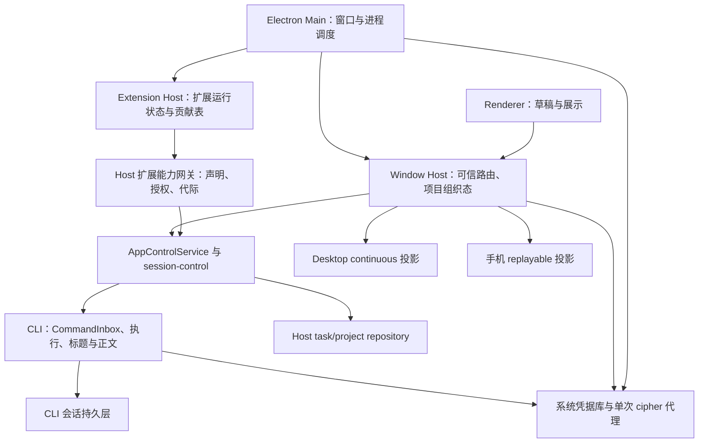

# ZCode v3.18.0 整合

## 基线与产品范围

- OpenZWork 从 `27d3808fc79ed565a087b34a01cc8973d6259ee4`（`3.17.2+openzwork.1`）继续；上游目标固定 `b95ebaffeab641907b38652f45c1502bd762972d`（mirror `zcode/main`，根 package `3.18.0`，GitHub tag 届时仍为 `v3.17.2`）。共同基线 `a9fe401eede6e6e5e01be9048679c206fe6f02d9`（v3.17.2），到目标仅 1 个提交，整版双亲 merge。应用版本更新为 `3.18.0+openzwork.1`。
- 延续既有保留与裁剪范围：标准 MCP/OAuth、Browser Use、node_repl、GenUI/MCP Apps、本地与远端工作区保留；官方账号、套餐、闲时执行、Highspeed、遥测、自动更新、云端分享/反馈、原生 CUA、官方身份头依赖继续移除（OZ-D001–D009）。
- 保留 `.openzwork` 用户数据根、项目 `.zcode` 配置、标准 Provider 模板、系统提示词编辑器、模型能力规则、本地统计与指标、外部会话导入、远控入口与全部有效下游补丁。

## 功能域变更清单

| 功能域 | 上游改动 | 处置 | 理由 |
| --- | --- | --- | --- |
| 会话控制 session-control | 新共享包 + CLI/App 工具、可信绑定、ReadSession 分页、wait 快照、导航回执 | 吸收 | 本机会话读写合同；保留 owner/lease、CommandInbox 串行 admission、项目作用域与两种交付语义 |
| 流恢复 | runtime-stream-recovery、deferred-call 投影 | 吸收 | 通用链路；保留 OW-P020/P021 语义 |
| Extension Host | 唯一扩展进程、能力网关、插槽/视图、授权审计、日志 | 吸收通用主体 | 主体全部本机（§2/§3 边界与 OpenZWork 平台边界一致）；CLI/Renderer 不直连、远程无扩展、Web/手机无插槽 |
| Plugin API | `@zcode-dev/plugin-api` 类型包 1.4.0 | 吸收 | 本地构建与类型契约；不向官方 npm scope 发布 |
| 受管 worktree | 新建/fork 独立 cwd、删除租约、未提交改动带入 | 吸收 | 项目身份与 cwd 分离，layout 纯路径计算、IO 经注入端口；任务仍归原项目 |
| 系统凭据 v2 | 异步 cipher、v2 格式、OS/文件密钥、Main owner、远端准备与回滚门禁 | 吸收通用层 | 覆盖手工 Provider/MCP/Bot 凭据，与官方 OAuth 无耦合；官方 OAuth 域继续裁剪 |
| 插件发现 | SearchPlugins/SuggestPluginInstall、BM25、人工确认、安全重载 | 吸收 | 默认关闭、确认安装；`zcode-plugins-official` 为本地 marketplace ID，商店刷新链路按实调核实 |
| 浏览器设计 | design-runtime、元素引用、HTML 源码写回、撤销、截图与热更新 | 吸收 | 保留签名本地 HTML 边界；外部页面只读；Design 插件默认关闭 |
| App 控制与导航 | app-control 合同、导航回执、open 语义 | 吸收 | 只有真实导航 owner 回执才能 opened |
| UI | 新工具渲染、侧栏性能、设置窄屏、语音输入 | 吸收并保持我方行为 | 提示词编辑、指标、用量、导入、复制/筛选/排序、远控入口逐项回归 |
| 官方账号/套餐/闲时/Highspeed/遥测/自动更新/云分享/云反馈/原生 CUA/官方身份头 | 上游在保留文件中亦有增量（热点清单见升级计划） | 保持裁剪 | OZ-D001–D009；565 个我方已删上游改路径保持删除，保留文件中新增官方接线逐段剥离 |
| ReadSessionContext | 工具合同、core 旧链、handler、测试被移除 | 跟随替换 | 新读取进 ReadSession/session-control；历史渲染、引用提醒、回放夹具迁移 |
| 旧工具组 renderer/helper | changes-group、cua-group、execute-group 旧 renderer 删除 | 跟随替换 | 新渲染结构迁移断言；CUA 保持占位（OZK-DEC-004） |
| feedbackLocalTicketStore | 删除 | 跟随删除 | 与我方反馈裁剪边界一致，不恢复官方反馈 |
| node-repl-host/dist-types | 产物删除 | 跟随删除 | 按需生成，不留旧声明 |
| `.agents/skills/electron/SKILL.md` | 上游删除 | 跟随删除并清理引用 | 上游技能原文政策；不另造同名技能 |
| E2E 重组 | 666 重命名、目录重排、新增 765 个 e2e 文件 | 迁移 | 路径/夹具/准入逐文件映射；manual-review/pending 状态随移动保留 |
| 工程链 | 新 lint 边界（session-control-boundary、react-hooks）、类型检查扩展 | 吸收并保留我方工具链 | Node 24.14.0 / pnpm 11.28.6 不变；按最终声明重算 lockfile；不恢复 CUA 包检查 |

上游未修改 `apps/zcode-cli/pnpm-lock.yaml`；根 `package-lock.json` 上游有改动，合并时按我方工具链口径处理。三个新包（session-control、plugin-api、design-runtime）依赖声明合并后重算根 lockfile。

## 状态所有者与依赖

不变量：会话事实归 CLI、组织态归 Host、每字段唯一写者；Main 不承载业务会话/队列/快照；Extension Host 不直连 CLI 或 Renderer；远端不能读取本机系统密钥；`workspaceIdentity?.trim() || workspacePath` 为身份 key，`workspacePath` 用于执行；受管 worktree 是会话 cwd 不新增 workspace。

## 冲突处理规则

1. 我方已删、上游改（565 路径）：保持删除，逐段读上游改动，保留域修复移植到存活文件（OZK-DIF-004）。
2. 双方都改（237 contents 事件）：以上游为底重放我方语义——`.openzwork` 根、官方端点/鉴权/遥测剥离、OpenZWork 接线、OW-P 标记与回归（OZK-DIF-005）。不整仓选边。
3. rename/delete（153）与 directory rename（69）：存活 E2E 的位置选择按新目录结构，准入状态随移动保留；不能整体归入保持删除。
4. 锁文件不手改（OZK-DEC-006）：依赖声明确实变化后 `pnpm install --lockfile-only --ignore-scripts` 重算。
5. 上游实现了我方已有功能时改用上游（OZK-DEC-005）；上游退役测试按 OpenZWork 口径保留（OZK-DEC-007）；spec 与代码矛盾登记待定（OZK-DEC-008）。
6. 保留文件中新增的官方接线（热点清单）逐段剥离，不因文件名不在裁剪目录而漏掉（OZK-PIT-001）。

## 测试与 E2E 承接

- App 业务单测链维持退役：不新增、不恢复 App 业务单测与对应 `contract.test.ts`；新共享包（session-control、plugin-api）的库合同测试与 CLI、工程门禁测试保留，按实际所有者接入执行入口。
- 上游新增 765 个桌面 E2E 与 15 个 UI 浏览器候选：路径/夹具/准入逐文件映射；`manual-review/pending` 状态随移动保留，不因上游换目录自动准入。
- 旧 E2E 承接：fork-cold-start-membership 迁至 `branching/`；remote-data-sync-subagent-push 迁至 `remote/data-sync/manual-review/pending/` 并保留等待评审语义；read-session-context-timeout 及同名夹具按新 ReadSession 合同重做或有依据退役（含我方自有候选用例）；`helpers/conversation-session-tool-groups.ts` 断言按新工具渲染结构迁移。
- 完整分配表（台账 32 条、补丁 23 条、新增测试分类）见升级计划 `receipts/T01-20261112-1130-assignment.md`；补丁逐项复核按 `docs/openzwork/patches/downstream-patch-registry.md` 执行。

## 验收场景与门禁

- 场景编号 SC/RS/CR/WT/EX/PD/BD/UI/RM/PK 及 L/R/A 分层、工程门禁命令清单见升级计划验收矩阵（SC01–SC06、RS01、CR01–CR05、WT01–WT04、EX01–EX04、PD01–PD03、BD01–BD03、UI01–UI03、RM01–RM02、PK01–PK02）。
- 必须执行根 typecheck/lint 与 CLI typecheck/lint；固定 Core 套件前先构建 CLI（OZK-PIT-009）；净化与补丁门禁独立执行。未实际运行的场景记 planned，不继承上游文档记录。
- 桌面 desktop-continuous 与手机 web-remote-replayable 分开验收；改动 stream/snapshot/queue/重连时两种语义都验证。

## 未决项与授权边界

- Extension Host 主体未发现官方服务依赖，按 D01 默认吸收；T08/T09 实测发现强依赖时升级待决。
- 真实钥匙串迁移（CR05）、Windows/Linux 打包（PK02）、SSH/实机远控（RM02）、push/PR/合入/tag/发布属用户授权项，本轮不执行。
- 应用版本 `3.18.0+openzwork.1` 在发布动作前核对占用。
