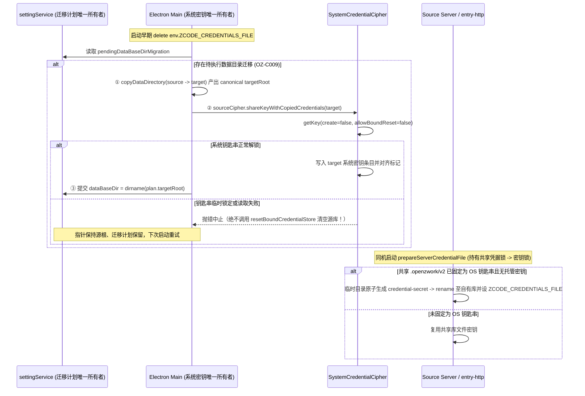
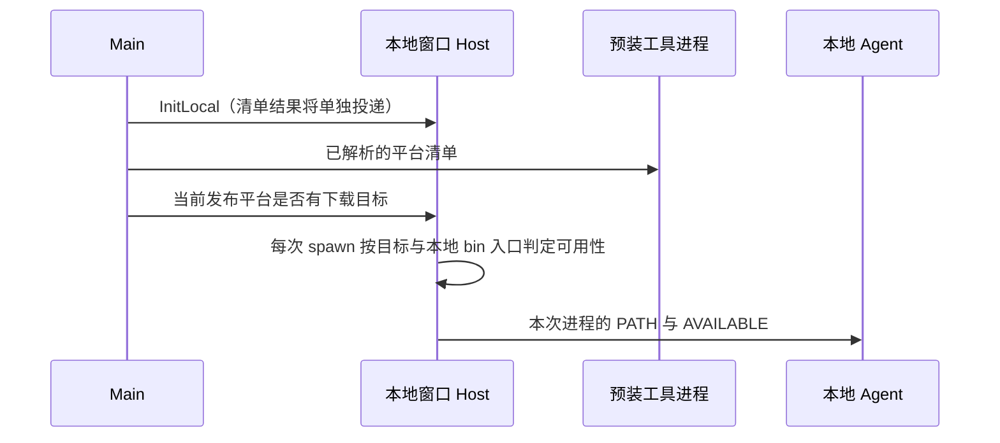

# ZCode v4.0.0 整合 spec（OpenZWork）

## 1. 基线与产品范围

- **OpenZWork 基线**：`c70f62b87c99de6ce5a20013ef4d6c4d9dcda543`（`3.18.2+openzwork.4`）
- **共同上游基准**：`fec975905a2abd4c07e35c40d51fa097a2258ec9`（`v3.18.2`）
- **上游合入目标**：`a4b4445141eb7d3b3e99eada9292775383bfc44e`（`v4.0.0`，tag `v4.0.0`），采用双亲 `git merge --no-ff` 合入，目标应用版本更新为 **`4.0.0+openzwork.1`**
- **同步分支**：`codex/sync-upstream-v4.0.0-20261124`
- **预演吸收概览**（`pnpm openzwork:scan --upstream a4b44451`，上游共改动 **2,309** 个文件路径）：
  - **直接吸收**（`direct`，我方未改）：**966** 个
  - **需要合并**（`merge`，双方均改）：**416** 个
  - **我方已删、上游修改**（`removed` / `modifiedAfterRemoval`）：**137** 个（源码与清单 59 个、测试与夹具 49 个、文档与契约 29 个）
  - **上游新增**（`added`）：**790** 个（含上游 `git diff -M` 检测到的 100 个重命名，主要为桌面 E2E 由 `manual-review/pending/` 转正移动；落在既有 `OZ-D*` 裁剪路径内的 `addedInDropPaths` **6** 个）
  - **预演冲突与波及范围**：`git merge-tree` 冲突 **284** 个（`upstream-modified` 136、`removed` 137、`new` 8、`upstream-identity` 3）；波及台账与补丁条目 **35** 个（`OZ-*` 18 个、`OW-P*` 17 个）；合并前 `--entries` 共 **38** 个有效台账条目，`0` 个未受保护。
- **延续既有保留与裁剪边界**：
  - **保留**：`.openzwork` 用户级数据根与 `OpenZWork` 产品身份（`OZ-C001`）、项目级 `.zcode` 工作区配置兼容、三种标准协议 Provider 模板（`OZ-C003`）、模型能力规则与 `/v1/models` 探测（`OZ-C004`、`OZ-F008`）、系统提示词编辑器（`OZ-F002`）、本地用量统计与会话指标栏（`OZ-F003`～`OZ-F005`）、对话控制与项目排序（`OZ-F006`）、外部会话导入（`OZ-F007`）、Web 远控 V1 多连接方式（`OZ-F010`）、构建与自动发布链路（`OZ-F011`）、CI/E2E 分片与 WT04 关联探针（`OZ-F012`）、本地内存诊断（`OZ-F013`）、多机配置包（`OZ-F014`）、可配置业务数据目录完整迁移（`OZ-C009`）、独立 `workflow-query` 通道（`OZ-C011` / `OW-P024`）、OpenAI Responses 原生联网搜索（`OZ-C013`）、自定义插件市场来源（`OZ-C014`）、预装文档工具本地回退与无官方 CDN 默认态（`OZ-C015`）及全部 42 项活跃 `OW-P*` 下游补丁。
  - **裁剪**：遥测与 ARMS/OTel 上报（`OZ-D001`）、Coding Plan / Start Plan / Highspeed 加速卡 / 闲时任务（`OZ-D002`）、官方 OAuth 与区域登录（`OZ-D003`）、云端分享 / 云端反馈 / 自动更新（`OZ-D004`）、原生 CUA 实现与进程内 Broker（`OZ-D005`）、官方 MCP 身份头 / `client-config` / `client-scenes` / `zcode-site-plugin` / Built-in 远端下载（`OZ-D006`）、营销触达 / 奖励 / 请求安全版本 / Project Access Token（`OZ-D007`）、云端内容 / 全局公告 / 云端用量账本 / 官方 ASR 桌面语音输入（`OZ-D008`）、`image-search` 官方插件（`OZ-D009`）。

---

## 2. 功能域变更清单（四切片汇总）

| 功能域                                                                                      | 上游改动                                                                                                                                                                                                                                                                                                                                                                                                                                                  | 处置                                                             | 理由                                                                                                                                                                                                                                                                                                                                                                             |
| ------------------------------------------------------------------------------------------- | --------------------------------------------------------------------------------------------------------------------------------------------------------------------------------------------------------------------------------------------------------------------------------------------------------------------------------------------------------------------------------------------------------------------------------------------------------- | ---------------------------------------------------------------- | -------------------------------------------------------------------------------------------------------------------------------------------------------------------------------------------------------------------------------------------------------------------------------------------------------------------------------------------------------------------------------- |
| 预装文档工具（`preinstalled-tools`：Python / qpdf / Pandoc / Poppler / LibreOffice）        | `shared/src/preinstalled-tools/*`、`desktop/src/preinstalled-tools/*`（独立 `utilityProcess`、流式校验解压、Mach-O/文本路径改写）、`windows-preinstalled-entry-shim`（C 辅助程序 + `tar@7.5.13`）、`ui/src/preinstalled-tools/*`（帮助菜单管理弹窗与存储分类）、Agent `PATH`/`ZCODE_PREINSTALLED_TOOLS_AVAILABLE` 注入、四大文档插件 `zcode_libreoffice.py` 与门禁脚本 `check-document-{libreoffice,python}.mjs`                                          | 吸收框架、裁剪官方默认 CDN（`OZ-C015`）                          | 按 `OZK-DEC-001` 吸收本地生命周期管理、显式镜像覆盖（`ZCODE_PREINSTALLED_TOOLS_CDN_BASE_URL`）与回退系统工具能力；剥离 `catalog.ts` 与 `CONTRACT.md` 官方默认 CDN 基址，仅在已配置下载源或本地已有预装工具时注入 `ZCODE_PREINSTALLED_TOOLS_AVAILABLE="1"`，在 `PreinstalledToolsDialog` 对无目标/无已装项禁用无效开关并说明默认使用本机已有工具，修复 Windows CMake 生成器硬编码 |
| 系统凭据代次屏障、坏库重置与同机 Server 凭据隔离                                            | `credential-security/{boundStoreReset,credentialFile,credentialFileState,systemCredentialCipher}.ts`、`getCredentialsFilePath()`、`prepareServerCredentialFile`（`ZCODE_CREDENTIALS_FILE`）、CLI `withCredentialGeneration`、Desktop 启动早期清理 `ZCODE_CREDENTIALS_FILE`                                                                                                                                                                                | 吸收并加迁移源保护                                               | 消除并发恢复乱序覆盖与同机 Desktop（固定 OS 钥匙串）同 Source Server 的凭据源冲突；适配 `.openzwork` 数据根、`openzwork-credential-fallback` 与 `server/src/entry-http.ts`，并约束 `OZ-C009` 迁移源读取不触发后台重置（见 §3.1）                                                                                                                                                 |
| Agent 回复语言偏好与行为开关扩展                                                            | `AppSettings.{replyLanguage,totalTokensReminderEnabled,agentAlwaysBackgroundEnabled}`、Main→Host `ReplyLanguageChanged` 广播、协议 `session/readReplyLanguage` 与 `session/requestRuntimePreferences`、CLI `--total-tokens-reminder` / `--agent-always-background`、UI `agentBehavior` 三项控件                                                                                                                                                           | 吸收（剥离 UI 动作追踪埋点）                                     | 纯本地多窗口与运行时个性化能力，与 `OZ-F002` 系统提示词设置正交；`SettingsPage.tsx` 改走无埋点的 `updateSharedSettings`                                                                                                                                                                                                                                                          |
| 工作区目录插件手动信任与插件密钥分层                                                        | `workspace-plugin-trust-v1.json`、`setWorkspacePluginTrust`、`plugin-secrets.json`（工作区 `plugins.options` 不再并入可信用户配置）、单个坏插件隔离、UI 待信任徽标与市场 `"user"` 作用域启停修复、可选 `PluginStoreRegion` 字段                                                                                                                                                                                                                           | 吸收通用主体、裁剪登录区域过滤                                   | 阻断未信任仓库自动激活工作区插件的安全风险；保留 `OZ-C014` 多市场源管理，剥离依赖官方 OAuth 的 `usePluginLoginRegion` 与插件发现遥测上报                                                                                                                                                                                                                                         |
| Workspace Hook 入口脚本内容绑定（D23 / D24）与远端信任身份修复                              | Hook 信任摘要纳入相对入口脚本 SHA-256 并在派发前复核、`PostToolUseFailure` 脱敏、`remoteWorkspaceTrustIdentity` 修复远端重连后信任失效、受管 worktree 透传 `hookWorkspacePath` 与脚本缺失告警                                                                                                                                                                                                                                                             | 吸收                                                             | 关键本地与远端安全加固；合并 `workspace-hook-config.ts` 时保留 `.openzwork/config.json` 发现与家目录过滤（`OZ-C001`）                                                                                                                                                                                                                                                            |
| 产品 Git 子进程安全加固与 Windows Git Bash 异步发现                                         | `buildProductGitArgs` 注入 `-c core.fsmonitor=` 与 `--no-ext-diff --no-textconv`（附 `test:git-invocation`）；新增 `windowsGitBashDiscovery` 异步多源探测与 Windows Runtime Host 退出诊断                                                                                                                                                                                                                                                                 | 吸收                                                             | 阻断恶意仓库通过 `.git/config` 触发宿主命令执行（RCE 防护），消除 Windows 主线程同步探测阻塞                                                                                                                                                                                                                                                                                     |
| Zod 4 原生工具 JSON Schema 与工具输入校验拆分                                               | `@zcode/contracts` 升级 `zod@4.6.5` 并移除 `zod-to-json-schema`；新增 `unparsed-tool-input` 保留原始畸形参数并返回工具错误；`Read`/`Write`/`Edit`/`WebSearch` 收口 `validateInput`                                                                                                                                                                                                                                                                        | 吸收                                                             | 消除跨版本 Schema 转换差异并防止畸形 JSON 降级为 `{}` 误执行工具，与 `OZ-C013` 兼容                                                                                                                                                                                                                                                                                              |
| MCP 异步目录缓存、共享配置源与 `WaitForMcpServers`                                          | 新增基于 `chokidar@4.0.3` 的共享文件监听 `watch`、进程级 `McpConfigSourceRegistry`、工具目录缓存、`WaitForMcpServers`、后台 MCP 启动及内建 `node_repl`/MCP App 断连重连                                                                                                                                                                                                                                                                                   | 吸收（剥离官方 MCP 与 CUA 分支）                                 | 显著降低会话冷启动延迟与重复 watcher 开销；按 `OZ-D005`/`OZ-D006` 剥离 `official-auth`、`computerUse`、`trustedOfficialCuaServerNames` 与 `ZCODE_CUA_*`                                                                                                                                                                                                                          |
| Skill 实时目录与增量列表公告                                                                | 新增 `SkillCatalogSourceRegistry` 与只追加 `skillsListingDelta` 增量公告，`ContextBuilder` 移除静态 `skills` 段，`Skill` 工具未命中时重扫目录                                                                                                                                                                                                                                                                                                             | 吸收（对齐 `OZ-F002`）                                           | 保持多轮 prompt cache 前缀稳定并支持会话内热更新 Skill；保留 `OZ-F002` 章节配置与 `meta_user` 观测映射                                                                                                                                                                                                                                                                           |
| OpenAI Responses 加密推理回传与并发治理器限流冷却                                           | Responses 推理请求自动附带 `store: false` 与 `reasoning.encrypted_content`，遇 `invalid_encrypted_content` 400 自动剥离重试一次；`WorkflowConcurrencyGovernor` 主代理重试参考同模型限流冷却并先归还票据                                                                                                                                                                                                                                                   | 吸收（剥离 `off-peak` 分支）                                     | 提升通用 OpenAI Responses 多轮推理兼容性与并发限流稳定性；按 `OZ-D002`/`WP-09` 剥离闲时退避分支与注释                                                                                                                                                                                                                                                                            |
| Subagent 立即发送抢占转后台、Compact 1M 窗口与系统提示词新增段落                            | 前台运行中子代理遇 `sendNow` 原子转为后台继续运行；`ProductProjection` 独立事务表统计 `completedActivityCount` 并限制子代理预览体积；Compact 1M 比例预留与后台任务/文件哈希恢复；新增 `Finishing work`、`Memory notes` 与 Windows `CMD_SHELL_RULE`；Bash 新增 CMD 只读解析、长 `sleep` 提示与工作区 `adb` 劫持拦截                                                                                                                                        | 吸收（对齐 `OZ-F002`，保留 `OW-P021`、`OW-P040`）                | 全面提升长会话、子代理并发与跨平台命令安全性；将 `finishing_work` 与 `memory_notes` 接入 `OZ-F002` 独立规则章（17 → 19 章，保留 `memory_notes` 不依赖 `memoryRoot` 的无条件注入与旧稀疏配置兼容）；剔除测试中的闲时任务用例                                                                                                                                                      |
| Headless Browser Use 登录态文件注入（`--browser-state`）                                    | CLI 新增 `--browser-state [path]` / `--no-browser-state` 与 `adapters/src/browser/storage-state.ts` 权限校验加载                                                                                                                                                                                                                                                                                                                                          | 吸收并改默认根为 `.openzwork`                                    | 通用本地浏览器自动化能力；将默认路径段与双语帮助文案统一改为 `.openzwork/cli/browser-state.json`（`OZ-C001`/`WP-03`）                                                                                                                                                                                                                                                            |
| 内置通用插件升级与 CLI 内存诊断修正                                                         | `design` `0.8.0`、四大文档插件 `0.2.10`/`0.2.11`（移除 `visual-judge`）、`browser-use` `0.5.2`、`android-emulator` `0.1.3`、`ios-simulator` 静态解析 scheme、`node-repl-host` `0.7.1`（移除 `no-progress-guard`）；内存诊断修复采样预算误计业务耗时并新增 `createAgentStderrTail`                                                                                                                                                                         | 吸收（统一 `node-repl-host` 五处版本为 `0.7.1`，剥离进程内 CUA） | 吸收通用插件能力与 `OZ-F013` 内存诊断修复；保持保留插件（含 `feishu-lark`、`restore-legacy-sessions`）多处版本号严格一致，继续排除 `image-search`、`zcode-site`、`zcode-cua`                                                                                                                                                                                                     |
| 桌面窗口导航安全、本地预览句柄校验、可执行文件打开确认与崩溃恢复                            | `guardWindowNavigation` 拦截主窗口外链跳转、`browser-local-preview` 句柄/inode/`nlink===1` 防硬链接与 FIFO、`executableOpenGuard.ts` 可执行文件确认弹窗、`RestartAfterCrash` 与渲染进程崩溃恢复对话框、插件沙箱首帧 `data-theme` 注入、随包 npm Windows 隐藏控制台补丁                                                                                                                                                                                    | 吸收（修正原生弹窗产品名为 `OpenZWork`）                         | 关键桌面安全加固与交互稳定性修复；剥离 `update-status` 更新窗口分支，将崩溃恢复五语种文案与确认框标题中的 `"ZCode"` 改为 `"OpenZWork"`                                                                                                                                                                                                                                           |
| 对话底部状态胶囊栏重构（`ComposerStatusRow`）、模型搜索与 UI 体验改进                       | 移除顶部 `ConversationStatusPanel` 与 `ConversationBackgroundWorkTrigger.tsx`，改为输入框上方 `ComposerStatusRow` + `GitStatusRepositoryContext` + `GitBranchActionsHost`；`ModelConfigSelect` 改用 `Popover` + `@radix-ui/react-roving-focus@1.1.11` + 模型搜索框；文件链接 `#L` 行号滚动高亮与 CJK 裸链接拆分；辅助对话选区注释；桌面项目顺序同步至手机远控（`useProjectDisplayOrderSync`）与归档每批 20 条批量删除预检；快捷键物理键让位与日文字体配对 | 吸收（更新 `v4SessionPaneOwner.test.ts` mock）                   | 纯本地 UI 重构与体验增强，与 `OZ-F004`/`OZ-F005`/`OZ-F006` 正交互补（`OZ-F006` 活动排序自动同步至手机端）                                                                                                                                                                                                                                                                        |
| Source Server 跨平台可移植归档与飞书 SDK 外置（`zcode-server-cli`）                         | `stageArchives.ts` 改用 `tar@7.5.13` 显式保留可执行权限位，`tsup.config.ts` 外置 `@larksuiteoapi/node-sdk`                                                                                                                                                                                                                                                                                                                                                | 吸收（保留 `OW-P038` `1.74.0`）                                  | 修复 Windows 打包 Linux 远端归档权限丢失与飞书 SDK ESM 打包动态 `require` 崩溃                                                                                                                                                                                                                                                                                                   |
| 桌面 E2E 共享缓存基建与 96 项候选转正                                                       | 新增 `e2e-shared-stage-cache`、按需构建 SSH 远端 release、`PrelaunchedElectronOwner`，并将 `manual-review/pending/` 下通用用例批量转正                                                                                                                                                                                                                                                                                                                    | 分类吸收、裁剪私有域用例                                         | 吸收通用基建与保留域转正用例（重放 `.openzwork` 路径改写与远控 helper），删除官方账号/套餐/遥测/官方 CDN/原生钥匙串高危用例                                                                                                                                                                                                                                                      |
| 服务端规则驱动草稿模型迁移（`draft-model-migration`）                                       | 新增 `v4/composer/draftModelMigration.ts`、`OFFICIAL_PROVIDER_TEMPLATE_IDS`、草稿初始化与客户端配置读取及 3 项 E2E                                                                                                                                                                                                                                                                                                                                        | 裁剪                                                             | 100% 依赖已删 `clientConfigService` 与官方账号/官方模板（`OZ-D002`/`OZ-D003`/`OZ-D006`/`OZ-C003`），无官方服务端下发时无有效行为                                                                                                                                                                                                                                                 |
| 桌面语音输入快捷键（`toggleVoiceInput`）                                                    | 新增 `voice-input/ui/useVoiceInputShortcut.ts`、快捷键面板条目、5 语言文案与 E2E 夹具                                                                                                                                                                                                                                                                                                                                                                     | 裁剪                                                             | 桌面语音输入依赖官方 ASR 端点已整体移除；删除新增 hook/夹具，将 `packages/ui/src/voice-input/**` 补入台账裁剪路径，并从 `packages/shared/src/shortcutCommands.ts` 移除 `toggleVoiceInput`（释放 `⌘⇧D / Ctrl+Shift+D`，避免冲突检测暴露原始 i18n key）                                                                                                                            |
| 独立 CLI 进程内 CUA Broker 与 SEA CUA 资产                                                  | `packages/zcode-cua/broker-in-process.*`、`sea-cua-runtime-assets.mjs`、`in-process-cua-runtime.test.ts`、`runtimeEnv.ts` / `cli` / `node-repl-host` CUA 接线                                                                                                                                                                                                                                                                                             | 裁剪                                                             | 属 `OZ-D005` 原生 CUA 裁剪域（`OZK-DEC-004`、`WP-06`）                                                                                                                                                                                                                                                                                                                           |
| 业务遥测与 ARMS 埋点扩展、官方 OAuth / 套餐 / 闲时 / PAT / 远端内置刷新 / 云分享 / 自动更新 | 新增 `conversationRewindTelemetry`、`permissionPromptTelemetry`、`workflowRunTelemetry`、`windows-runtime-quit-telemetry`、`project-token-network-retry`、`process-provider-builtin-refresh-cadence`、`update-confirmation`、`plugin-store-login-region` 等及 137 个我方已删文件的上游修改                                                                                                                                                                | 裁剪（仅保留 V4 线协议兼容 schema）                              | 属 `OZ-D001`～`OZ-D009` 既有裁剪域；V4 协议层保留纯本地 Zod schema 并由 Host 静默忽略，防止 CLI 通知帧解析报错                                                                                                                                                                                                                                                                   |

### 2.1 我方已删文件（137 个 `modifiedAfterRemoval`）中的保留域修复核查（`OZK-DIF-004`）

逐项审阅全部 **137** 个我方已删除、上游在 `fec97590..a4b44451` 修改的文件后，全部 **137** 个文件在合并时均保持物理删除（`git rm`），保留域核查结论如下：

1. **`packages/shared/src/telemetry.ts`（`+79/-1`）→ `packages/shared/src/conversation-telemetry/eventShapes.ts`**：
   - 上游在已禁列的 `telemetry.ts` 中新增低基数工具错误码归一函数 `normalizeToolErrorCode` / `sanitizeToolErrorCode`，供 `packages/shared/src/conversation-telemetry/messageTelemetry.ts` 计算 `agent_step.error_code`。
   - `packages/shared/src/telemetry.ts` 保持物理删除（`WP-05` 强断言）；`messageTelemetry.ts` 保持保留，将纯本地函数 `normalizeToolErrorCode` 与 `sanitizeToolErrorCode` 移植至 `OZ-D001` 唯一存活契约文件 `packages/shared/src/conversation-telemetry/eventShapes.ts` 并由 `@zcode/shared` 公开出口重导出，同时物理删除上游新增的 `packages/shared/test/messageTelemetry.test.ts` 与 `packages/shared/vitest.config.ts`。
2. **确认已由存活上游文件原生覆盖、无需重复移植的 4 处改动**：
   - `apps/zcode-cli/packages/core/src/runtime/methods/turn-execution-fallback.ts`（`+2/-0`，写入 `committedToolSearchDelivery`）：该文件仅服务于已裁剪的加速卡/套餐回退（全仓零调用方），而存活的 `turn-model-step.ts`、`turn-step-finish.ts`、`turn-stop.ts` 与 `turn-output-token-continuation.ts` 在 `a4b44451` 中已原生包含同一修复。
   - `packages/ui/src/hooks/useComposerConnectionSwitch.ts`（`+15/-0`，等待 `providerProvisioningStatusService.getStatus({ waitForIdle: true })`）：该 hook 仅服务于已删官方套餐连接族切换，我方存活的远端配置同步面板 `packages/ui/src/data-sync/app/useDataSyncProviders.ts` 已调用 `getStatus({ sourceServerId, waitForIdle: true })`。
   - `apps/zcode-cli/packages/bootstrap/src/official-command-endpoint/endpoint.ts`（`+2/-0`，包装层透传 `resolveAdbExecutable`）：我方已移除 `withOfficialCommandEnv` 包装层并直接传入原始 `ExecutionPort`，天然保留 `resolveAdbExecutable`。
   - `packages/services/src/coding-plan-subscription/bigmodelCodingPlanSubscriptionProvider.ts`（`DYNAMIC_WORKFLOW_MODE_ON_FETCH_FAILURE`）：存活的 `dynamic-workflow-feature.ts` 与 `zcodeAgentService.ts` 已同步包含该回退常量。
3. 其余 132 个文件（官方 OAuth 时钟偏差、云端分享产物后缀校验、自动更新 Linux `sudo` 提示、ARMS 延迟采样、CUA 客户端与站点部署插件等）100% 属已裁剪域内部逻辑，无需移植。

---

## 3. 核心架构边界与合并裁定规则

### 3.1 数据目录凭据迁移（`OZ-C009`）与 v4.0.0 凭据重置/同机隔离的状态所有者及事件顺序

上游 v4.0.0 在 `packages/desktop/src/main/index.ts` 将 `enablePrivateFileKeyFallback({ onFallback, onReset })` 扩大到全平台，并在 `systemCredentialCipher.ts` 的 `getKey()` 锁内一旦遇到系统凭据库读取失败（`read` / `missing` / `invalid` / `managed`）便异步触发 `resetBoundCredentialStore` 备份清空凭据文件与 `credential-source`。该行为与 OpenZWork `OZ-C009` 启动门禁（源系统钥匙串临时未解锁时必须中止迁移、保留源凭据与迁移计划待下次启动重试）直接冲突。本轮裁定如下：

1. **延续 v3.18.2 规则 2（Linux 未绑定目录回退与禁止自动清空已绑定库）**：`packages/desktop/src/main/index.ts` 仅在 `process.platform === "linux"` 时传入 `enablePrivateFileKeyFallback: { allowBoundStoreAutoReset: false }`（macOS / Windows Desktop 保持 `false`），使 Linux 桌面仅对未绑定目录启用私有文件密钥回退，而在 GNOME Keyring / KWallet 临时未解锁时**绝不触发 `resetBoundCredentialStore` 清空已绑定的 `credentials.json`**。
2. **迁移源读取与代次刷新递归保护护栏**：在 `packages/shared/src/credential-security/systemCredentialCipher.ts` 中，`shareKeyWithCopiedCredentials` 读取源目录密钥传入 `getKey(false, false)`（`allowAutoReset = false`），`getKey` 在检测到磁盘 `credentialGeneration` 变化递归重读时显式透传 `return getKey(create, allowAutoReset)`，且仅在 `allowAutoReset && fallback && (fallback.allowBoundStoreAutoReset ?? true)` 成立时执行 `resetBoundCredentialStore`（不与 `!options.keyStore` 耦合，确保注入模拟钥匙串的回退单测与 `credentialMigrationDataRootShare.test.ts` 重试不变量同时成立）；保留 `legacyKeyCandidates` 中的 `openzwork-credential-fallback`。
3. **同机 Desktop 与 Source Server / Web Server 凭据库隔离**：
   - Desktop Main 启动早期（`applyEarlyDataBaseDirBootstrap`）执行 `delete process.env[ZCODE_CREDENTIALS_FILE_ENV]`，独占绑定 `<dataBaseDir>/.openzwork/v2/credentials.json`（经 `getCredentialsFilePath()`）。
   - `zcode-server-cli`（`runtime/paths.ts` 改为 `OPENZWORK_DATA_DIR_NAME`）与独立 Web 入口 `packages/server/src/entry-http.ts`（`OZ-F011`）统一对齐 `prepareServerCredentialFile` + `getCredentialsFilePath()`：当检测到共享库已固定为 `"os\n"` 或含 `enc:v2:os:` 且未显式配置环境密钥时，在共享锁内原子发布 `<dataRoot>/server/credentials/` 自有文件密钥库并注入 `ZCODE_CREDENTIALS_FILE`，互不覆写。 发行版 `zcode --web` 与 `pnpm dev:web` 首次启动都在创建 Host 之前完成这一步。IPC 就绪通知仅用于有父进程的发行版。

### 3.2 预装文档工具（`preinstalled-tools`，`OZ-C015`）边界与 Windows 构建修复规则

1. **剥离默认官方下载源并对齐无 CDN 默认态（`OZ-C015` / `OZK-DEC-001` / `WP-08`）**：
   - `packages/desktop/src/preinstalled-tools/catalog.ts` 移除官方默认 CDN 常量；未配置环境变量 `ZCODE_PREINSTALLED_TOOLS_CDN_BASE_URL` 时，`resolvePreinstalledToolsCdnBaseUrls()` 返回 `[]`，`loadPreinstalledToolsCatalog` 静默返回 `manifest: null` 的工具配置（不打印错误日志，首启零外部网络请求）；仅在显式配置了非法环境变量 URL 时记录错误日志。`packages/desktop/src/preinstalled-tools/CONTRACT.md` 同步净化官方 CDN 域名（`OZ-C015`），并删除直连官方 CDN 的正式 E2E `conversation-session-preinstalled-tools-builtin-cdn.test.ts` 及 `wdio.conf.ts` 对应特判。
   - **按需注入 `ZCODE_PREINSTALLED_TOOLS_AVAILABLE`**：`packages/services/src/node.ts`（配合 `packages/desktop/src/host/index.ts` 传入的 `preinstalledToolsBinDir`）仅在本平台和架构至少有一个经清单与镜像校验的下载目标，或本发布目录已有可用工具入口时才注入 `ZCODE_PREINSTALLED_TOOLS_AVAILABLE="1"`；默认无 CDN 且未安装预装包时不注入该标记，使四大文档插件直接回退宿主系统已安装的 `python3` / `soffice` / `pandoc` / `qpdf` / `poppler`。
   - **管理弹窗诚实状态呈现**：`packages/ui/src/preinstalled-tools/PreinstalledToolsDialog.tsx` 在全部工具 `target === null` 时禁用顶部「自动预装」开关，在单项 `target === null && installed === null` 时禁用「Agent 使用预装版本」开关，删除旧缓存提示仅在 `autoInstallEnabled && Boolean(confirmDeleteTool?.target)` 时展示，并在五语种文案中如实说明当前未配置预装下载源、默认直接使用本机已安装工具。
   - 数据目录统一经 `getZCodeDataRootDir()` 落入 `<dataBaseDir>/.openzwork/preinstalled-tools/<release>/`。
2. **修复 Windows CMake 生成器硬编码（归入 `OW-P028`）**：
   - `packages/desktop/scripts/build-windows-preinstalled-entry-shim.mjs` 移除硬编码的 `"-G", "Visual Studio 17 2022"`，交由 CMake 自动选择宿主已安装的 Visual Studio（兼容 GitHub Actions Windows runner 的 VS 2026），保留显式 `-A x64|ARM64` 与 `verifyPe()` PE 架构核验，合并登记到同类补丁 `OW-P028` 并复用核心 CI 回归 `scripts/test/windows-runtime-host-build.test.mjs`。

### 3.3 冲突解决、新增裁剪删除与依赖锁表规则

1. **双方修改冲突（`OZK-DIF-005`）**：以上游 `a4b44451` 为底重放 OpenZWork 语义（`.openzwork` 用户级根、`OpenZWork` 产品名、私有域剥离、`OZ-F*`/`OZ-C*` 接线与 `OW-P*` 编号注释）；`Root.tsx`、`useRootWorkspaceActions.ts`、`packages/web/src/main.tsx`、`settingsPageConfig.ts`、`ProviderTemplatePicker.tsx`、`README*` 等上游仅改动已裁剪域或排版的文件以我方为准。
2. **无冲突自动合并与直接吸收文件的静默净化（`OZK-PIT-001`）**：逐项剥离 `V4InteractionDialogs.tsx`（`appTelemetry`）、`useDraftConfigControl.ts`/`newTaskDraft.ts`/`composerRecent.ts`（`draftModelMigration`）、`pluginStoreListing.ts`（登录区域过滤）、`ShortcutSettingsSection.tsx`（`toggleVoiceInput`）、`runtimeEnv.ts`/`mcp.port.ts`/`dynamic-mcp-config.ts`/`cli/src/env.ts`（CUA）、`turn-loop.ts`/`runner-retry.ts`/`subagent-*.test.ts`（`off-peak`）、`zcode-server-cli/src/runtime/paths.ts` 与 `credentialFile.ts` 及 `browser/storage-state.ts` + CLI `i18n`（`.openzwork` 路径），以及更新 `tests/private-cleanup/cleanup.test.cjs` 中转正用例 `conversation-session-r3-update-cancel.test.ts` 的代理旁路后缀豁免路径。
3. **新增与残留裁剪域文件物理删除清单**：
   - `addedInDropPaths`（6 个）：`zcode-site-plugin/skills/site-deploy/scripts/{errors,stage,zcode-site}.mjs`、`packages/ui/src/conversation-share-interaction/conversationSharePreflightCache.ts`、`packages/zcode-cua/broker-in-process.{d.ts,js}`。
   - 各切片新增/残留裁剪文件：`apps/zcode-cli/packages/cli/scripts/sea-cua-runtime-assets.mjs`、`apps/zcode-cli/packages/node-repl-host/test/in-process-cua-runtime.test.ts`、`apps/zcode-cli/packages/adapters/tests/project-token-network-retry.test.ts`、`apps/zcode-cli/packages/bootstrap/tests/process-provider-builtin-refresh-cadence.test.ts`、`packages/shared/src/conversation-telemetry/{conversationRewindTelemetry,permissionPromptTelemetry,workflowRunTelemetry}.ts`、`packages/shared/test/messageTelemetry.test.ts`、`packages/shared/vitest.config.ts`、`packages/services/test/helpers/conversationShareMockApiClient.ts`、`packages/ui/src/voice-input/ui/useVoiceInputShortcut.ts`、`packages/ui/src/v4/composer/draftModelMigration.ts`、`packages/ui/test/browser/manual-review/pending/update-confirmation.{fixture.tsx,test.mjs}`，以及桌面端 `liveBigmodelProfileFixture.test.ts`、`system-credential-auto-reset.test.ts`（接触真实系统钥匙串且依赖已删登录按钮）、`windows-runtime-quit-telemetry`、`plugin-store-login-region`、`conversation-session-dynamic-workflow-gray-*`、`conversation-session-preinstalled-tools-builtin-cdn`、`conversation-session-r3-live-bigmodel-team`、`web-remote-control-auth-gate`、`conversation-session-remote-composer-plan-*`、`cn-login-stale-provider-family-domain`、`logout-relaunch-login-gate`、`conversation-session-draft-model-migration*`、`conversation-session-project-token-network-retry`、`provider-builtin-refresh-cadence` 及其配套私有夹具，并同步更新 `ledger.yaml` 的 `OZ-D*` 路径、`architecture-policy.yaml`、`scripts/engineering-test-files.json`、`e2e-remote-target-specs.json` 与 `r3-remote-spec-inventory.mjs`。
4. **依赖、脚本与锁表（`OZK-DEC-006`、`OZK-PIT-008`、`OW-P038`）**：
   - 工具链保持 Node `24.14.0`、`pnpm@11.28.6`、Electron `44.7.0`、TypeScript `6.0.2`；`pnpm-workspace.yaml` 保持 `nodeLinker: hoisted`、`verifyDepsBeforeRun: false`、既有 `overrides` 与 8 项 `patchedDependencies`（不恢复 `package.json#pnpm`）。
   - `packages/desktop/package.json` 与 `packages/services/package.json` 保留 `@larksuiteoapi/node-sdk: "1.74.0"`（`OW-P038`）并合入 `tar: "7.5.13"`；`cli/package.json` 仅合入 `tests/browser-state-option.test.ts`，剔除上游不存在的 CUA 测试项；根 `package.json` `test:repo-scripts` 排除使用 Vitest 运行器的 `scripts/test/audit-conversation-session-json-out.test.mjs`（由工程 Vitest 套件执行）。
   - 全部 `package.json` 解决后执行 `pnpm install --lockfile-only --ignore-scripts` 与 `pnpm install --frozen-lockfile --ignore-scripts` 重算 pnpm 11 锁表并清除 `apps/zcode-cli/packages/contracts/node_modules/zod` 旧版 `3.25.76` 遮蔽，随后从真实依赖闭包刷新 `third-party/inventory.json` 与 `THIRD-PARTY-NOTICES.md`（`OZ-C010`）。

---

## 4. 下游补丁（42 项 `OW-P*`）与上游文档变体（14 项 `-openzwork`）复核范围

- **下游补丁（[下游补丁清单](../patches/downstream-patch-registry.md) / `docs/openzwork/patches/downstream-patches.yaml`）**：
  - 全部 **42** 项活跃 `fixed` 补丁在 `a4b44451` 中均未被上游原生覆盖（**0** 项退役；v4.0.0 新增的 `build-windows-preinstalled-entry-shim.mjs` 同类生成器硬编码并入 `OW-P028`），全部保持 `status: fixed`、保留源码与回归测试中的 `OW-Pxxx` 编号注释，并将 `upstream.checked` 推进至 `4.0.0`。
  - 重点复核上游直接触碰的 **16** 项补丁（`OW-P010`、`OW-P012`、`OW-P016`、`OW-P020`、`OW-P021`、`OW-P024`、`OW-P025`、`OW-P026`、`OW-P029`、`OW-P030`、`OW-P031`、`OW-P033`［更新 `android-emulator` 断言版本至 `0.1.3`］、`OW-P034`、`OW-P039`、`OW-P040`、`OW-P044`）及间接触碰的 **2** 项补丁（`OW-P023`、`OW-P038`）。
- **上游文档与数据变体（`docs/openzwork/upstream-doc-variants.yaml`）**：
  - 上游原文保持 `a4b44451` 逐字节一致，不格式化上游文件（`OZK-PIT-002`）。
  - 对上游发生变更的 **14** 份登记条目（`zcode-feature-graph.yaml`［移除已删 `ConversationBackgroundWorkTrigger.tsx` 种子并合入崩溃重启节点］、`conversation-session-case-catalog.md`、`desktop-ci-cd.md`、`feedback-log-export-alignment.md`［相对链接指向 `-openzwork` 版本］、`mcp-oauth-two-phase.md`、`mcp-stateless-node-repl.md`、`monitoring/memory-diagnostics-log.md`、`remote/provider-provisioning.md`［路径改写为 `.openzwork/v2`］、`2026-09-09-virtual-project-design.md`、`bots-e2e-coverage-matrix.md`、`conversation-session-e2e-coverage-matrix.md`、`conversation-session-e2e-development-workflow.md`、`plugin-management-lifecycle-e2e-coverage-matrix.md`、`subagents-built-in-model-overrides-e2e-coverage-matrix.md`），在对应 `-openzwork` 文件中重放保留域增量并更新 `upstreamBlob` 为 `a4b44451` 哈希；并在 `docs/openzwork/README.md` 登记本整合文档索引。

---

## 5. 验证计划（L / R / A 分层）

- **L 层（本机与 CI 自动门禁，合并收口必跑）**：
  1. 维护与净化门禁：`pnpm openzwork:scan --check`、`node --test tests/ci/*.test.mjs`、`node --test tests/private-cleanup/cleanup.test.cjs`、`pnpm fmt:check`、`pnpm docs:stale-phrases:check`。
  2. 静态与架构门禁：`pnpm lint`（含 Oxlint React Hooks 依赖复核及新增 `check-document-libreoffice.mjs` / `check-document-python.mjs`）、根 `pnpm typecheck` 与 CLI `turbo run typecheck`、`pnpm db:schema:check`、`node scripts/licenses.mjs check`、`pnpm test:architecture && pnpm architecture:check`、`pnpm check:e2e-remote-targets`、`pnpm audit:conversation-session-coverage`。
  3. 单元、工程与核心回归：`pnpm test:repo-scripts`、`pnpm test:git-invocation`、`pnpm test:engineering` 新增保留用例（含 `audit-conversation-session-json-out.test.mjs`、`check-document-*.test.ts`、`scripts/preinstalled-tools/catalog.test.ts`）、先执行 `node scripts/build-desktop-agent-cli.mjs`（`OZK-PIT-009`）再运行 `pnpm test:ci:core`（含 `v4SessionPaneOwner.test.ts`、`credentialMigrationDataRootShare.test.ts`、`preinstalledToolsCatalog.test.ts`、`entryHttpCredentials.test.ts`、`remoteOfficialPluginAssets.test.ts`、`scripts/preinstalled-tools/catalog.test.ts`）、`identity-paths.test.ts`、`remote-chain-local.test.ts`、桌面 `test:agent-crash-diagnostic`，以及 `.github/workflows/ci.yml` 点名的 CLI 五包回归（含 `skill-catalog.test.ts`、`credential-security-desktop-fallback.test.ts`、`openai-responses-encrypted-reasoning-wire.test.ts`、`tui-model-selection.test.ts`）与 `pnpm build:sea:prepare` + `plugin-host-entry.test.mjs` / `sea-official-plugin-assets.test.mjs` / `build-sea.test.mjs` 打包门禁。
  4. 接线面复核：运行 `pnpm openzwork:scan --entries` 与合并前基线对比，确认 0 个 `unguarded` 条目并记录接线面变化至 `v4.0.0-validation.md`。
- **R 层（平台、远端与外部重资产环境验收）**：
  - Windows CI / 实机：`zcode-preinstalled-entry-shim.exe` CMake 构建与 PE 架构校验、Git Bash 异步发现、NSIS 安装包校验。
  - Linux 实机：未绑定目录私有文件密钥回退与 Secret Service 交互。
  - SSH 远端与双端链路：同机与跨机 `prepareServerCredentialFile` 凭据隔离、远端受管 worktree Hook 信任身份、桌面 `desktop-continuous` 与手机 `web-remote-replayable` 双语义及项目排序同步；需外部真实归档的预装工具用例（`dedicatedFormalSpecs` / `ZCODE_E2E_PREINSTALL_ARTIFACTS`）保持环境门控不进入默认全量分片。
- **A 层（破坏性或接触宿主机真实凭据，未经用户显式授权严禁执行）**：
  - 链接宿主机真实登录钥匙串的原生 E2E（`system-credential-data-root.test.ts`；新增的 `system-credential-auto-reset.test.ts` 因耦合官方登录入口直接裁剪删除）、针对真实用户家目录的破坏性重置演练，以及任何 `git push`、创建 PR、打 tag 与发布操作。
