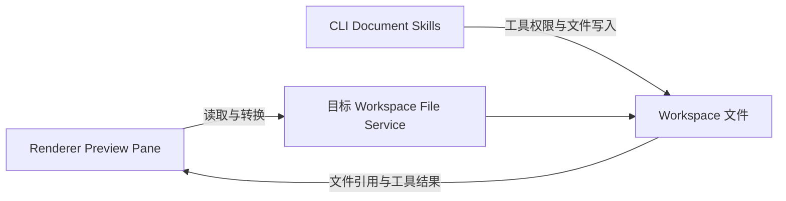

# 产品能力图：Office 文档能力

Office 文档能力由工作区预览与 Agent 文档生产共同组成。预览状态归 Renderer，文件读写归目标 workspace 的服务与 CLI；两条路径使用同一 workspace identity 定位来源。

## 当前能力与所有者

| 场景                          | 入口                           | 状态所有者                  | 文件与执行归属                  |
| ----------------------------- | ------------------------------ | --------------------------- | ------------------------------- |
| 预览 PDF、图片与 Office 文件  | 文件树、工具结果、Preview Pane | Renderer 的预览页与缩放状态 | 目标 workspace 文件服务         |
| 创建或修改 DOCX/PDF/PPTX/XLSX | Conversation、Document Skills  | CLI Tool/Skill runtime      | 当前工作区文件与工具权限        |
| 查看生成产物                  | 工具结果与 Preview Pane        | Renderer 展示，文件服务读取 | 保持原 workspaceIdentity 与路径 |

具体格式和加载限制以 `packages/ui/src/PreviewPane.tsx`、预览组件及 Document Skills 当前实现为准。原生 Office 编辑器、批注和修订需要独立规格与文件版本提交合同。

## 边界与检查

- Renderer 通过 hooks、服务与平台契约读取文件；不直接执行 Node 或转换进程。
- 文件 IO 使用 workspacePath；隔离、缓存与请求关联使用 workspaceIdentity，缺省回退 workspacePath。
- 桌面 continuous 和手机 replayable 共用既有执行 owner；手机预览不创建新的 Agent 或 Host。
- 本地和远端文件保持各自服务来源，不能把远端绝对路径当作本机路径读取。
- Agent 写文件与预览状态各有单一所有者；预览页刷新不能重放写入操作。

相关入口：[文档技能](./document-skills-plugin.md)、[产品能力图](./product-capability-map.md)。
