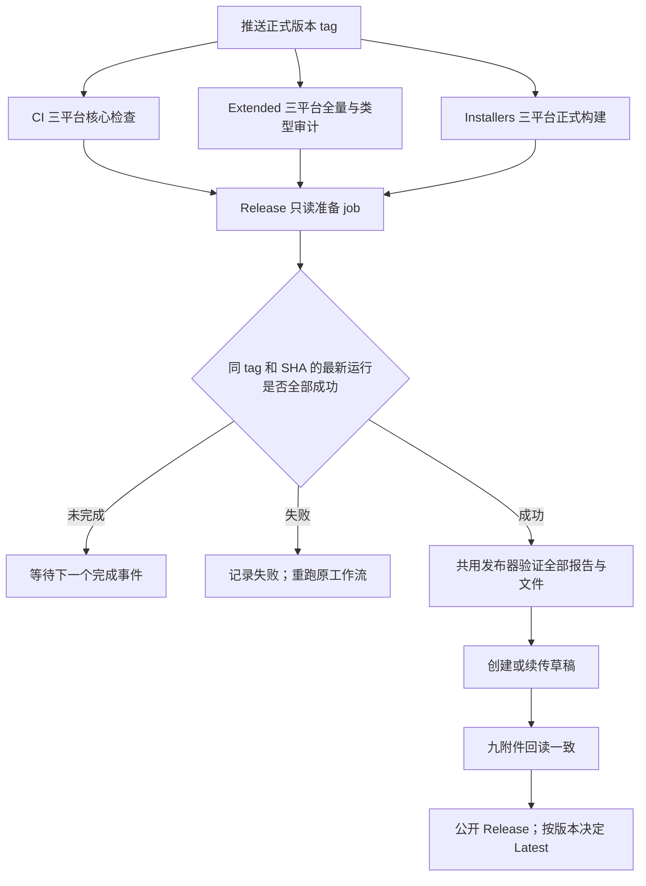

# 正式 tag 自动发布 GitHub Release

## 产品规则

推送 `v<major>.<minor>.<patch>-openzwork` tag 表示启动该版本发行。tag 必须与根 `package.json` 版本一致。日常 PR、main 和 wp 分支继续按原规则检查或构建 Preview。

根 `pnpm release` 沿用 release-it 的版本与 CHANGELOG 更新、commit/tag/push，将 tag 格式对齐为 `v${version}-openzwork`；GitHub Release 仍由 CI/CD 创建。CLI 子包的独立版本入口不变。tag push 的 `before` 为零 SHA，核心工作流不将其传入显式架构基线，沿用检查器的默认分支基线发现。

CI、Extended 和 Installers 在 tag 上各运行一次。Release 工作流由这三者的完成事件触发，只有同一 tag、同一源码 SHA 的三项最新运行全部成功，才调用既有发布器。Extended 的 non-blocking 名称只描述日常核心检查的独立性；它是正式发布的必需门禁，包括完整单测和 Main/E2E 类型审计。

安装文件下载、校验、上传全部在 GitHub runner 完成。自动流程沿用 production 身份、七个安装文件、来源清单和校验和；未签名构建、手动安装更新的产品规则不变。

## 所有者与事件顺序

- 三份原工作流拥有测试和构建步骤；通过明确的运行标题 `Release <tag> / <workflow>` 标识 tag 运行，不复用同提交的分支 Preview。
- `Release` 的只读准备 job 从事件或手动输入解析 tag，回读当前 tag SHA、根版本与最新运行，输出唯一一组来源编号。普通分支、PR、外仓运行不进入发布选择。
- 发布 job 仅执行受信工作流提交中的脚本，不执行下载 artifact 中的代码。`workflow_run` 使用默认分支上的工作流，checkout 保持事件工作流来源，不 checkout 触发者提供的分支。
- 所有发布入口共用仓库级并发组且不取消正在上传的任务。最终写入仍由 `publish-github-release.mjs` 负责；读取运行、逐份验证报告、归档和安装文件后，才创建或续传草稿。
- tag 是版本身份。轻量和 annotated tag 均解析到 commit；事件记录与当前 tag 指向不一致时失败。发布前再次核对 tag，流程不移动 tag。

## 恢复、版本说明与幂等

1. 选择每种工作流最新的 tag 运行；新运行失败或尚未完成时，不使用更早的成功记录替代。失败 job 重跑完成后重新触发选择。
2. `Release.workflow_dispatch` 接受已有 `release_tag`，用于恢复协调器；`verify_only` 只验证选择和状态，不创建草稿、不上传或公开。它不重建产品，也不自动重跑失败检查。
3. 自动模式在全部产物验证后创建草稿。版本说明优先保留已有草稿正文；没有正文时使用 GitHub 按 tag 生成的合并记录，并补充安装格式、未签名和更新方式。显式手动发布仍可传入自定义说明。
4. 草稿缺失的附件可以补传；同名不同大小或摘要立即失败。公开版本不补传或覆盖附件。已公开且九附件完整的版本在协调器中返回已完成；重放事件不重复发布。
5. 自动发布只将更新的正式版本设为 Latest。旧 tag 的补发不会降低 Latest；同版本重复运行也不改变更高版本的状态。该决策在公开前读取当前 Latest，所有发布 job 串行，避免不同版本同时结束造成倒退。GitHub 并发组只保留一个待运行 job；多个版本同时排队时，被替换的待运行版本可通过手动入口重放，已有草稿和附件可复用。
6. 三份测试/构建工作流仍可手动独立运行；原 Installers 的精确运行编号发布入口保留，供旧版本和固定源码复验使用。

## 验收

- 测试事件过滤、错误 tag/版本/SHA、外仓来源、不同 workflow 或分支 Preview；不能进入自动发布。
- 测试三种完成顺序、缺失/运行中/失败/取消、旧成功加新失败，以及同一次运行重跑成功。
- 测试草稿创建、生成说明、已有正文保留、错误附件拒绝、公开版本重放、旧版补发和版本并发规则。
- YAML 回归检查 tag 触发、production 输入、默认分支执行、只读准备与最小发布权限、并发组及失败传播；执行 actionlint、typecheck、lint、架构检查和提交门禁。
- 全量门禁中的本地资源样本 RPC 夹具必须等待服务端实际订阅，再发送一次性样本。固定睡眠 20ms 会在队列延迟超过该时间时丢失事件；使用 Emitter 的首个监听器回调确认就绪，并覆盖即时与 50ms 队列延迟，保持样本字段断言和原测试时限。
- 在 GitHub 对已有正式 tag 执行 `verify_only`，验证工作流装载、只读 API 与已发布幂等路径。全新 tag 的自动构建到公开链路由下一次实际发行验收；不为验收创建虚假正式版本或移动已有 tag。
