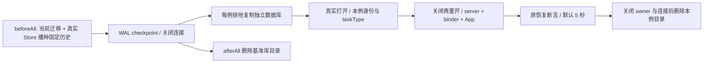

# 冷恢复集成测试的数据库夹具

## 问题与证据

`v4-cold-resume.test.ts` 原先每例从空文件建库，再反复写入完全相同的固定 transcript。这些准备与真实 App、协议恢复及关闭共用默认 5 秒用例期限。Windows 在单 worker 下仍发生超时；仅复用空 schema 后，完整流水线也再次超时。

完整步骤链的 83 个集成用例计时显示：75 次历史播种中位约 199ms、最大约 1025ms，复制文件最大约 3ms；命令请求最大约 85ms、订阅恢复最大约 23ms、App 创建最大约 23ms。该次采样全部通过；原失败没有细分阶段，不能精确断言那次超时的单一慢点。OW-P012 移除已观测到的重复建库和历史播种成本，保留真实冷恢复边界与原期限。

## 夹具所有者和顺序

suite 在 beforeAll 使用当前 `createSqliteSessionStore` 和原播种步骤真实生成一份基准历史库。确认 WAL checkpoint 完成后关闭全部连接；模板只属于该 suite。每个用例排他复制到自己的临时目录，再打开真实数据库，按需要覆盖本例的 workspace identity 或 taskType。相同的固定历史不在每例重新逐条写入，不共享活动连接或 Runtime。

副本打开时 `migrationResult.applied` 必须为空，并能读到完整四条基准消息。模板不含已物化的 App、缓存或其他用例的修改。回归验证副本之间及副本与模板的内容隔离，同时确认远程身份和 child taskType 只写入目标副本。

`prepareLegacySelectionUpgrade` 继续清除指定迁移记录，随后真实执行旧格式升级。本次不调整迁移和会话业务代码、桌面 continuous / 手机 replayable 语义、worker 设置或用例期限。

## 验证

- 拒绝没有完整历史的模板，验证副本不用重跑完整迁移、数据隔离和本例元数据覆盖。
- 原冷恢复 suite 和六文件核心 CLI 组全部执行，保留旧格式升级、标题/删除、重连、身份和桌面/手机语义断言。
- Node 工作流/补丁清单、根 typecheck、Lint、架构检查、正常提交门禁和三平台 Actions；合并后再次验证主线三个工作流。
- 定向与完整链的诊断 workflow、阶段日志和环境开关从最终改动移除；原始诊断保留在对应 Actions 运行记录。
