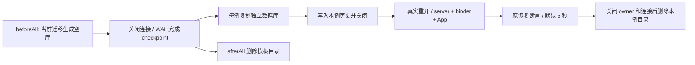

# 冷恢复集成测试的数据库夹具

## 问题与证据

`v4-cold-resume.test.ts` 的真实 SQLite 集成用例在每次播种历史时，从空文件执行完整建库迁移，再写 transcript、关闭并重开数据库。默认 5 秒期限因此同时包含与冷恢复断言无关的完整 schema 初始化。Windows 在单 worker 下仍发生超时，随后 afterEach 删除未释放的数据库时报 EBUSY。

Windows 定向回放 20 轮共 60 个目标用例未复现失败：40 次订阅恢复最大约 30ms，60 次 App 创建最大约 33ms，新库初始化中位约 66ms、最大约 1177ms。原失败日志没有阶段信息，不能精确断言该次超时停在哪一步；观测已确认重复建库是夹具中的明显波动来源。补丁 OW-P012 移除这项重复准备，并保留真实恢复边界。

完整 CI 在模板化之后仍出现 cold rename/delete 超时；模板优化不能作为该事故已经解决的证据。继续在原步骤链记录每例的目录创建、复制、播种、开库、App 创建、请求和关闭阶段，保持原期限，按实际阶段结果决定后续修复。

## 夹具所有者和顺序

测试 suite 在 beforeAll 用当前 `createSqliteSessionStore` 生成空 schema 模板并关闭连接。模板只属于该 suite；每个用例将其复制到自己的临时目录，使用独立数据库写入历史、关闭、重开和执行协议请求。模板中不能预存会话、消息或模型选择，不能共享活动连接。

`seedPersistedSession` 只接受新夹具路径，复制使用排他创建，防止覆盖既有测试数据库。复制后打开的 `migrationResult.applied` 必须为空，证明复用了完整、已提交的 schema。仍需验证每个实例及模板之间数据隔离。

测试中的 `prepareLegacySelectionUpgrade` 继续清除指定迁移记录，随后真实运行对应旧格式升级；本次不调整迁移、会话业务代码、桌面 continuous / 手机 replayable 语义、worker 设置或测试期限。

## 验证

- 回归验证两个独立副本和空模板互不污染，并验证副本无需重跑完整迁移。
- 原冷恢复 suite 和六文件核心 CLI 组全部执行，保留桌面与手机、旧格式升级、标题/删除、重连和身份语义断言。
- Node 工作流/补丁清单、根 typecheck、Lint、架构检查、提交门禁和三平台 Actions；合并后再次验证主线三个工作流。
- 诊断 workflow 和阶段 console 日志不进入最终改动；原始诊断留在 Actions 运行记录。
