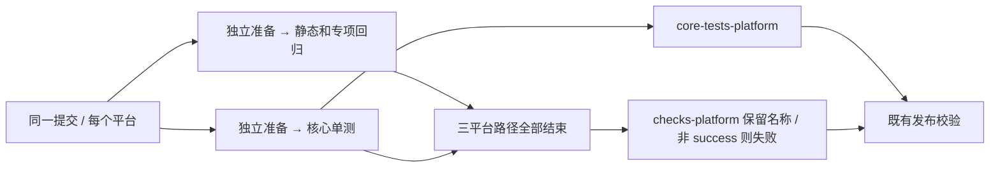

# CI job 编排与并发预算

## 目标和范围

Core 原先在每个平台串行执行检查、CLI 回归和核心单测；Windows 基线中，核心单测启动前等待约九分钟。每个平台改为 regressions 与 unit 两条独立路径，使核心单测在必要构建结束后立即启动。

- regressions 保留工作流回归、Lint、架构、仓库脚本和全部 CLI、协议、远控专项检查。
- unit 执行原有固定核心单测，上传原有 core-tests-<platform>。
- 两条路径各自安装依赖、生成根声明、准备 Agent workspace、构建 CLI/MCP runtime 和 remote bundle。不存在跨 runner 的 node_modules 共享或隐含构建前置。
- 所有命令、用例、pool、worker、超时和失败退出策略保持。SQLite 冷恢复、插件与 ToolSearch runtime 回归采用单 worker、文件串行。ToolSearch hydration 会真实创建、写入并重开 SQLite；PR 实跑中五文件并行触发该用例默认 5 秒超时（测试阶段 6.81 秒、累计 transform 22.10 秒）。保留全部断言与期限，只收紧此步骤的文件并发；具体主机慢因未确认。
- 六个执行 job 的名字为 core <lane> (<platform>)。完成后用 Ubuntu 轻量汇总保留 checks (<platform>)；汇总 always 执行，任何执行路径失败、跳过或取消均令门禁失败。GitHub 的矩阵 needs 结果按整个矩阵聚合，因此三个平台门禁共同验证六个 job 全部成功。

## 所有者和顺序

CI workflow 拥有 lane 分配与门禁，核心清单仍由 tests/ci/core-tests.json 拥有。Extended 的分片归属与报告合并按 [Extended 并行规范](extended-ci-parallel.md)执行。发布器继续以完整工作流成功和原 artifact 格式验收。

## 并发预算

Extended 保持九个测试 runner：macOS 两个、Linux 三个、Windows 四个。Windows 最慢 UI 组拆为两份；macOS 的 services 与 supporting 合并释放一个 slot。主线同时执行时，主要阶段为 Core 6 + Extended 9 + audit 1 + Installers 3 = 19 个 job，其中 macOS 为 2 + 2 + 1 = 5。汇总 job 随前置结束启动，不要求占用 macOS。

这个预算参考 GitHub 标准 runner 常见默认上限，不断言账号实际额度。并行会重复 Core 环境准备，总 runner 用时可能上升；验收同时记录最长路径、排队和累计 runner 用时。安装包现有构建方式保持，本轮不扩张为多格式独立 runner。

## 验收

1. workflow 回归证明两条路径覆盖原有所有命令，unit 所需前置无遗漏，只有 unit 上传核心报告；门禁对 failure、cancelled、skipped 退出非零。
2. Windows UI 通过真实 Vitest discovery 证明两半互斥且并集与原组一致；故障夹具验证合并不能掩盖失败、缺片和来源不一致。
3. 执行 Node 回归、actionlint、typecheck、lint、架构检查和正常 pre-push。
4. PR 实跑三平台，逐用例与基线比较报告；通过后验证合并提交的 Core、Extended、Installers 和同 SHA Preview artifacts。记录实测耗时，不创建正式 tag 或 Release。
