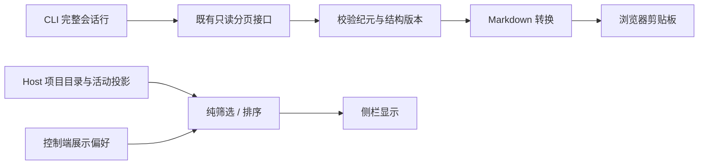

# 对话复制、筛选与项目排序

## 范围

OpenZWork 在既有共享任务菜单和项目侧栏上增加完整对话 Markdown 复制、未读/状态筛选、项目最近活动排序，并统一归档菜单颜色。保留菜单原有顺序、三种视图、归档确认与执行流程。归档撤销、路径菜单重组、CLI 协议和数据库迁移不在本次范围。

这是 OpenZWork 功能增强，不登记为上游缺陷补丁。接入点和回归集中记录在本文，官方提供等效能力后优先采用官方实现并移除重复代码。

## 状态归属与数据流

| 事实或状态                                   | 所有者                                                | 本功能的使用方式                                                      |
| -------------------------------------------- | ----------------------------------------------------- | --------------------------------------------------------------------- |
| 完整会话行、有效分支、revision / logEpoch    | CLI V4 conversation projection                        | 经已有 conversationRowsRangeV4 只读分页，不建立对话订阅或发送执行命令 |
| 项目与任务行集合、归属、归档、未读           | Host 项目目录                                         | 仅派生显示结果，筛选不改权威树或当前打开的对话                        |
| phase、待处理摘要、后台工作、活动时间        | 既有任务 activity 投影 / CLI 时间镜像                 | 共用现有判定函数，不另存一套运行状态                                  |
| 视图、手动项目顺序、展开、新增筛选与排序偏好 | useProjectSidebarPreferences                          | 同一 localStorage 对象、同一跨窗口 storage 接收路径，旧字段保持       |
| 一次复制的目标与结果                         | 点击时捕获的 workspace / identity / session / service | 菜单收起后继续完成所选目标；不回写会话或切换导航                      |

桌面 continuous 与手机 replayable 继续使用各自现有可信 attachment；查询携带原 workspaceIdentity 和 remoteSessionId，身份不退化为路径。剪贴板使用现有浏览器能力，与已有消息复制一致；正文不写日志。

## Markdown 复制

- TaskActionMenuContent 与分组右键菜单共用“复制为 Markdown”菜单项及导出 hook；主页面三点针对当前任务，项目、分组、时间线右键针对被选择的任务。
- 已有菜单项保持原顺序。没有稳定 session ID、目标不可读或本次读取在途时禁用对应复制项。
- 使用现有 rowsRange 的 200 行窗口，从尾部向前读取完整有效历史。按 rowId 排列，拒绝不递减游标、重复行或分页失败；不返回截断成功结果。
- 首个窗口固定本次导出的尾部。分页保持相同 logEpoch 与结构 revision，末尾再次校验；结构变化重新读取一次，再变化时提示稍后重试。普通正文流式增量不要求 seq 静止。
- 输出标题、用户消息和助手正文，保留 Markdown 代码块、表格、列表。用户附件以名称列出；引擎尾注、reasoning、系统来源输入、原始工具输出与排队草稿不作为用户正文导出。
- 终态 ExitPlanMode 计划复用已有可见计划正文解析，作为助手内容；与同轮助手正文相同的计划不重复。
- 复制任务使用点击时捕获的目标；关闭菜单不取消复制。后发起的复制意图优先，较早的迟到结果不得覆盖其剪贴板。
- 成功提示“已复制对话”；读取、版本校验或剪贴板失败显示可操作提示，不记录内容或敏感参数。

## 侧栏筛选

- 保留按项目、按分组、最近更新三个视图及原本的对话排序语义；本轮不追加对话创建时间排序。
- 新增独立“只看未读”和状态单选：全部、进行中、待处理、失败、已结束。
- 待处理取现有 permission/userInput 摘要；进行中复用运行 / 后台工作判定并排除待处理；失败与已结束优先取实时 phase，缺席时只使用已有持久化终态。未知或残留 running 不推断为已结束。
- 未读和状态为 AND 条件；置顶和普通列表共同过滤，筛选在截断分页前执行。
- 按项目仅显示有匹配任务的项目；按分组保留成员手动顺序并隐藏无匹配成员的组；过滤不删除组或项目。即使零匹配也保留新建组和当前草稿入口，移动到分组的菜单仍使用完整分组目录。
- 显示可单独清除的已选条件；清除筛选只重置未读和状态，不改视图、项目排序、展开或手动顺序。
- 空结果提供清除入口。筛选不改变主区会话、未读标记、项目蓝点/托盘计数或输入框项目候选。
- 手机 home-only 缺少完整项目目录时沿用原入口，不展示无法执行的新增筛选。

## 项目排序

- 增加“最近活动 / 手动顺序”，保存至既有偏好 owner。已有有效 order 的用户缺少新字段时保持手动；无历史顺序的新偏好默认最近活动。
- 手动序列继续由原 order 保存。自动排序不覆盖它，切回手动可恢复原序列；置顶项目保留手动顺序。
- 活动时间取所属 Host + projectId 的任务创建 / CLI 活动时间最大值，不使用项目 updatedAt 或前端当前时间。空项目使用创建时间。
- 活动汇总基于未筛选的完整目录；归档等组织操作不制造新时间，已归档会话的历史活动仍可参与汇总。
- 同活动时间按保存的手动顺序稳定决胜；离线项目缺少任务事实时保留其位置，不制造时间或启动 Agent。
- 普通项目处于自动模式时禁用项目排序拖拽；任务拖入项目与分区顺序拖拽保持。置顶区仍可手动排序。
- 侧栏与 composer 共享项目顺序投影；筛选只作用于侧栏，不过滤 composer 的项目候选。
- 保留已有流式活动投影。本轮不新增“回复完成才更新”的协议事件、业务缓存或计时器。

## 归档样式

未归档任务的共享菜单项使用已有 destructive variant；取消归档使用 default。两种菜单和深浅主题共用语义 token。保持原确认、归档 mutation、状态清理、恢复入口与运行状态行为。

## 验收与边界

| 用例  | 设置与操作                                           | 必须成立                                                 |
| ----- | ---------------------------------------------------- | -------------------------------------------------------- |
| OCC01 | 三点 / 右键复制超过 200 行的历史，含 Markdown 和附件 | 目标正确、顺序与正文完整、无排队 / 内部输入；不导航      |
| OCC02 | 分页中发生 edit/retry 或重连换纪元；查询或剪贴板失败 | 整体重试有界；失败不写部分结果；迟到复制不覆盖新意图     |
| OCC03 | 项目、分组、时间线组合未读与四种状态                 | 置顶共同过滤，组内顺序保留，空态可清除；不改主区和权威树 |
| OCC04 | 本地 / 远端同名项目活动变化，筛选切换，空项目 / 离线 | 按完整身份排序；筛选不改变活动顺序；离线位置稳定         |
| OCC05 | 旧偏好、切换排序、storage 事件、重新打开界面         | 旧手动顺序与展开保留，新字段读回，自动模式不覆盖 order   |
| OCC06 | 两种菜单的归档 / 取消归档，深浅主题与窄屏            | 样式一致、键盘可达、布局可用；归档行为保持               |

定向单测覆盖纯转换、分页一致性、筛选/排序、偏好和真实共享入口。桌面候选 E2E 置于 manual-review/pending，以合成标记和既有回放验证主路径；未经人工确认不晋升正式集。按仓库要求执行 typecheck、lint、架构检查及受影响定向验证；不调用未获授权的全量根单测。

剪枝：不更改删除、归档执行、重连恢复、accepted queue、Host 行集合、CLI 时间、工作区 cwd 或跨 Host 路由。既有能力继续由原测试保障；新功能另覆盖精确身份与入口接线。

## 上游更新维护

基线为 ZCode 3.16.2 的 OpenZWork 主线。升级时核对以下接入点：

1. TaskActionMenuContent / TaskListItemContextMenu / WorkspaceHeaderSections / grouped/task-context-menu-content：复制入口、目标与归档样式仍接入；分组保留自身组织操作顺序。
2. useTaskListItemContextActions 与 conversation-export：只读查询签名、V4 row 类型、版本校验及剪贴板意图。
3. ProjectSidebarListHeader / ProjectSidebar / TaskGroupedView：筛选进入最终显示集合，保留现有视图语义。
4. useProjectSidebarPreferences / ProjectDirectoryProvider / ProjectNode：单一偏好与排序 owner，自动 / 手动接线和拖拽边界。

新增功能测试纳入现有核心 CI；既测试独立函数，也测试共享 UI 入口，防止官方改版后保留实现却丢失接线。官方提供等效能力时先用上述场景验证，再撤除重复实现；不增加独立补丁框架。
