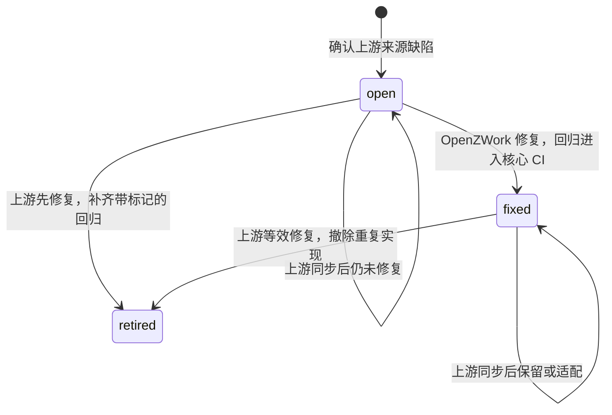

# 下游补丁清单

[`docs/upstream/downstream-patches.yaml`](../upstream/downstream-patches.yaml) 登记缺陷代码来自上游 ZCode、由 OpenZWork 修复或确认待修复的问题。每个条目记录触发条件、上游核对版本、修复与回归位置，以及撤销条件。清单描述所在提交的代码状态：分支上的修复随合并进入 main，某个 tag 中的清单就是该版本的补丁状态。

## 登记范围

- 缺陷代码来自上游，包括产品代码、测试与夹具，并已通过可复现的触发场景或源码证据确认。
- 官方账号、遥测、CUA 等产品边界的移除与适配，由各版本整合 spec 和清理测试维护；OpenZWork 自有代码的缺陷按普通修复处理。这两类不登记。

## 条目字段

| 字段                           | 内容                                                                               |
| ------------------------------ | ---------------------------------------------------------------------------------- |
| `id`                           | `OW-P` 加三位序号，按登记顺序递增，撤销后不复用                                    |
| `title`                        | 一句话描述问题                                                                     |
| `kind`                         | `product`：发布产物中的代码；`test`：测试与夹具；`build`：构建、CI 与发布脚本      |
| `status`                       | `open`、`fixed` 或 `retired`，见下节                                               |
| `priority`                     | `open` 条目必填，取 `P1`–`P3`                                                      |
| `upstream.since`               | 最早确认存在缺陷的上游版本                                                         |
| `upstream.checked`             | 未撤销条目最近一次核对的上游版本，须等于根 `package.json.version` 解析出的官方基准 |
| `upstream.fixedIn`             | `retired` 条目必填：上游提供等效修复的版本                                         |
| `trigger` / `impact` / `cause` | 触发条件、错误表现与影响、根因                                                     |
| `evidence`                     | 确认依据：复现方式与结果，或回归在修复前后的结果                                   |
| `fix`                          | `fixed`、`retired` 条目必填：修复机制，也是同步冲突时必须保住的行为                |
| `files`                        | 缺陷或修复所在文件                                                                 |
| `regression`                   | `fixed`、`retired` 条目必填：回归测试文件                                          |
| `retire`                       | 撤销条件                                                                           |
| `refs`                         | 可选：spec、PR 等链接；仓库内路径须存在                                            |

## 状态与编号标记

| 状态      | 含义                                     | 检查要求                                                     |
| --------- | ---------------------------------------- | ------------------------------------------------------------ |
| `open`    | 当前代码仍有缺陷                         | `files` 存在，`upstream.checked` 为当前上游版本              |
| `fixed`   | 当前代码包含 OpenZWork 修复              | 另要求 `files` 与 `regression` 都带编号标记，回归进入核心 CI |
| `retired` | 上游已有等效修复，OpenZWork 不再单独实现 | `regression` 带编号标记并进入核心 CI                         |

- 编号标记写在修复处与回归断言旁的中文注释中，例如 `// OW-P003：……`。上游同步覆盖文件时，标记随修复一起消失，清单检查失败，提示重新应用修复或改为撤销。
- 带编号标记的文件必须登记在该条目的 `files` 或 `regression` 中；`retired` 条目只在回归中保留标记。
- 回归进入核心 CI，指文件登记在 `tests/ci/core-tests.json`，或出现在 `.github/workflows/ci.yml` 的回归步骤中；Agent CLI 包按 `--filter` 包名和包内路径识别。检查展开直接调用的根 package script，识别 `node --test scripts/test/*.test.mjs` 的目录覆盖。

## 日常维护

1. 确认上游来源缺陷后登记 `open` 条目，写明触发条件、证据和优先级。
2. 修复 PR 把条目改为 `fixed`：填写 `fix` 与 `regression`，在修复处和回归处加编号标记，并把回归加入核心 CI。PR 描述写明编号。
3. 版本整合 spec 链接本清单，逐项结论只记录在清单中。

## 上游同步复核

OpenZWork 根版本号的前三段跟随上游，`+openzwork.N` 表示本项目修订。合入上游新版本会改变官方基准；未撤销条目全部复核前，清单检查保持失败。仅增加 OpenZWork 修订号保持原有 `upstream.checked`。上游以相同版本号重推时检查不会提示，同样按以下步骤复核。逐项处理：

1. 以原触发场景的实际行为或上游源码为依据，核对新版本是否仍有缺陷。
2. 上游仍有缺陷：保留或适配修复，解决冲突时保住编号标记和回归，再把 `upstream.checked` 更新为新版本。
3. 上游已等效修复：撤除 OpenZWork 的重复实现并保留回归，状态改为 `retired`，填写 `upstream.fixedIn`。
4. 修复位置或回归文件变化时，同步更新 `files`、`regression` 与标记。
5. 同步 PR 的核心 CI 执行全部登记回归。

## 检查入口

`node --test tests/ci/downstream-patches.test.mjs` 校验字段、上游版本、编号标记与回归的 CI 覆盖。CI 的 `Workflow configuration regression tests` 步骤在三个平台运行 `tests/ci` 下的全部检查。
