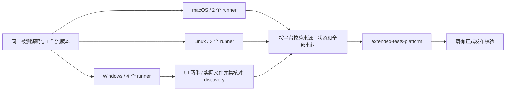

# Extended 测试按平台与分组并行

## 范围与目标

Extended 保留 macOS arm64、Windows amd64、Linux amd64 三个平台，按平台耗时将七组历史单测分配到合计九个独立 runner。Installers、Desktop Main/E2E 类型审计和 Windows repair 入口保持原有职责。Core 的两条并行路径见 [CI job 编排](ci-job-orchestration.md)。

| 平台    | 分片                                             | 执行范围                                      |
| ------- | ------------------------------------------------ | --------------------------------------------- |
| macOS   | ui-and-web、services-and-supporting              | UI 一组；其余六组串行                         |
| Linux   | services、ui-and-web、supporting                 | services；UI；其余五组串行                    |
| Windows | services、supporting、ui-and-web-1、ui-and-web-2 | services；其余五组；UI 原生 Vitest 1/2 与 2/2 |

组的路径过滤器、超时预算、Vitest 配置和测试断言不变。同一分片内逐组执行，某组失败后仍收集其余组；九个测试 job 使用 `fail-fast: false`。普通测试保留 macOS/Linux 四 worker、Windows 两个 fork worker；`fork-isolated` 保留单 worker 与文件串行。

目标是缩短等待时间。每个 runner 独立安装与构建，预计总 runner 用时增加；实际收益以同一套覆盖范围的 Actions 实跑为准。不调整组内 worker 数，不增加自动重试。Windows UI 按文件分片；两个 runner 分别用 Vitest discovery 记录完整文件清单，汇总核对互斥性与并集，避免覆盖遗漏。

## 所有者与执行顺序

- `scripts/full-suite-plan.mjs` 定义唯一的七组清单、路径过滤器、期限和各平台分片的归属。
- `scripts/run-full-suite-groups.mjs --shard=<name>` 执行一个分片；无参数仍执行完整七组。未知分片或参数在运行测试前失败。
- 调度与汇总脚本来自 `github.workflow_sha`，通过独立的稀疏 checkout 获取；被测工作区来自 `inputs.source_commit || github.sha`。固定旧源码复验无需旧提交支持新的分片命令。
- 每个分片独立写入组 JSON、`summary.json` 和 `source.json`，上传 `extended-shard-<platform>-<shard>`。重新运行同一 job 时替换其自身 artifact，其他分片不共享写入位置。
- 三个平台的汇总 job 等待全部测试 job 结束，失败时也运行，以便保存诊断。汇总不安装应用依赖、不重复构建，只读取本次运行该平台的全部分片 artifact。
- 报告校验由只依赖 Node 标准库的共享模块负责，发布器和汇总器调用同一实现；汇总器不能通过发布器引入桌面打包或应用源码依赖。稀疏工具 checkout 必须可独立执行。
- 汇总验证通过后生成原有 `extended-tests-<platform>` artifact。正式发布继续读取该名称、七份组 JSON、完整 `summary.json` 与 `source.json`。

## 报告合同与失败传播

`source.json` 保留 `sourceCommit`、`sourceTree`、`workflowCommit`、`testPool`，补充平台、分片与运行编号。汇总以自己的固定源码 checkout 和工作流环境为来源依据；各分片必须匹配同一源码 SHA/tree、工作流 SHA、运行编号、平台和对应 pool，且分片名与分配一致。失败 job 重跑可以使用同一运行中其他已成功分片的报告。

汇总必须验证：

1. 该平台的全部分片目录存在且没有额外分片，每组只出现在指定分片中；仅 Windows UI 允许两份受控子分片。
2. 每个分片 summary 的组集合与分配完全一致，各组状态为 passed、退出码为 0，`anyFailed` 为 false。
3. Windows UI 的两份 summary 必须分别标明 1/2 与 2/2，完整 discovery 清单一致；从两份 JSON 提取实际执行文件，两个集合不相交、并集等于完整 discovery 清单。两个报告分别通过校验后，合并计数、testResults 与 snapshot 统计，恢复一份 ui-and-web.json。七份 Vitest JSON 全部存在且通过既有发布器的报告校验；缺报告、损坏 JSON、失败断言、运行错误或计数不符均失败。
4. 出现 `.cancelled` 标记、来源不一致、重复或错放的组均失败。汇总诊断可上传，但不得生成成功 summary 掩盖缺失或失败。
5. `full suite (<platform>)` 保留为按平台汇总后的检查名称；分片 job 与汇总 job 的真实失败均传递到工作流结果，不能使用 `continue-on-error`。

## 验收

- 离线测试验证各平台分配完整、分片选择、完整报告汇总与发布器兼容。
- 故障夹具覆盖缺分片、缺组 JSON、重复/错放组、cancelled、错误来源、损坏报告、错半片、重复或遗漏文件、计数不符和失败状态，确认汇总非零退出并保留失败摘要。
- workflow 回归验证九个测试 job、独立准备、组内隔离、固定源码与工作流工具分离、失败后汇总、artifact 命名及替换规则。
- 执行根 typecheck、lint、架构检查、相关 Node 回归与提交门禁。
- 在 PR 实跑三平台，下载汇总 artifact，使用正式发布的校验函数核对七组及来源；记录最长路径、准备时间、测试时间、总 runner 用时和排队影响。
- 本轮不执行正式 tag 发布，也不将 Desktop E2E 类型检查计为交互 E2E。
