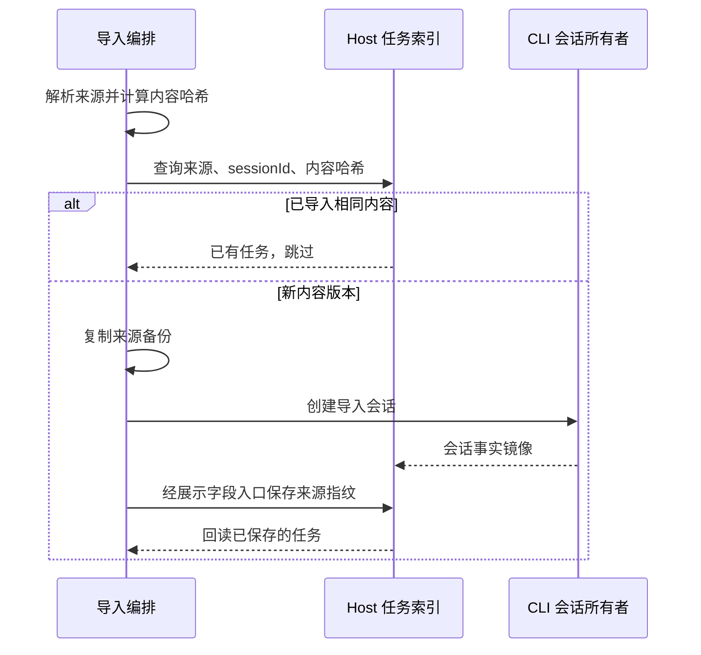

# 外部会话多源导入（external session import）

状态：已实现（PR-1）　所有者：conversation（session 域）　关联：`docs/spec/` 无前置；上游为 `packages/services/src/session/claude-native/`（Claude Code 单源导入，保持不动）

## 1. 背景与目标

OpenZWork 继承了 ZCode 的 Claude Code 原生会话导入（`claude-native` 模块）与 16 agent 配置同步（`settings-sync`）。会话历史导入目前是单来源（`~/.claude/projects`），本 spec 把它扩展为多来源架构，并新增两个来源：

- **Codex CLI / Codex Desktop**：`~/.codex/sessions/YYYY/MM/DD/rollout-*.jsonl`
- **Qoder / Qoder CN**：`~/.qoder/projects/<pathKey>/<sessionId>.jsonl` 与 `~/.qoder-cn/projects/<pathKey>/<sessionId>.jsonl`

依据 `local/cross-client-import-sync-research-20261028.md`：两家格式均已实物验证。WorkBuddy 本地无完整转录（正文 edge-sync 上云），不纳入。

## 2. 契约

### 2.1 来源枚举

```ts
// packages/shared/src/zcode-task-types.ts
export type ZCodeImportSessionSourceProvider = "claude" | "codex" | "qoder";
export type ZCodeTaskMigrationSource = "claudeCode" | "codexCli" | "qoder";
```

- `provider` 描述"来源产品"，`migrationSource` 描述"任务索引中的迁移来源标记"，两者一一映射（`claude→claudeCode`、`codex→codexCli`、`qoder→qoder`），由 services 层 `migrationSourceForProvider` 唯一换算，禁止散落字面量。
- `packages/shared/src/validation.ts` 的 `zcodeTaskMigrationSourceSchema` 与 `packages/shared/src/zcode-protocol/index.ts` 的 `zcodeSessionImportHistorySchema`（`importedHistory`）同步扩枚举；协议为严格 zod 校验，新增值必须三处同步。

### 2.2 服务契约（IZCodeTaskService）

保留 `scanImportableClaudeSessions` / `importClaudeSessions`（旧调用方零改动，语义=provider "claude"），新增通用方法：

```ts
scanImportableExternalSessions(params: {
  provider: ZCodeImportSessionSourceProvider;
  workspacePath?: string;
  workspaceIdentity?: string;
  modifiedSince?: number;
  limit?: number;
}): Promise<ZCodeImportableSessionCandidate[]>;

importExternalSessions(params: {
  provider: ZCodeImportSessionSourceProvider;
  workspacePath?: string;
  workspaceIdentity?: string;
  sessionIds: string[];
}): Promise<ZCodeImportSessionsResult>;
```

新方法遇到 provider "claude" 时复用既有 Claude 扫描和导入路径；旧方法继续保留。

### 2.3 导入编排（services/session/external-import）

每来源一个 repo + parser + 落盘目录约定，共用编排：

| 来源   | 扫描根                                                                               | 会话文件                                           | 落盘备份目录                                             |
| ------ | ------------------------------------------------------------------------------------ | -------------------------------------------------- | -------------------------------------------------------- |
| claude | `<home>/.claude/projects`（多 home）                                                 | `<sessionId>.jsonl`                                | `agent-config/claude/{workspaceHash}/projects/…`         |
| codex  | `<home>/.codex/sessions`（多 home）                                                  | `rollout-*<uuid>.jsonl`（sessionId=文件名内 uuid） | `agent-config/codex/{workspaceHash}/sessions/<相对路径>` |
| qoder  | `<home>/.qoder/projects` 与 `<home>/.qoder-cn/projects`（双根，sourcePath 天然去重） | `<sessionId>.jsonl`                                | `agent-config/qoder/{workspaceHash}/projects/…`          |

复用规则：

- **Qoder jsonl 与 Claude Code 同构**（uuid/parentUuid/message.content[]），parser 复用 `claude-native` 的 `readJsonLinesFileHead`/`jsonLineRecord` 与可见消息提取（通过参数化 provider 的提取函数实现，Claude 的解析函数不复制粘贴）。
- **Codex rollout** 独立 parser：头采样取 `session_meta.payload.cwd`；正文只取 `response_item.payload.type === "message"` 的 user/assistant，忽略 developer/system 角色。用户消息开头的 AGENTS.md 标题及连续的 `INSTRUCTIONS`、`user_instructions`、`environment_instructions`、`environment_context`、`app-context` 注入块被移除；移除后为空的消息不参与正文、标题和轮次计算。用户普通正文中的标签引用、代码块与 assistant 原文保留。`token_usage_record`/`event_msg`/`turn_context`/`world_state`/`compacted` 不参与导入（天然不产生我方 usage）。
- 复制备份沿用 tmp+rename 原子写与 `createdOutputPaths` 清理边界。备份相对路径按来源路径的 Windows/POSIX 语义解析，支持盘符、UNC 和正反斜杠；POSIX 文件名中的反斜杠保持原义。

### 2.4 幂等重导（PR-1 语义：跳过，不追加）

- 导入时对来源文件全文计算 `sha256`，将 `externalImport: { provider, sessionId, sourceContentSha256 }` 经 adapter 的展示字段写入入口保存到 Host 任务 `meta_json`。沿用既有字段和表；CLI 继续独占会话事实写入。
- 顺序重导按 `provider + sessionId + sourceContentSha256` 查全部已导入记录，包含已删除任务；命中时返回 `skipped: reason "already_imported_unchanged"`。同一来源的多个历史版本都参与匹配，查询结果顺序不影响判定。
- 来源出现尚未导入的内容版本时新建会话，保留已删除/已续聊记录；来源恢复到已导入过的内容版本时跳过。增量追加和已有任务恢复仍不在本次范围。
- 增量 append 留待后续 PR（spec 预留，不在本次实现）。



## 3. 不变量

1. **防统计污染**：新来源任务必须带各自 `migrationSource` 新值（禁用 "claudeCode" 复用）。现有过滤链（mentions provider 的 `migrationSource` 过滤、`taskIndexRepo` 的 provider 过滤、导入不产生 usage 事件）对新来源自动生效。
2. **不污染运行态**：沿用 `DEFAULT_IMPORTED_CLAUDE_TASK_FILTER_PATHS` 语义——新来源导入文件同样清洗 `meta.mode/model/provider`、`messages[].model`（Codex 来源的模型名一律不落到我方 snapshot）。
3. **来源只读**：扫描/解析/复制均只读外部目录；唯一写动作是复制到我方数据目录与创建我方会话。
4. **扫描有界**：头采样（前 N 行）决定候选，不做全量解析；目录遍历忽略外部产品的派生目录（codex 忽略 `archived`；qoder 无已知派生目录）。

## 4. 验收场景

1. Codex rollout fixture（session_meta + user input_text + assistant message）scan 出候选（provider "codex"、cwd 正确）；导入后任务 `migrationSource === "codexCli"`、消息可见、meta 无 mode/model/provider。
2. Qoder fixture（Claude 同构 jsonl）scan 候选；导入后 `migrationSource === "qoder"`。
3. developer 消息和用户消息前缀中的环境注入块不出现在正文、标题或轮次中；AGENTS.md 与 environment_context 连续出现时也过滤；普通用户引用和 assistant 原文保留。
4. 真实 adapter 与临时 SQLite 覆盖首次导入、关闭重开索引、未变重导跳过、内容变化新建、再次重导跳过及恢复旧内容跳过；确认指纹实际落库，删除后的相同内容不复活。
5. Claude 旧路径回归：`scanImportableClaudeSessions`/`importClaudeSessions` 行为与基线一致（既有测试不改动仍通过）。
6. `~/.qoder` 与 `~/.qoder-cn` 双根扫描互不重复。
7. Codex/Qoder 备份路径覆盖 POSIX、Windows 盘符与 UNC 路径；真实复制入口使用当前平台原生路径验证输出位置和文件内容。

## 5. 决策记录

- UI 接入不在本 PR：services/shared 先行，迁移对话框多 provider 化留待后续（避免波及 UI/i18n/桌面链路）。
- 方法名保守处理：新增通用方法 + 旧 Claude 方法保留委托，避免 desktop host 注册与 UI hook 链路重命名波及。
- WorkBuddy 不纳入（本地无完整转录）。
- APFS clone 加速不纳入（纯优化，语义不变）。
