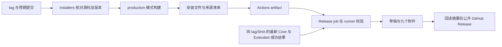

# GitHub Actions 的 Node.js 24 运行时升级

## 目标与范围

消除 `CI` 与 `Installers` 工作流中 JavaScript Action 声明使用 Node.js 20 的弃用提示，不依赖 GitHub runner 强制切换旧 Action 的运行时。

本规范维护 `.github/workflows/ci.yml`、`.github/workflows/installers.yml`、`.github/workflows/extended-checks.yml` 、`.github/workflows/release.yml` 和对应的离线结构测试。产品整合验收及核心/扩展检查边界另见 [v3.15.1 整合验收](upstream-v3.15.1-integration.md) 与 [v3.16.1 整合验收](upstream-v3.16.1-integration.md)。

## 所有者与边界

- Action 自身的运行时由所引用发布版本的 `action.yml` 中 `runs.using` 决定。
- 项目命令的 Node.js 版本由 `mise.toml` 与工作流的 `node-version` 固定为 `24.14.0`；pnpm 固定为 `11.28.6`。
- 工作流 YAML 是步骤、缓存配置和 artifact 上传配置的唯一所有者。测试只读取它们，不维护第二条执行链。
- GitHub 托管 runner 负责执行 Action 和保存缓存、artifact；本地测试不模拟这些服务，也不声称完成真实 runner 验收。
- 不引入或修改产品状态、协议、持久化及 Desktop/Web 同步链路。本改动位于架构策略的产品模块之外。

## 版本契约

2026-09-30 核对官方发布说明与对应 `action.yml`，下列精确发布版本均声明 `runs.using: node24`：

| Action                    | 发布版本 |
| ------------------------- | -------- |
| `actions/checkout`        | `v7.0.1` |
| `actions/setup-node`      | `v7.0.0` |
| `actions/cache`           | `v6.1.0` |
| `pnpm/action-setup`       | `v6.1.0` |
| `actions/upload-artifact` | `v7.0.1` |

四份工作流引用相同的精确版本，不使用 `latest`、浮动主版本或运行时强制降级变量。以后更新版本时同步审查此契约与结构测试。

## 行为与兼容性规则

1. 保留分支触发、平台矩阵、timeout、业务命令和失败传播；正式 tag 同时触发 CI、Extended 和 production Installers。构建可取消同 ref 的旧运行；发布 job 共用仓库级并发组，不取消正在上传的运行。不加入 `continue-on-error` 或警告隐藏配置。
2. 保留顺序：checkout、安装 pnpm、setup-node、显式安装依赖。`pnpm/action-setup` 不承担仓库依赖安装，不替换成 `pnpm/setup`。
3. 检查型 CI 的安装仍为 `pnpm install --frozen-lockfile --ignore-scripts`；安装包工作流仍执行完整的 `pnpm install --frozen-lockfile`。
4. setup-node 继续显式 `cache: pnpm`；pnpm/action-setup 的内置缓存保持默认关闭，不新增第二份 pnpm 缓存。
5. turbo 与 Electron/electron-builder 的缓存路径与恢复前缀保持不变；固定源码复验时，Extended 的 turbo 外层缓存 key 使用源码 SHA，默认运行仍使用事件 SHA。
6. 安装包继续以 `openzwork-installer-${{ matrix.platform }}` 聚合上传多种文件，保留全部安装包 glob 与 `if-no-files-found: error`；正式构建额外上传来源清单。显式 `archive: true`，不启用 upload-artifact v7 新增的单文件直传模式。
7. Node.js 24 Action 要求 Actions Runner 至少 `2.327.1`。当前使用 GitHub 托管 runner；若以后迁移到自托管 runner，必须先核对 runner 版本。checkout 的 Docker container action 认证操作另要求至少 `2.329.0`，当前工作流无此操作。
8. checkout v7 对 `pull_request_target`/`workflow_run` 的 fork checkout 安全限制不应绕过；Release 使用 `workflow_run`，只执行默认分支的协调器和发布器；不 checkout 触发者分支，不执行 artifact 中的代码。
9. 依赖目录由固定版本 pnpm 按 lockfile 安装。干净 runner 不从旧 `.ignored` 目录恢复依赖，不使用安装后目录搬移补救版本解析。
10. 核心 CI 执行明确列出的保留能力回归；完整历史套件由独立扩展工作流按原发现范围执行。核心清单中的文件缺失必须失败，不能动态过滤失效用例或放宽断言取得绿灯。
11. 完整检查和安装包构建在 GitHub 托管 runner 执行。本地 pre-push 共用核心测试清单，同时保留 Lint、schema 与架构检查；历史全量检查由独立扩展工作流执行，不修改仓库合并保护规则。
12. 历史套件加载、实际断言和 E2E 类型诊断在扩展工作流中报告；核心 CI 不等待它们。扩展检查保留失败退出码并上传日志和结果，不使用 `continue-on-error` 伪装成功。
13. 扩展单测执行完整依赖安装，准备真实 Electron；Main 类型审计可使用无安装脚本的依赖安装。扩展任务不成为 Installers 或核心 CI 的 `needs` 依赖。
14. v3.16.1 的 Main、remote Main 和 shared testing 继续进入根应用类型检查。历史 Desktop E2E 类型审计在扩展工作流中使用现有配置独立执行，失败上传原始日志；核心工作流不等待该审计。
15. Server CLI 的 `releaseInstaller.test.ts` 与 `cli.test.ts` 包含真实归档创建、校验、解压及安装，应沿用 `fork-isolated` 的串行文件调度。两次 Windows 完整运行曾在这两份文件的不同归档安装用例上分别触发 30 秒超时；调整测试执行隔离，不改变产品逻辑、用例内的并发安装、断言或超时值。测试发现回归必须确认两份文件各执行一次且进入隔离组。
16. Windows 完整套件使用现有 `ZCODE_TEST_POOL=forks` 模式（普通池最多两个进程），其余平台保留 threads。归档隔离后又出现 SQLite 原生迁移测试超时，完整 Windows 验证统一使用进程边界，避免继续逐文件调整。测试发现范围、内部并发场景、30 秒用例时限和七组时限均不改变；执行模式是否有效由真实完整报告确认。
17. Extended 手动复验支持可选 `source_commit`：非空时必须是完整 40 位 SHA，所有 job checkout 该提交并在安装依赖前核对 HEAD。将实际源码 SHA/tree、工作流 SHA 和测试池写入结果目录的 `source.json`。该入口可以在不移动 tag 的前提下，使用更新的执行流程验证已冻结源码；发布证据必须分别记录源码与工作流提交。

## GitHub 正式安装包

- `Installers` 在正式 tag push 时自动取得 tag 和提交；`workflow_dispatch` 接受 `release_tag` 与 `release_commit`，必须同时为空或同时提供。为空时沿用现有 Preview 构建；正式构建要求 `v<版本>-openzwork` tag、完整 40 位提交 SHA、checkout HEAD 和根 package version 一致（Desktop build-metadata 使用根版本），校验在依赖安装之前完成。
- 正式构建显式使用 `ZCODE_ENV=production`、`ZCODE_PREVIEW_IDENTITY=0`；沿用未签名构建，不注入证书或开启公证。应用标识为 OpenZWork，不能将 Preview/\_TEST 包改名后当作正式包。
- 工作流可从主干执行并 checkout 已有版本 tag，因此工作流的 SHA 与源码 SHA 分别记录。GitHub run 的 `head_sha` 表示工作流来源，安装包来源以验证过的 `release_commit`、源码 tree 与 tag 为准。
- 构建后生成 `RELEASE-MANIFEST.json`：记录源码 tag/SHA/tree、工作流 SHA/run、版本、平台、正式身份及实际安装文件的字节数和 SHA-256。只收集 dist 根目录的两份 macOS、一个 Windows 或四份 Linux 安装文件；不将 unpacked 目录中的辅助 exe 作为安装包发布。缺文件或空文件直接失败。
- Linux x64 的各发行格式采用 builder 实际架构名：AppImage/rpm 为 `x86_64`、deb 为 `amd64`、pacman 为 `x64`。按版本、平台、允许的架构别名和扩展名从根目录匹配，每种格式必须恰有一个文件；歧义也直接失败。
- 正式 tag 的 GitHub Release 由 `Release` 自动协调：三项同 tag/SHA 的最新运行成功后发布。普通分支 push 只生成 Preview artifacts。原手动 `Installers` 发布模式保留，接受 `publish_installer_run`、`core_run`、`extended_run` 和 `release_notes`。事件选择、幂等和恢复详见 [正式 tag 自动发布](automatic-github-release.md)。
- 发布 job 共用串行并发组和最小 `actions: read`、`contents: write` 权限；在 GitHub runner 下载已有 artifacts，核对归档 SHA-256、源码 tag/SHA/tree、正式身份、每种安装格式的数量、大小和哈希，然后生成 `PROVENANCE.json` 与 `SHA256SUMS`。本机无需下载安装包。
- 核心与 Extended 必须完整成功并指向发布源码；Extended 三平台的 `source.json`、七组退出码及测试统计必须一致。构建工作流 SHA 单独记录；发布脚本不移动 tag、不重新构建产品。
- 先校验全部产物再写 Release。草稿可继续上传缺少的附件；同名附件仅在大小和摘要相同的情况下复用。已发布内容不覆盖、不删除；全部九个附件核验后才公开；按语义版本比较决定 Latest，旧版补发不降低 Latest。

## 验收场景与验证

- 离线结构测试先在旧工作流上失败，再在升级后通过；检查精确 Action 版本、固定工具链、安装顺序、缓存与 artifact 配置。
- `CI` 新增独立的 `node --test tests/ci/*.test.mjs` 步骤，使结构测试在各平台持续执行。测试使用仓库已有的 YAML 解析器，不联网或下载 Action。
- `actionlint .github/workflows/ci.yml .github/workflows/installers.yml` 校验工作流语法、表达式与 Action 输入。
- 必须实际执行 `pnpm typecheck`、`pnpm lint`、`pnpm architecture:check --changed`；既有 lint warning 不纳入本次清理。
- 真实 GitHub 运行需在提交并推送后验证：各平台 Action 初始化、pnpm 缓存、turbo/Electron 缓存和 artifact 上传成功，且不再出现本次涉及的 Node.js 20 Action 弃用提示。
- 旧运行的 Annotations 是历史记录，不因修改 YAML 而被清除。真实 runner 的结果必须关联当前候选提交；本地验证不能代替该证据。
- 正式构建回归直接执行工作流内的校验与清单脚本，验证缺少输入、错误 SHA、错误版本会拒绝，正常 tag 可通过，安装包哈希精确且排除 unpacked 文件。两版实际安装包必须在云端以正式身份重建后才发布。
- 发布回归验证错误源码/版本/身份、缺失或重复格式、无效哈希、失败或不完整测试组、同名附件内容冲突均拒绝；验证自动入口只接受正式 tag 的同源完整门禁，手动入口仍需精确来源；正在上传的发布不被构建取消。

## 官方依据

- [checkout v7.0.1](https://github.com/actions/checkout/releases/tag/v7.0.1) / [action.yml](https://github.com/actions/checkout/blob/v7.0.1/action.yml)
- [setup-node v7.0.0](https://github.com/actions/setup-node/releases/tag/v7.0.0) / [action.yml](https://github.com/actions/setup-node/blob/v7.0.0/action.yml)
- [cache v6.1.0](https://github.com/actions/cache/releases/tag/v6.1.0) / [action.yml](https://github.com/actions/cache/blob/v6.1.0/action.yml)
- [pnpm/action-setup v6.1.0](https://github.com/pnpm/action-setup/releases/tag/v6.1.0) / [action.yml](https://github.com/pnpm/action-setup/blob/v6.1.0/action.yml)
- [upload-artifact v7.0.1](https://github.com/actions/upload-artifact/releases/tag/v7.0.1) / [action.yml](https://github.com/actions/upload-artifact/blob/v7.0.1/action.yml)
