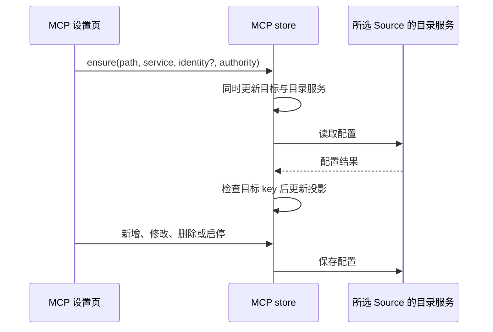
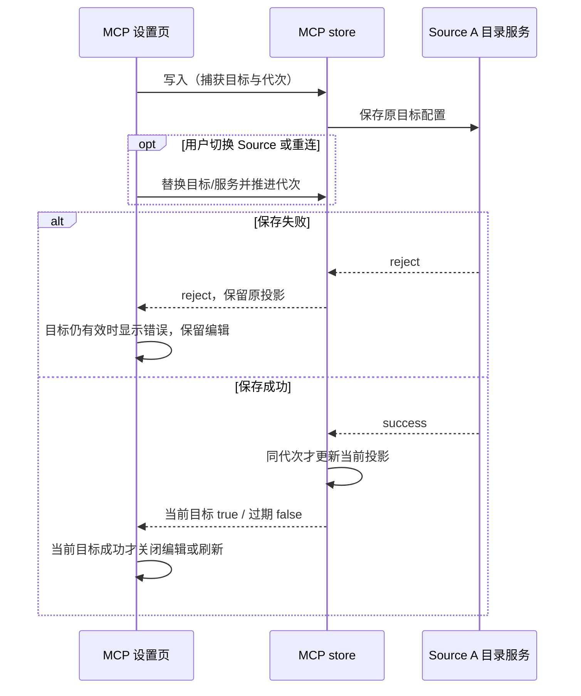

# 3.16.2 候选维护修复

## OW-P001：Source 用户级 MCP 配置目标

设置页已有 `cacheAuthorityKey` 标识所选 Source，`mcpSyncService` 是该 Source 的目录读写入口；用户级目标可以没有 `workspaceIdentity`。MCP store 统一拥有当前配置目标及其目录服务，读取、保存、删除和启停复用同一服务。

- 有 Source authority 时，使用该目标显式传入的目录服务；缺少服务时报错，不回落到当前工作区的平台服务。
- 普通本机工作区仍通过平台服务读写，并保留旧 common MCP 迁移。远端 workspace 继续按原 identity 路由。
- 切换目标同时替换目录服务并清空旧投影；重连时可更新同一目标的服务引用。已有异步加载 key 检查继续丢弃过期结果。
- 配置目录路由与写回归属沿用现有 MCP store；Agent admission、owner/lease 及桌面 continuous／手机 replayable 会话传输保持。



回归覆盖：无 identity 的 Source 读写只访问所选服务、当前 workspace 默认服务不同、同路径 Source 切换、同目标重连、缺少服务失败、本机迁移不变。交互验收场景：打开本机项目，在设置选择远端 Source 的用户级 MCP，新增并编辑条目，切回本机确认配置未变化，再切回远端确认持久化结果；该场景的自动化 store 集成回归使用真实 store 和可观察服务端口，不连接真实 SSH 主机。

## OW-P005 / OW-P006：MCP 写入结果与目标归属

Source 目录服务继续拥有持久化配置，`mcpStore` 只拥有当前目标的界面投影。新增、修改、启停、删除及旧预载入口共用写入完成边界。

- OW-P005：目录服务缺失或写入拒绝时向调用方返回失败，保留原条目、配置、启停状态和预载删除标记。删除返回可等待的 Promise。设置页捕获失败并展示现有 toast，保留编辑内容；JSON 与表单入口采用相同处理。
- OW-P006：写入开始时绑定 authority、workspace 目标及目录服务代次。目标切换、切走再切回或同目标更换服务后，旧写入可以在原 Source 完成，但不能修改当前投影、关闭新目标的表单或触发其 MCP 配置刷新。批量预载绑定同一目标，逐项成功后更新；目标过期时停止后续项。
- Store mutation 返回 `true` 表示已更新当前投影，`false` 表示目标已过期或无操作；持久化失败 reject。设置页只在当前目标的成功结果后关闭表单或刷新状态。
- 保留现有本机平台迁移、远端目录服务和 status request epoch；不增加权威缓存、重试队列或改变 Desktop/Web 传输协议。



验收场景（均为 accepted）：

| ID        | 操作与断言                                                                    | 验证入口                                                                                                       |
| --------- | ----------------------------------------------------------------------------- | -------------------------------------------------------------------------------------------------------------- |
| MCP-WR-01 | 新增、修改、启停、删除写入失败，原状态保留，调用者收到失败                    | store 受控服务回归                                                                                             |
| MCP-WR-02 | 删除成功前保留条目；完成后才移除，服务只收到一次正确目标请求                  | store 受控 Promise 回归                                                                                        |
| MCP-WR-03 | A 保存挂起后切 B，A 完成不污染 B，也不进入 B 的状态刷新请求                   | 真实 store 与刷新函数集成回归                                                                                  |
| MCP-WR-04 | A→B→A 或同 Source 重连，旧代次结果不覆盖新投影                                | store 受控 Promise 回归                                                                                        |
| MCP-WR-05 | 服务缺失及预载写入失败不回落本机，不提前写删除标记                            | store 回归                                                                                                     |
| MCP-WR-06 | 在设置页保存/启停/删除失败时有错误提示，保留表单与原状态；成功后正常关闭/更新 | `settings/manual-review/pending/mcp-mutation-errors.test.ts`，隔离 HOME 的真实只读目录错误；POSIX 非 root 环境 |

## OW-P002：Web token Cookie 编码

HTTP 鉴权写 Cookie 时继续使用 `encodeURIComponent`；验证 Cookie 时只解码一次，按原 token 比较。URL 参数和 Bearer 行为保持。畸形百分号编码返回未授权，不抛出服务端异常；不对 token 做二次解码。

真实 HTTP 回归使用回环地址与临时令牌，覆盖普通字符、`+`、`/`、`=`、`%`、Unicode、错误 Cookie、畸形编码及双重编码。

## 仓库维护

### OW-P004：Windows 显式受影响测试路径

三平台接入脚本回归后，Windows 的 manifest 选择未执行目标测试，公共 setup 的全量选择也未触发。`resolveScope` 将 Windows 原生反斜杠绝对路径直接赋给 Vitest 的 `config.related`；官方依赖图和 trigger 使用正斜杠路径。显式绝对路径还可能经过临时目录别名，与依赖图的实际路径不同。入口对存在的文件解析真实路径，再统一原生分隔符；不存在的文件保留解析后的路径交给官方选择器处理。保留原 Git 基线、文件去重、官方选择及全量跳过规则。回归用真实临时 Git 仓库，验证相对路径、绝对路径与 manifest 都执行目标文件，并验证根公共 setup 仍选择全量后跳过。

- 仓库根 `.gitignore` 登记 `/local/`，本地归档、报告和临时材料的忽略不依赖个人 Git 配置。
- `verify:pre-push` 保持现有执行顺序：lint、schema、架构治理测试、架构检查、固定核心 Vitest。受影响单测保留为独立入口，文档与 hook 注释按此说明。
- `scripts/test/` 中仍对应现有功能的 Node 测试进入三平台核心 CI，按文件串行执行以限制子进程并发。已移除 ARMS 依赖的安装补丁测试随退役功能清理；不恢复依赖以满足旧断言。
- `subagentRuntimeConfigWatcher.test.ts` 使用真实原生文件事件，按既有 pre-push 规范进入 `fork-isolated` 串行进程池。Windows 核心 threads 池曾未观察到大小写改名后的删除，同提交 Extended forks 池通过；保留测试断言、8 秒事件等待与生产 watcher 实现，并在核心发现检查中固定其进程池归属。
- 下游补丁清单沿用已有草稿，修复后更新 OW-P001、OW-P002，并将回归纳入核心测试清单。
- 格式校验限定本次修改文件；历史全仓格式偏差另行处理。

### OW-P007：Bot 消息流测试的后台任务隔离

`botsService.messageFlow.test.ts` 通过显式 inbound、受控 task events 和渠道 HTTP 替身验证消息处理。共享夹具默认启动三种渠道后台任务；当立即返回成功的 HTTP 替身被微信 `getupdates` 消费时，空轮询会在 Promise 链里持续运行并累积 mock 调用。隔离诊断使用真实服务/provider 与临时锁目录，在 18 毫秒内达到 100 次轮询上限。核心检查还出现过 worker OOM、该文件未完成的失败；历史失败没有堆快照，逐次归因保留这一限制。

消息流文件使用自己的 service factory，默认传入 `runStartupBackgroundTasks: false`；验证启动读取的用例显式传入 true。每例结束先等待已创建服务的 `disposeAllAndWait()`，再由共享夹具恢复全局 HTTP 替身。原消息、交互、自动化、出站与状态断言保留，并在清理后检查 HTTP 替身没有消费后台 `getupdates` 请求。

```text
显式 inbound / task event → BotsService → 受控渠道 HTTP → 消息与状态断言
每例结束 → 等待所有 service disposeAllAndWait → 检查无意外轮询 → 恢复全局 HTTP
```

生产 runtime 与默认启用语义保持；锁接管、轮询、attached remote 禁用等后台合同继续由 `botsChannelRuntime.test.ts`、`botsService.config.test.ts` 和 `botsService.feishuRuntimeLock.test.ts` 覆盖。不得通过提高堆上限、放宽超时或跳过断言消除失败。
