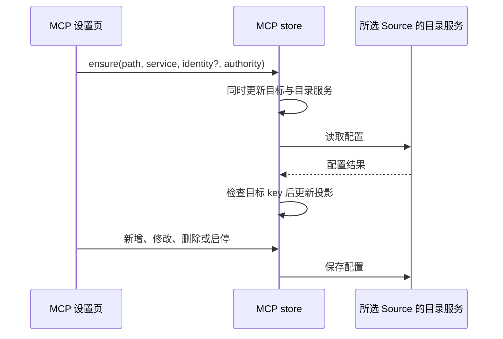

# 3.16.2 候选维护修复

## OW-P001：Source 用户级 MCP 配置目标

设置页已有 `cacheAuthorityKey` 标识所选 Source，`mcpSyncService` 是该 Source 的目录读写入口；用户级目标可以没有 `workspaceIdentity`。MCP store 统一拥有当前配置目标及其目录服务，读取、保存、删除和启停复用同一服务。

- 有 Source authority 时，使用该目标显式传入的目录服务；缺少服务时报错，不回落到当前工作区的平台服务。
- 普通本机工作区仍通过平台服务读写，并保留旧 common MCP 迁移。远端 workspace 继续按原 identity 路由。
- 切换目标同时替换目录服务并清空旧投影；重连时可更新同一目标的服务引用。已有异步加载 key 检查继续丢弃过期结果。
- 本次只修配置目录路由，不改变 Agent admission、owner/lease 或桌面 continuous／手机 replayable 的会话传输。

回归覆盖：无 identity 的 Source 读写只访问所选服务、当前 workspace 默认服务不同、同路径 Source 切换、同目标重连、缺少服务失败、本机迁移不变。交互验收场景：打开本机项目，在设置选择远端 Source 的用户级 MCP，新增并编辑条目，切回本机确认配置未变化，再切回远端确认持久化结果；该场景的自动化 store 集成回归使用真实 store 和可观察服务端口，不连接真实 SSH 主机。

## OW-P002：Web token Cookie 编码

HTTP 鉴权写 Cookie 时继续使用 `encodeURIComponent`；验证 Cookie 时只解码一次，按原 token 比较。URL 参数和 Bearer 行为保持。畸形百分号编码返回未授权，不抛出服务端异常；不对 token 做二次解码。

真实 HTTP 回归使用回环地址与临时令牌，覆盖普通字符、`+`、`/`、`=`、`%`、Unicode、错误 Cookie、畸形编码及双重编码。

## 仓库维护

### OW-P004：Windows 显式受影响测试路径

三平台接入脚本回归后，Windows 的 manifest 选择未执行目标测试，公共 setup 的全量选择也未触发。`resolveScope` 将 Windows 原生反斜杠绝对路径直接赋给 Vitest 的 `config.related`；官方依赖图和 trigger 使用正斜杠路径。显式绝对路径还可能经过临时目录别名，与依赖图的实际路径不同。入口对存在的文件解析真实路径，再统一原生分隔符；不存在的文件保留解析后的路径交给官方选择器处理。保留原 Git 基线、文件去重、官方选择及全量跳过规则。回归用真实临时 Git 仓库，验证相对路径、绝对路径与 manifest 都执行目标文件，并验证根公共 setup 仍选择全量后跳过。

- 仓库根 `.gitignore` 登记 `/local/`，本地归档、报告和临时材料的忽略不依赖个人 Git 配置。
- `verify:pre-push` 保持现有执行顺序：lint、schema、架构治理测试、架构检查、固定核心 Vitest。受影响单测保留为独立入口，文档与 hook 注释按此说明。
- `scripts/test/` 中仍对应现有功能的 Node 测试进入三平台核心 CI，按文件串行执行以限制子进程并发。已移除 ARMS 依赖的安装补丁测试随退役功能清理；不恢复依赖以满足旧断言。
- 下游补丁清单沿用已有草稿，修复后更新 OW-P001、OW-P002，并将回归纳入核心测试清单。
- 格式校验限定本次修改文件；历史全仓格式偏差另行处理。
