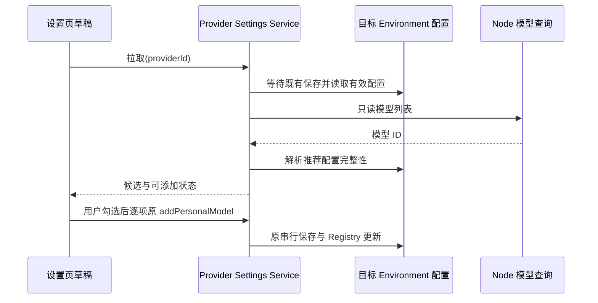
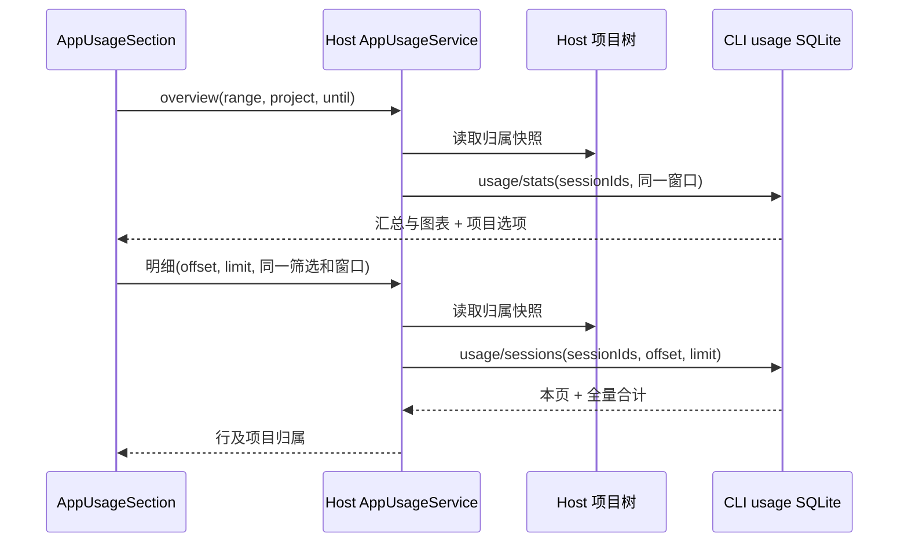

# 模型列表拉取与项目用量查询

状态：本地实现与定向验证完成（2026-10-30）。用户已确认沿界面示意尝试两项功能；本规格限定本次交付。Electron 候选仍保留 manual-review/pending 状态。

## 模型列表拉取

- 设置 → 模型供应商 → 模型列表新增「拉取模型」，保留原「添加模型」。只查询已保存的目标 Provider 配置，不保存连接草稿、不改变当前会话模型。
- Node Provider adapter 使用目标 Environment 的有效协议、Base URL、Key 与自定义 headers。Chat Completions / Responses 查询 `{base}/models`；Messages 与现有推理 adapter 一致，根地址先补 `/v1`，已含 `/v1` 时不重复追加，再查询 `/models`。仅既定同源端点，手动处理分页、拒绝重定向。设置超时、响应体和条数上限，错误不回显服务商响应正文或凭据。
- 列表去重并按 ID 排序。已有模型禁选；新模型使用现有推荐解析判断是否可添加。缺项进入原添加配置弹窗，不猜能力、不查询外部能力目录。
- 勾选后逐项调用原模型保存路径；成功项退出待选，失败项保留并可重试。切换 Provider / 关闭弹窗 / 新查询后拒收旧请求；保存期间禁止切换本弹窗的动作。候选只归当前 UI 草稿，Provider 配置仍由 Config Service 唯一持久化。
- 空列表、401/403、404/405、超时、非法 JSON、过大响应分别有可操作提示。用户可继续手工添加。

## 项目用量（2026-10-30 二级明细页修订）

- 以 62aefeff 为视觉基线，概览保留原三格汇总、六项指标、图表和排行。新增项目选择与会话数量标签行的「明细」入口；删除页尾表格。桌面最小窗口 480px，统计仍仅支持可信 Desktop 本地 Host。
- AppUsageSection 独占项目、时间范围、视图、分页和刷新窗口状态。会话明细复用 SettingsBreadcrumbReporter，进入顶部聚焦，返回恢复 main 滚动位置与入口焦点；若筛选已变为零会话而入口隐藏，则焦点回到概览标题并结束恢复；useLayoutEffect 同步恢复，不用定时器。
- 项目选择不加外部文字标签，提供 aria-label；控件按容器 760 / 520px 明确分行。明细按 640px 切换表格与列表，50 行一页，排序为合计降序、sessionId 升序。合计行覆盖筛选下全部记录，不只当前页；全部项目显示项目归属列。
- Host project repository 为项目归属唯一来源，每个请求读取一次树；缺失项目抛出带 code=project-not-found 的错误，经既有 RPC 错误字段传递，页面回到全部项目并提示。
- fork 是独立任务，使用自身归属；selection_side_chat 是辅助会话，归入父根的主会话列。归属递归沿 selection_side_chat、subagent_child、workflow_child、nested_workflow_child；只有经过后三种边才计为子任务。不能沿普通 fork 的 parent_id 合并或跨项目重复计数。
- 缺失父记录的会话独立保留一行。Host 树内无对应行时标记 not-in-task-list；没有有效项目归属的现存任务为 unassigned。全部 = 各现存项目 + 未归类 + 已不在任务列表；后者只作明细归属注记，不另加筛选项。
- overview 使用 getAppUsageStats(includeProjects)，不读会话明细。新增 getAppUsageSessions 与 v4/usage/sessions / usage/sessions，入参 range、timeZone?、until?、sessionIds?、offset、limit（1–100），严格运行时 schema。
- 明细返回本页 rows、totalCount、childSessionCount、全量 totals、offset/limit 及查询时间。同一 SQL 快照内计算页与合计，越界仍返回总数和合计。Host 为行附加 membership/projectId/projectName。
- 两种查询共用时间窗口解析；明细继承概览 generatedAt 作为 until，筛选/刷新重置页码和时间窗口，AI 查询在同一 until 下组合汇总与第一页（50 行）。动态写入期间不同查询时间的快照不强行宣称相同。
- QueryUsage 保留只读工具合同，返回完整汇总、明细合计、第一页与总条数；报告超过 120,000 UTF-8 字节裁剪列表并标记 truncated。源数据仍保持原 30 天保留，不作表结构迁移。
- 明细标题为「会话明细」，说明 N 个主会话及子任务归并关系；不把明细行数当作原卡片 count(distinct session_id)。统计说明陈述本机数据与保留期。

实现与验收按 local/model-usage/usage-page-plan.md 执行；本地对照台使用完整真实组件与共同 fixture，不提交 fixture 中的本机信息。v1 不含跳转会话、导出或切换排序。

## 验收与范围

| Case | Setup / Action                                         | 断言                                                     | 验证证据                                     |
| ---- | ------------------------------------------------------ | -------------------------------------------------------- | -------------------------------------------- |
| MD01 | 合成服务返回重复、已有和新模型，真实设置页勾选添加     | 去重；已有禁选；保存后模型行出现且原模型选择不变         | adapter/UI UT + Electron 主流程              |
| MD02 | 缺配置模型走原编辑器                                   | ID 预填；校验与手工添加一致；取消无写入                  | UI UT 验证 ID 交接；复用原编辑器             |
| MD03 | 查询异常、换 Provider、关闭、部分保存失败              | 凭据不进入错误；迟到结果失效；成功不重复保存、失败可重试 | adapter/hook UT                              |
| PU01 | 两个同 cwd 的应用项目及未归类会话，含子孙会话          | 只按 Host 归属分组；空项目为零；全部和项目总量同口径     | services + SQLite UT                         |
| PU02 | 失败消耗、缓存、跨日、仅工具调用                       | 原统计口径保留；主子不重复计；所有图表和明细一致         | SQLite/builder UT                            |
| PU03 | 统计页切项目、时间、刷新，旧查询迟到                   | 筛选即时更新；不显示旧项目结果；明细可读                 | hook UT + Electron 项目切换                  |
| PU04 | QueryUsage 经 Host 协议查询与 UI 相同项目              | 同参数同数据；只读；缺 Host 不伪造成功                   | tool/protocol/service UT + Electron 工具往返 |
| UX01 | 桌面最小窗口 480px 与宽屏，中文/英文、浅深主题代表场景 | 概览与基线对照，明细使用表格/列表，无页面横向溢出        | 真实组件对照台 + Electron 导航与布局断言     |

本轮采用已有样式、hook/service 读取、配置保存及用量写入。未纳入：能力目录自动补全、模型自动同步、套餐/余额、跨机器汇总、长于既有保留期的数据、新实时速度指标。E2E 留在 manual-review/pending，不自动转正或纳入 Docker。

## 本地验证记录

- 根目录类型检查、CLI 29 项类型检查任务、E2E 类型检查通过。根 lint 0 errors / 32 warnings；CLI lint 0 errors / 97 warnings，另有 5 项原样上游行数诊断。
- UI / service / Provider adapter 8 文件、33 项测试通过；CLI 5 文件、14 项通过；Host 侧聊 SAT28 定向回归 4 项通过、同文件其余 97 项未选中。共 51 项不同定向测试，包含零会话返回焦点、真实子 runtime 写入 turn_usage、fork/侧聊归属和分页全量合计。
- 架构检查 0 violations；SQLite schema 检查 8 项通过，Host 与 CLI 两份 schema 均兼容。功能图节点/边引用及新增 10 个文件与符号定位通过静态检查；本轮无可用 codegraph 索引。
- 最终重建后的 macOS Electron 回放 1/1 通过，case 用时 11.298 秒。Run ID：`desktop-e2e-20261030055350041-p33610-c05b0898b2a191f6`。覆盖模型发现、概览无页尾表、二级页面包屑、120 Token 明细、返回滚动（误差 ≤1px）与焦点、筛选保留、480px 英文深色列表及 QueryUsage Host 往返。真实 UI 分叉后读取 Host 任务树，确认父会话与 fork 是两个独立任务。
- 本地真实组件对照台使用同一份合成数据：128 个主会话行、42 个子任务计数、多项目及长/空标题。1280px 中英文深浅主题、900px 中文浅色、480px 中文深浅主题共 7 组截图与翻页检查通过；另有 9 项状态检查通过。九项原指标在宽/中窗口的位置和尺寸差值均为 0；480px 下仅 y 统一增加 36px，尺寸保持。证据为视觉检查与几何量测，未执行全页面逐像素 diff。
- 较早一次启动在 WebDriver 创建会话前超时，尚未执行功能断言；后续重试和两次最终构建运行通过，未确认首次超时根因。
- 使用本机合成 Provider 回放，不证明真实供应商账号的 `/models` 兼容或真实账单。Windows/Linux 原生窗口未在本轮验收；使用统计仍限定 Desktop 本机，480px 按桌面最小窗口验收。候选继续保留 manual-review/pending，未作人工转正或 Docker 准入。
