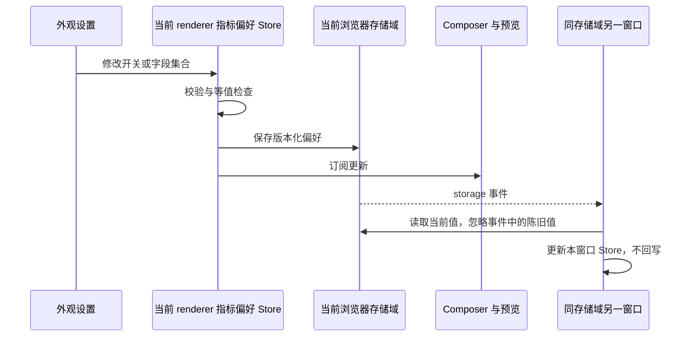
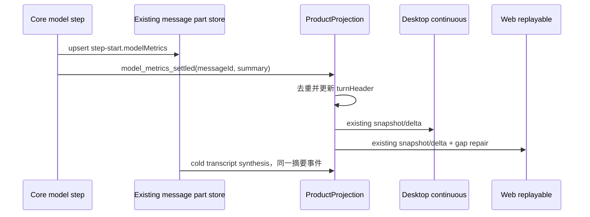

# 原生会话指标栏

状态：首版本地实现完成，交互用例保持 manual-review/pending。

## 产品规则与指标字典

输入框工具按钮下方增加一行：运行状态、工作耗时、最近请求生成速度、首正文、本轮 token、缓存读取比例、更多。普通草稿和历史输入编辑器不传 footer；Side Pane 单行输入保持紧凑布局。窄容器将次要值收进更多，指标含义不变。历史轮次在工作耗时旁提供“本轮统计”，复用同一明细。

“更多 / 收起”紧跟最后一个可见指标，使用与指标一致的小字号、常规字重和辅助文字颜色；展开后保持透明底色，通过文字和箭头方向表达状态。保留悬停反馈、键盘焦点和展开状态的可访问语义。

| 指标         | 定义 / 来源                                                                                                      | 缺项                                                  |
| ------------ | ---------------------------------------------------------------------------------------------------------------- | ----------------------------------------------------- |
| 工作耗时     | 既有 turnHeader.activeMs；运行中仅展示已开始的经过时间并标注运行中                                               | 历史无工时显示 —                                      |
| 速度         | 最近结算请求的 outputTokens / (durationMs - timeToFirstContentMs)，单位 tok/s；含 reasoning 的供应商 output 口径 | 未上报、失败、非正生成区间显示 —，不使用工具/审批耗时 |
| 首正文       | 最近结算请求的 timeToFirstTextMs；不将 reasoning 当正文                                                          | 无正文显示 —                                          |
| 本轮         | 此 product turn 自身模型请求的已报告 input + output，包含失败尝试已报告的消耗；不再加 cache/reasoning            | 没有完整输入输出上报显示 —；部分上报在明细注明        |
| 缓存         | cacheReadTokens / inputTokens；cache 字段全部已知且输入大于 0 时计算                                             | 缺项或零分母显示 —                                    |
| 会话主链累计 | 直接读取既有 snapshot.usage.cumulative，保留成功主链口径                                                         | 不与本轮含失败或本机数据库总量强制对账                |
| 本机今日     | 已有 App Usage 7d 快照中 generatedAt 在 timeZone 对应日期的日桶                                                  | 无可信本地 base Host 隐藏；错误提供刷新               |
| 工具         | 轮次投影统计独立 toolCallId 的调用与错误数                                                                       | 旧 header 缺项显示 —                                  |
| 直接子任务   | 既有子会话目录的直接子任务，独立于主会话；使用持久化请求摘要，按 childSessionId 去重                             | 未采集/旧记录显示未知，不伪造 0                       |

更多明细在窄容器使用单列、数值不换行，展开区限制高度并可滚动。更多默认收起，只在浏览器本地记住一个版本化展开偏好，不持久化统计副本。展开才挂载本机/子任务查询；会话终态和用户刷新时更新，无秒级 RPC。子任务汇总不递归，后台跨轮任务计入会话直接子任务，不能归到当前轮。

## 状态与恢复

### 显示偏好（NCM08–NCM11）

显示偏好采用独立 store / 本地存储方案，接入集中在外观设置和 Composer，便于复核上游升级。

“设置 → 外观 → 会话指标”提供总开关、七项字段勾选、固定示例预览与恢复默认。默认显示状态与耗时、速度、首字、本轮 Token、缓存；会话主链累计、工具调用数默认关闭。顺序固定，预览与主栏共用纯展示行。设置修改立即生效；关闭保留选择，全不选或总开关关闭时 Composer 不传 footer。历史统计与更多明细不被筛选，今日/子任务仍只在真实展开时查询。

字段先按勾选筛选，再按容器和内容实际宽度排布，预留更多入口。折叠顺序为工具数、累计、缓存、首字、速度、本轮、状态；只处理已勾选项。宽度恢复时自动恢复，数值不拆行，极窄容器保留更多入口。布局测量限于最多七个字段，测量行不可交互且不受折叠结果影响，避免尺寸反馈循环。

偏好由 `store/conversationMetricsPreferencesStore.ts` 唯一管理，作为现有 conversation-metrics-ui 模块的额外 root；不扩展全局 Store、Root 或 Host 广播。保存 `version: 1`、`enabled`、稳定字段 ID 数组 `visibleFields`，key 为 `openzwork.conversation-metrics.preferences.v1`。读取校验、去重并固定顺序；合法空集合保留，坏值只回退本分组，读取不写回。新增指标不加入已有选择。更多展开继续使用原 key。

订阅按消费者生命周期共享并清理；恢复窗口焦点时重读，不轮询。同存储域桌面窗口/浏览器标签同步；手机和独立数据目录按各自存储域隔离。关闭指标栏卸载查询组件；既有 scope/version 拒绝迟到结果。

### 指标事实

新增可选 `step-start.modelMetrics`，保存在现有 part JSON 内；不新增表、migration 或账本。Core 在模型逻辑步骤结算时从该步骤网络事件产生一个有界摘要，按 requestId + attempt 去重，排除旁路。持久化同一 step-start 后发送 `model_metrics_settled` 内部事件；ProductProjection 按 assistant message ID 去重聚合到可选 turnHeader.metrics。模型失败仍是失败，不合成 ModelComplete。

每步摘要同时保存可选 mainUsage：只取 main_turn 成功 result 的用量，排除重试失败和旁路。冷恢复从该字段重建既有主链累计；live 仍由 ModelComplete 单独计入，避免双计。旧 part 没有 mainUsage 时不推测补全。

Cold transcript synthesis 读取 schema 校验后的摘要，合成同一 settled 事件。缺项不从文本长度或墙钟回填；fork/rewind 随原消息 part 的复制/裁剪保留对应事实。UI 不累计事件，不读 session debug。工具数量从 CLI 的唯一工具行状态投影，冷恢复复用相同事件转换。

子任务目录用可选 `includeMetrics: true` 按需返回摘要。缺省请求不增加响应字段，保留旧客户端 strict schema 兼容；新 UI 连接旧 CLI 时，子任务统计可明确显示不可用，主栏旧字段仍可阅读。

Main、Host relay 不增加业务事实。workspaceIdentity 的现有 fallback、remoteSessionId、seq/epoch/owner 及 stale run 防护保持。查询使用当前服务的只读入口；本机日桶始终使用可信 base service。子目录复用现有已读取的 child messages 计算，不增加逐子会话 RPC 或激活 runtime；输出明细按现有目录分页，汇总由 CLI 返回。

## 影响与边界

| 表面     | owner / 接点                                                      | 隔离                             |
| -------- | ----------------------------------------------------------------- | -------------------------------- |
| Composer | 可选 ChatPromptEditor.footerContent → 独立 ConversationMetricsBar | 历史编辑器/草稿不展示别的会话值  |
| 历史轮次 | TurnGroup → 同一 TurnMetricsDetails                               | 与当前栏分离；无历史定时器       |
| 今日     | useAppUsageStats → local base authority                           | 无远端 fallback；时区来自快照    |
| 子任务   | listSessionSubagents → persisted parts                            | 直接子任务独立汇总、不与主链相加 |

must-inspect：runtime 结算、消息 part、cold hydration、V4 row schema、Composer/TurnGroup。should-inspect：App Usage hook、子会话目录。invariant-only：队列/权限/调度/传输。evidence-only：协议、恢复与 UI 回归。源码引用扫描深度 2；当前环境无 codegraph，不能宣称调用图验证。

新代码集中在有管理的 metrics contract/domain、Core metrics 与 UI metrics 目录。既有大文件只做接入。功能图登记 capability 与两种 UI surface。此功能属于自有能力，不进入 OW-P 上游缺陷清单。

## 验收与剪枝

| Case  | 前置 / 动作                                    | 断言                                             | 证据                          |
| ----- | ---------------------------------------------- | ------------------------------------------------ | ----------------------------- |
| NCM01 | 模型 success + reasoning + tool，打开更多/本轮 | 正确 token/cache/TPS/首正文，工具等待不计速度    | domain + projection + UI/E2E  |
| NCM02 | retry、重复 terminal、已报告 usage 的失败/取消 | 不重复计数，失败单列，未知与 0 分离              | Core + projection             |
| NCM03 | 重建进程/首帧终态/旧记录                       | 新摘要冷恢复一致，旧值未知，重复 snapshot 不增加 | SQLite + hydration + V4 apply |
| NCM04 | 会话 A→B，同路径不同 identity，迟到查询        | 清空旧数据，拒绝迟到响应；展开不发送对话         | hook + UI                     |
| NCM05 | 本地/无本地 base，日界线与时区                 | 本机今日来自正确日期；不可用无 fallback          | hook + model                  |
| NCM06 | 直接子任务重复引用/后台跨轮/孙任务             | 直接子去重、主链独立、只读不激活子 runtime       | bootstrap query               |
| NCM07 | 390px 与桌面、中文英文、深浅主题               | 关键值/更多/统计可达、无横向溢出、编辑不挂指标   | UI + browser/E2E              |
| NCM08 | 外观页修改字段、总开关、全不选、恢复默认 | 主栏即时变化、无残留 footer；预览不查询；历史明细完整 | UI + 真实设置入口 E2E |
| NCM09 | 保存偏好、重载、同域另一窗口、独立存储域 | 恢复选择；同域同步无回写；独立域隔离；未知/重复/损坏值归一化 | store UT + 产品多窗口 E2E |
| NCM10 | 只选速度/本轮与全选；390px/1200px、大字号、两语言主题 | 已选字段按实际空间显示；未选字段不恢复；无横向溢出或测量抖动 | 布局 UT + 截图 E2E |
| NCM11 | 展开后从另一窗口关闭指标栏 | 今日/子任务组件卸载、主栏隐藏，重新启用读取同一 snapshot | UI + 多窗口 E2E |

accepted：NCM01–NCM11。pruned：额度/费用/壁纸/云遥测；递归后代合计；改调度/权限；旧数据推算补全。具体实现沿既有合同。E2E 保持 manual-review/pending；人工 review、正式转正和 Docker/跨平台安装验收分别记录。

## 维护与验证

必跑根 typecheck、lint、architecture；CLI typecheck/lint、metrics 定向测试及冷恢复；交互候选 E2E 与 fixture 校验。未请求根全量测试。发布/部署不在本次本地开发范围。

升级重点复核模型 usage 归一化、step part 编解码、V4 hydration 和 Composer footer 四个接点。删除展示可保留可选读字段兼容；旧版本忽略附加 JSON 字段。

显示偏好新增的业务 UI 接入只有 `AppearanceSectionContent → MetricsDisplaySettings` 与 `ConversationComposer → useConversationMetricsPreferences / footer`。独立 store 是 metrics UI 模块的额外 root，不修改全局 Store、Root 或 Host 广播。字段 ID、默认选择和折叠优先级集中在 UI contract；新增字段不覆盖已保存选择。主题、语言、界面字号沿用现有 UI 机制。

官方升级记录版本及 commit SHA（含同版本重推），按下表复核并记录保留/适配结论。本功能属于自有能力，不登记 OW-P 缺陷编号。

| 接点 | 必须保持的行为 | 验证 |
| --- | --- | --- |
| 外观设置分组 / Composer footer | 真实入口存在，勾选立即影响主栏，关闭无占位，历史明细完整 | native metrics pending E2E + conversationMetrics.test.ts |
| 偏好 key / 窗口 URL 与 session | 旧偏好恢复、同存储域同步、独立域隔离，事件不回写 | conversationMetricsPreferences.test.ts + 产品多窗口 E2E |
| 请求结算 / usage 归一化 | 重试失败、旁路与重复终态口径保持 | Core native-metrics 定向测试 |
| part JSON / ProductProjection / hydration | 可选字段保留、live/cold 一致、累计不双计 | bootstrap native-conversation-metrics + 冷恢复 E2E |
| 子任务 includeMetrics / scope | opt-in 兼容，查询只读，主链和子任务分开 | subagent-session-query 定向测试 |

稳定 UI/偏好/共享指标 UT 登记在 `tests/ci/core-tests.json`。模块测试不能替代真实入口 E2E；候选未人工转正时，官方升级仍显式运行该 case。官方出现同类能力时先比较指标口径、失败与恢复语义、偏好范围，再提出复用或迁移方案。

## 2026-10-25 验证记录

- 自选显示最终验证：`desktop-e2e-20261025-141253-955` 1/1 passed，覆盖真实设置入口、两产品窗口同步、关闭/全不选/恢复默认、冷重启保存选择、窄屏两项和大字号；29 张截图。根 typecheck、Desktop E2E typecheck、架构、fixture、格式检查通过；根 Lint 0 error / 32 既有 warning；核心入口定向 5 文件 / 14 passed，核心发现检查 7/7 passed。大字号截图按栏和按钮的实际视口边界等待布局完成。没有运行根全量测试。

- 根 TypeScript、CLI TypeScript、Desktop E2E TypeScript、根/CLI Lint、架构检查及 fixture contract 均执行通过；Lint 保留既有 warning。
- 固定核心 `verify:pre-push`：262 文件、3584 passed、1 skipped；未运行根全量测试。
- 指标及相邻 UI/hook：19 passed。CLI 定向 10 文件、412 passed，覆盖持久化、取消、断流恢复、轮次投影、SQLite 冷恢复、直接子任务。
- Desktop macOS `desktop-e2e-20261025-122440-760`：1/1 case-local replay 通过。真实 UI 发送固定 provider 响应，得到本轮 120、缓存 80%，打开更多/历史统计；重启后本轮明细及主链累计 120 保持一致。
- 1200px / 390px × en-US / zh-CN × zai-light / zai-dark 八组合无指标栏横向溢出，另留默认收起截图；窄容器展开区有高度上限且可滚动。
- 入口视觉调整后，`desktop-e2e-20261025-124756-612` 复跑 1/1 通过；上述八组合均保存展开与收起态，共 16 张截图。根 typecheck、Desktop E2E typecheck、Lint、架构、格式检查及现有入口交互单测 2/2 通过；根 Lint 为 0 error / 32 warning。
- 既有 `transcript-hydration.test.ts` 的 CUA 图片 `output.display` 断言单独失败，在基线原 projection/hydration 文件上复现；本功能未改该图片链路。

限制：供应商响应为本地 synthetic fixture，未消费真实模型；390px 是 Desktop Chromium 视口验证，不替代实体手机与真实 replayable 连接。Windows/Linux 安装包、跨 Host 真机与大规模子任务性能尚未验收。旧 part 缺少新摘要时不推测回填。E2E 尚未人工转正或加入 Docker preset。
