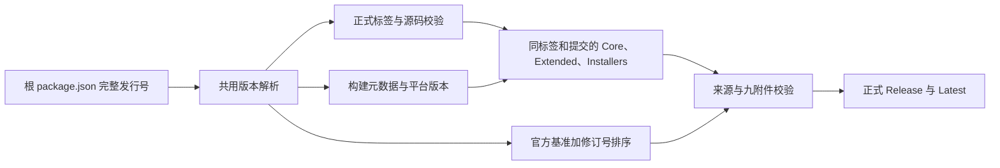

# OpenZWork 发行版本

## 编号与事实源

根 `package.json.version` 是完整发行号的唯一事实源，根 `package-lock.json` 的根版本字段同步更新。格式为 `X.Y.Z` 或 `X.Y.Z+openzwork.N`：前三段记录官方基准，N 是该基准下的 OpenZWork 正整数修订号。不带后缀时修订号为 0；数字不得有前导零。同步官方基准后可先发行不带后缀的版本，再从修订号 1 开始迭代。

构建和发布共用 `scripts/openzwork-version.mjs`，从完整发行号解析出官方基准与修订号，避免另存两个可漂移的版本字段。CLI 子包的独立版本规则不变。

## 顺序与标签

先按数字比较官方基准的三段，再比较修订号。必须满足：

```text
3.16.2 < 3.16.2+openzwork.1 < 3.16.3 < 3.16.3+openzwork.1
3.16.2+openzwork.999 < 3.16.3
3.16.3+openzwork.2 < 3.16.3+openzwork.10
```

这项顺序用于 OpenZWork Release 的 Latest 选择。标准 SemVer 忽略构建信息，不能单独完成同基准修订号的比较。协议兼容性仍使用官方基准或显式配置的最低兼容版本。

不带修订号的版本沿用 `vX.Y.Z-openzwork` 标签；带修订号的版本使用 `vX.Y.Z+openzwork.N`，不再重复追加 `-openzwork`。两类均为正式 Release，`prerelease=false`。标签必须精确匹配源码中的完整发行号。已发布的旧标签、附件与说明不改写。

## 构建与展示

- 应用内版本、Release 标题、下载文件名、来源清单保存完整发行号。
- electron-builder 的数字构建号取修订号，不从 CI 环境自动推导。Windows 文件版本为 `X.Y.Z.N`；四段均须在 Windows 可表示的 0–65535 范围内。
- macOS 的 `CFBundleShortVersionString` 使用官方基准；`CFBundleVersion` 使用 electron-builder 的数字构建版本 `X.Y.Z.N`。应用内关于窗口优先显示构建元数据中的完整发行号。
- Linux 包保留完整发行号，并以修订号作为 package iteration；实际包元数据在三平台发行构建中检查。
- 下游补丁登记的 `upstream.checked` 比较官方基准；仅增加 OpenZWork 修订号不冒充同步了新上游。



## 验收

1. 混合无后缀/有后缀版本按上述顺序比较，包括数字 2/10 与跨官方基准。
2. 拒绝四段应用版本、预发布标识、未知构建信息、零或带前导零的修订号；发布 tag 与源码发行号不一致时失败。
3. 两类正式标签均触发同源三项门禁；手动恢复与自动事件使用同一解析入口。
4. 完整发行号贯穿构建元数据、关于窗口、安装文件、manifest 和 Release；旧版发布与 Latest 防倒退继续有效。Preview 候选与正式构建都核对包内版本，生成 `VERSION-VERIFICATION.json`；发布器只接受 production 核验。ASAR 嵌套条目按运行平台的路径分隔符读取，以真实归档夹具覆盖 Windows 路径。
5. 本次正式发行 `3.16.2+openzwork.1` 包含已合并的原生会话指标栏、自选指标、对话 Markdown 复制、筛选与项目活动排序。
