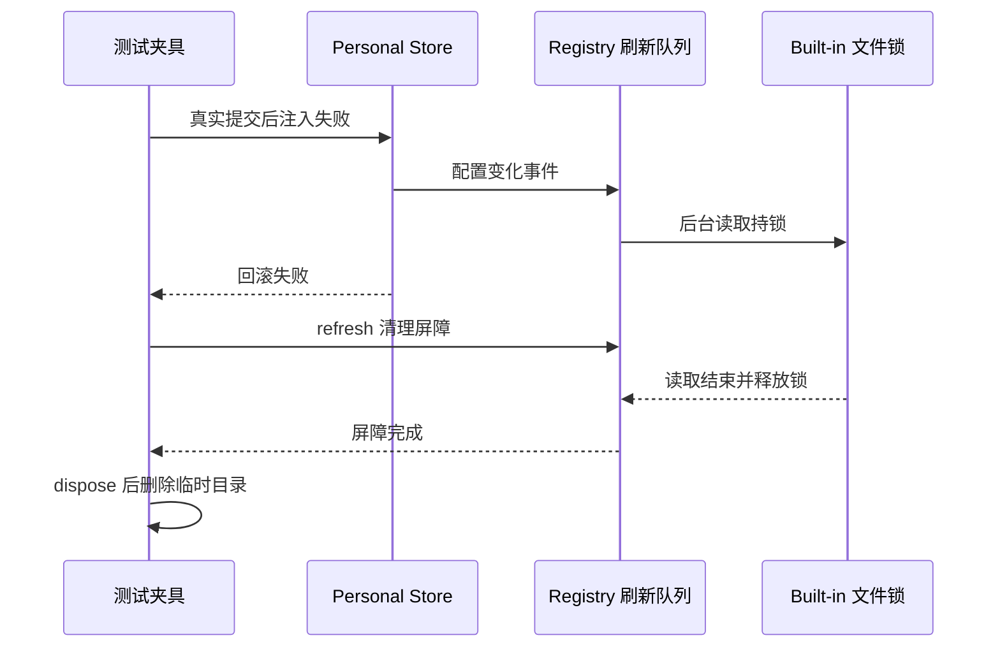

# Provider Provisioning 真实 Store 测试生命周期

`providerProvisioningRealStores.test.ts` 的临时目录由测试夹具拥有；Provider Registry 拥有配置变化触发的串行刷新，文件锁由刷新调用使用的 Store 持有。夹具禁用文件监听和轮询。

配置提交发出的事件可以启动后台刷新。测试在提交后注入异常、且回滚也失败时，`apply()` 会返回 `rollback_failed`，已经触发的刷新仍可能读取 Built-in 文件。同步 `dispose()` 只取消订阅，不能证明在途文件 IO 已结束。

## 清理契约

1. 保留原业务断言：回滚失败返回 `rollback_failed`、`rolledBack: false`，且不写入成功幂等记录。
2. 夹具清理先通过现有 `registryService.refresh()` 等待此前排入的刷新和本次屏障完成，再 dispose Runtime 与默认模型 Repository。
3. 同一夹具重复调用清理返回同一个完成 Promise；所有调用方等待其完成后，才能恢复环境变量并删除临时目录。
4. 清理不使用固定 sleep、目录删除重试或忽略 EPERM 来掩盖未完成的 IO，不改变产品 dispose 接口和测试时限。

## 回归证据

在回滚失败用例中用真实 `withFileLock` 持有 Built-in 锁，以显式 Promise 控制后台读取完成。`apply()` 返回后启动夹具清理，验证读取放行前清理尚未完成、锁仍存在；放行读取后验证清理完成且锁已释放。此场景应在旧同步清理上稳定失败，并在三平台完整 services 组中执行。
