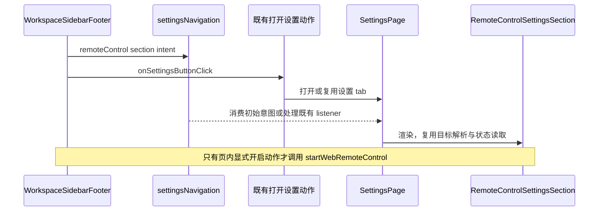

# 设置页布局与远控快捷入口

## 范围与设计约束

2026-10-26：优化会话指标、系统提示词、远程控制、使用统计的内容布局，并恢复工作区侧栏底部直达远控设置的按钮。保留 DESIGN.md 定义的 Zai 主题、设置页框架、文字角色、圆角和共享控件；不修改全局设计 token。

变更层为 presentation 和导航 commit-effect。沿用现有默认选项、配置格式、权限、数据查询与连接生命周期。HTML 原型中的示例正文和连接状态不进入产品实现。

## 页面规则

- **会话指标**：七个已有字段按“运行与响应”“用量与工具”分组，限制选项列宽；预览使用现有 MetricsSummaryRow，单独以低强调 surface 呈现。总开关、空集合、恢复默认、跨窗口同步和默认五项保持原合同。
- **系统提示词**：桌面章节目录有独立高度上限，窄屏使用共享 Select 切换全部章节及自定义章节。模式按钮在窄屏或大字号下允许换行，完整显示两个选项。主要正文为生效预览，默认规则折叠作为对照；切换章节回到折叠态。保存状态、保存和取消集中在同一操作区。目录、情景和运行内容继续来自现有 catalog 与解析器，草稿、并发比较、整体替换和动态数据开关不变。
- **远程控制**：手机表单与 Bot 入口使用原有卡片；桌面紧凑并列、窄屏堆叠。开启动作使用适当宽度，Bot 渠道改为紧凑列表，保留名称、区域标签和原有配置入口。运行后的二维码、复制、重新配对和停止保持原行为。
- **快捷入口**：仅 Desktop 且远控功能启用、footer 处于工作区 settings 模式时显示。点击先写入 remoteControl section intent，再调用既有打开设置动作；设置页自身的 back 模式不重复提供入口。无工作区也可导航，开启按钮仍由远控页的目标校验决定。点击、返回和离开页面均不启动或停止连接。
- **使用统计**：Token、会话、活跃天数使用一组紧凑概览，其余指标降低视觉权重。合法空快照在概览附近说明，不渲染空趋势/排行；无输入 Token、模型请求或工具调用样本时，对应比率显示“—”。有样本的真实 0% 保留。没有最常用模型显示“暂无数据”，有模型记录但名称缺失仍显示“未知模型”。包含模型请求的零 Token 快照仍有数据，不当作空态。

## UI Surface Matrix

| 场景            | 入口与共享实现                                                 | 草稿 / 默认 owner                        | 校验和提交                      | 权威 / 落点                   | 边界                              |
| --------------- | -------------------------------------------------------------- | ---------------------------------------- | ------------------------------- | ----------------------------- | --------------------------------- |
| 指标偏好        | AppearanceSectionContent → MetricsDisplaySettings → SummaryRow | 既有 metrics preference store / contract | store.update/reset              | 同域 localStorage             | 不改变主栏统计或历史明细          |
| 提示词编辑      | SettingsPage → SystemPromptEditor                              | React draft/baseline；CLI catalog        | shared schema → onSave          | SettingService                | 保留创建期 runtime 快照与冲突检测 |
| 手机 / Bot 配置 | RemoteControlSettingsSection / ConnectionForm / BotsDialog     | 页内连接草稿；Main 状态投影              | 显式 start/stop 或 Bot 既有动作 | Main / 本机 Host              | 不新增连接入口或后台连接          |
| 首页快捷导航    | WorkspaceSidebarFooter → settingsNavigation → openSettings     | SettingsPage section intent              | Desktop / feature / footer mode | 既有 TabStore 与 SettingsPage | 不携带或改写 workspace 身份       |
| 本地用量        | AppUsageSection → useAppUsageStats                             | 页面 range；hook 查询状态                | 既有本机 facade                 | CLI 本地 usage store          | 不回退远端，不改聚合口径          |

## 共享与差异

共享 Button、Select、Card 和主题/i18n。显示偏好即时生效，系统提示词显式保存，远控显式连接，统计显式查询；这些副作用不合并。没有新增持久状态、公共协议或依赖。

## 影响关系与归属

must-inspect：上述五条入口与直接 owner。should-inspect：SettingsPage 既有 section listener、footer 调用方、系统提示词 runtime 预览。invariant-only：Host/CLI、owner/lease、workspaceIdentity、desktop-continuous / web-remote-replayable。evidence-only：已有 UI 单测与候选 E2E。

codegraph 在当前环境没有工具或 CLI；按功能图 seeds 精确检索并只读核对直接调用方至深度 2，不宣称调用图验证。图谱中远控 surface 的旧 dialog 名称落后于已迁移的实现；保留 ID，修正 label 并登记首页导航 surface。

## 验收与剪枝

用户已确认保持原作风格、四处内部布局调整和首页远控快捷按钮；无未决业务取舍。

| ID    | 前置与操作                                                        | 断言                                                                            | 证据                         |
| ----- | ----------------------------------------------------------------- | ------------------------------------------------------------------------------- | ---------------------------- |
| SVP01 | Desktop 工作区点击 footer 远控；设置 back 模式；Web / feature off | 直达 remoteControl；后两类无额外入口；无隐式 start/stop；既有设置页也可接收意图 | UI + pending E2E             |
| SVP02 | 切换七项指标、关闭、空集合、恢复默认                              | 分组后仍写入同一 store；预览实时跟随且无查询；默认值不变                        | 既有指标 UI + pending E2E    |
| SVP03 | 默认章、追加/替换、自定义章、窄屏切章                             | 默认原文初始折叠，展开可读；预览真实；切章保留脏草稿；保存/取消与冲突合同不变   | UI + SP06/SP14 + pending E2E |
| SVP04 | 空快照、仅失败请求、无比率样本、有样本但比率 0                    | 空态可见；空图表收起；未知比率为 —；有样本 0% 保留；刷新/错误与不可用互不混淆   | App Usage UI                 |
| SVP05 | 三种连接方式、Bot 入口、运行连接                                  | 字段与目标不变；渠道进入原有子页；离开不停止                                    | 既有远控 UI + pending E2E    |
| SVP06 | 中英文、Zai Light/Dark、桌面/390px、大字号                        | 控件可达，正文不被目录撑出首屏，页面无横向溢出                                  | 截图 E2E                     |

剪枝：真实模型、真实第三方 Bot/relay、SSH/WSL/Docker 传输矩阵不因本次呈现与导航改变，复用既有合同；不修改连接安全边界或提示词物化行为。跨平台原生窗口和实体手机另记未验证范围。候选不自动转正或准入 Docker。

布局候选通过 CDP 固定 renderer 的宽高，并回读 innerWidth / innerHeight；不依赖宿主显示器允许的原生窗口尺寸。macOS 工作区可能将内容高度限制为 795px，不能把要求 800px / 900px 的测试准备失败当成页面溢出。每个用例结束清除视口覆盖，原生窗口尺寸测试继续使用既有严格窗口 helper。

## 交接

各功能 spec 链接本规则；catalog / coverage matrix 登记 SVP01–SVP06。交互候选为 settings-visual-polish.test.ts，不需要模型请求；case-local fixture 与 manifest 使用 canonical formal target，并声明 providerRequestPolicy 为 none，候选文件仍保留 pending。测试配置使用隔离应用目录，禁止生产配置或真实凭据。
