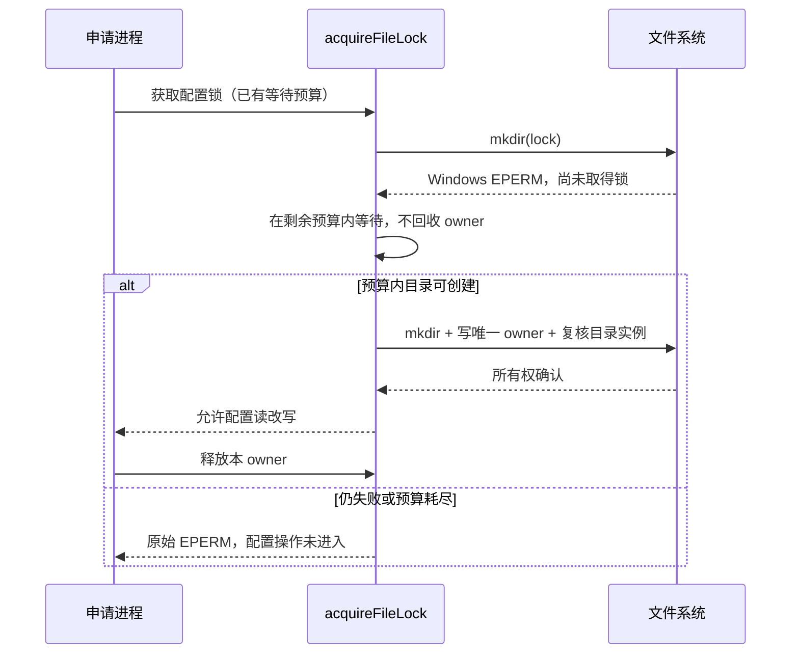

# 共享文件锁的 Windows 创建竞争

## 问题与所有者

Windows CI 的两个真实 Node 进程并发写 Provider 配置时，`mkdir(provider_config.json.lock)` 返回 `EPERM`，异常直接结束配置写入。上游 3.16.2 的共享工具只将 `EEXIST` 或已创建锁后丢失目录的 `ENOENT` 交给等待流程，缺少 Windows 创建阶段的短暂占用处理。具体占用者未被该次 CI 日志记录。

`acquireFileLock` 继续独占跨进程锁的创建、owner 文件复核与释放职责；`withFileLock` 保留同进程 FIFO。Provider Repository 在取得锁后读取并更新配置，不增加缓存、锁文件格式或第二套锁实现。

## 规则

- 仅在 Windows、尚未成功创建锁目录且 `mkdir` 返回 `EPERM` 时重试。沿用调用方的重试间隔和原 `maxWaitMs`，不增加等待预算。
- 该分支只等待后重新执行排他的 `mkdir`，不读取或删除其他进程的 owner，也不触发陈旧锁回收。重新创建成功后仍完成 inode 和唯一 owner 文件复核，随后才允许调用方写配置。
- 空重试列表或零等待预算立即返回原始 `EPERM`。预算耗尽时保留原错误及其 path/syscall；到期后不再尝试获取锁。
- 非 Windows 的 `EPERM`、其他创建错误，以及成功 `mkdir` 后的 owner 写入/复核错误，继续按原规则失败和清理本次 owner。
- `EEXIST` 的存活 owner 保护、陈旧实例识别、替换锁保护和显式锁超时保持原有语义。一次失败仍释放同进程 FIFO，让后续调用可重新尝试。

## 验证

OW-P019 故障注入覆盖一次及连续 `EPERM` 后恢复、持续失败的预算与原错误、零预算/禁用重试、非 Windows 与其他错误立即失败、owner 写入失败、活 owner 不被抢占，以及失败后的同进程队列恢复。等待使用受控时钟，目录和 owner 校验使用真实临时文件。

原 Provider 双进程写入回归加入 Core，继续断言双方全部更新及默认模型选择被保存；保留共享原子写入、陈旧锁/替换锁、Source Server 真实进程竞争和个人配置纯读回归，并执行三平台 Core / Extended。
