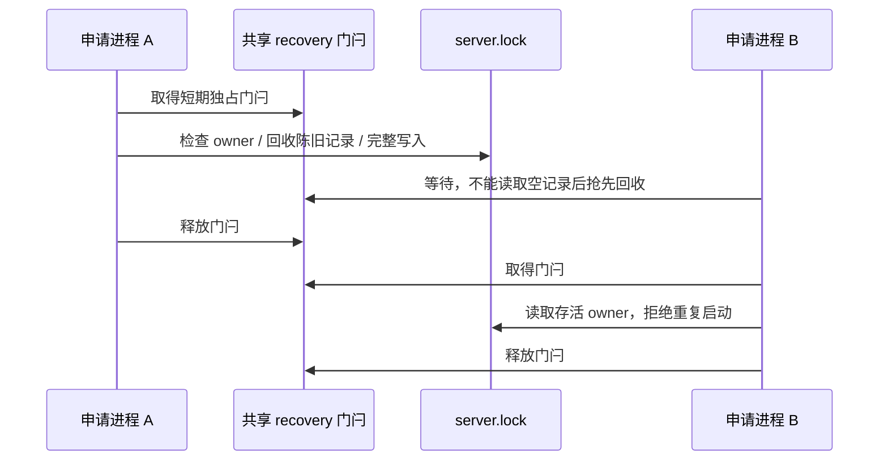

# Source Server 数据目录锁的取得顺序

## 问题与范围

Linux Extended 的真实八进程竞争用例出现两个 `success`。原 `DataRootLock` 先用 `open(wx)` 创建空文件，再写入 PID 和 ownerToken；竞争者会把这个初始化中的空文件当作损坏锁回收。旧 `.recovery` 门闩自身也有同样的空文件窗口。OW-P014 用阻塞首次建锁写入的回归验证该竞争，不以延长测试期限或重跑规避。

`DataRootLock` 仍是 Server 数据目录的唯一 owner。保留 `server.lock` JSON 格式、PID 存活检查、ownerToken、公开 acquire/release/inspect 接口和独立数据目录隔离。仅取得锁的临界区复用 `@zcode/shared/node` 的 `acquireFileLock`；不修改共享工具或 Supervisor 的状态机。

## 所有者和顺序

取得锁必须先持有共享文件锁工具创建的 `server.lock.recovery.lock` 门闩，再检查、回收并完整写入 `server.lock`。共享工具使用带唯一 owner 文件的目录和实例身份校验，避免把正在初始化的单文件门闩当作陈旧 owner 删除。完整记录写入后释放短期门闩，长期持有者继续由原 `server.lock` 表示。

门闩重试间隔保持 5ms；将原 100 次重试对应的 500ms 等待预算交给共享工具，ownerless grace 为该工具默认的 100ms。门闩到期仍返回已有的重复实例错误，权限和其他 IO 错误保持可见。释放时继续按原 ownerToken 校验，不删除后来者的记录。

## 验证

- 在首次启动和陈旧锁恢复两条路径，暂停首个 owner 的文件创建，第二个 owner 必须拒绝取得锁；放行后首个 owner 正常完成。
- 运行原八个真实进程竞争、损坏锁恢复、存活 owner 保护、替换 owner 保护和独立目录回归。
- 把完整锁回归文件加入 Core，执行 Supervisor/daemon、共享文件锁、根 typecheck/Lint、架构与工作流回归，再实跑三平台。
