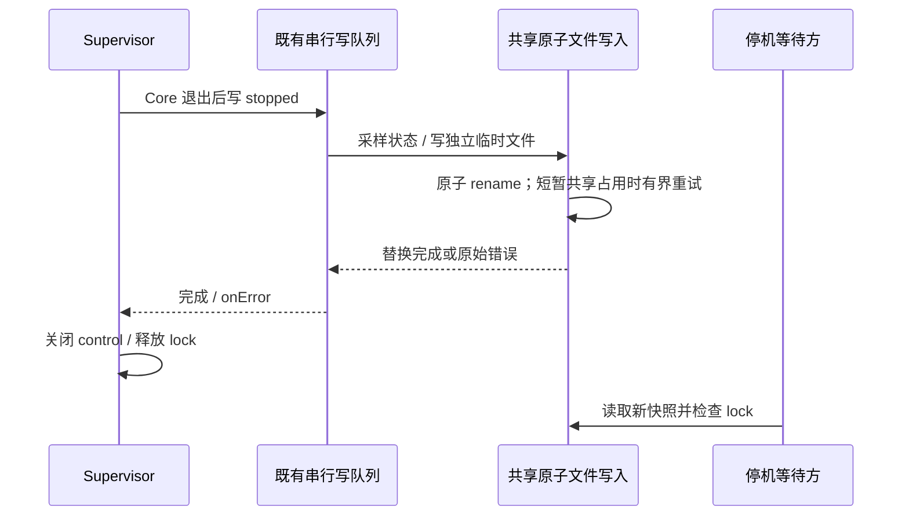

# Source Server 状态快照的原子替换

## 规则与证据

Supervisor 是生命周期状态的唯一所有者，`status.json` 是其串行写入的观测快照。停机等待方同时要求新 stopped 快照和 data-root lock 已释放；保留这两个条件。

Windows CI 的停机回归已记录最终状态文件 rename 的 EPERM，随后等待方超时。旧 persister 仅做一次 rename，记录错误后继续结束 Supervisor，导致 stopped 快照缺失且没有后续写入机会。上游 3.16.2 同样保留此实现。OW-P013 复用 `@zcode/shared/node` 的 `atomicWritePrivateTextFile` 修复该路径。

- 保留现有 inFlight 队列，前一次写入或错误处理完成后才采样和写入下一份状态。
- 写入独立临时文件，再原子替换目标；读取方始终看到完整旧快照或完整新快照。
- 复用共享工具对 EPERM、EBUSY、EACCES 的有界退避：50、100、200、400、800ms，总等待上限 1550ms。其他错误立即交给原 onError；持续占用在预算耗尽后同样报错。
- 失败时保留原目标文件并清理临时文件，后续写入仍可执行。永久失败不会被当作已发布的新状态，停机等待方保留原校验和期限。
- 状态格式、Supervisor 的关闭顺序、进程停止预算、客户端等待期限和测试期限保持。

## 回归

- 注入一次 EPERM、EBUSY、EACCES 后，确认 stopped 状态实际落盘，错误回调不触发。
- 持续占用与不可重试错误保留旧快照、只报告最终错误、清理临时文件；后续写入可恢复。
- 首次替换受阻时并发提交后续状态，验证快照采样和落盘仍按队列顺序，最终文件保留新状态。
- 反向验证原单次 rename 实现无法通过瞬时占用回归；运行原真实 Supervisor 停机等待测试、核心套件及三平台 CI。
