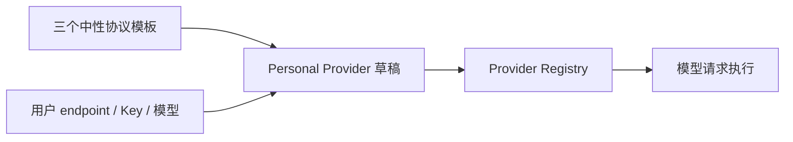

# 标准 Provider 模板

## 产品规则

OpenZWork 的内置 Provider 目录只提供三个中性协议模板：

| templateId | API type | 用途 |
| --- | --- | --- |
| `standard-anthropic-messages` | `anthropic-messages` | Anthropic Messages 兼容服务 |
| `standard-openai-chat-completions` | `openai-chat-completions` | OpenAI Chat Completions 兼容服务 |
| `standard-openai-responses` | `openai-responses` | OpenAI Responses 兼容服务 |

模板只预置协议类型和 API Key 接入方式；不预置厂商名称、Base URL、Logo、模型目录、能力规则或站点规则。用户创建 Provider 时选择协议模板，随后填写自己的 endpoint、Key 和模型。

内置配置允许保留：

- 三个中性模板；
- 通用模型默认值；
- 三个协议各自的通用请求参数映射；
- 三个模板的空模型目录。

内置配置不允许恢复：

- 第三方厂商模板或固定 Provider；
- 厂商域名、Logo、API Key 管理入口；
- 厂商模型目录、模型精确规则、站点差异化规则；
- 官方账号、套餐、Coding Plan、off-peak 或 highspeed Provider。

## 兼容边界

用户已有的 Personal Provider 记录不删除。旧版本由厂商模板继承的 Base URL、模型和能力规则不迁移到新内置配置；移除模板后这类 Provider 需要用户补齐 endpoint 和模型。用户显式保存过的 Key、模型覆盖与排序保持原样。

旧 `templateId` 不做隐藏兼容基线，避免厂商配置继续随产品分发。配置读取遇到未知 `templateId` 时按无模板基线处理。

## 状态所有者

| 状态 | 唯一所有者 |
| --- | --- |
| 三个中性模板与通用规则 | `config/provider/zcode-builtin.json` |
| Personal Provider 草稿与保存值 | Provider Config Service 的 personal config |
| 协议选项展示 | `ProviderApiTypeDataSchema` 与设置页协议选择器 |
| 模型事实 | 用户配置的模型 + 通用规则解析结果 |

## 验收

| ID | 场景 | 断言 |
| --- | --- | --- |
| SPT01 | 解析正式与测试内置配置 | 模板数量为 3，API type 分别对应三种协议，均无 Base URL、Logo 和内置模型 |
| SPT02 | 扫描内置配置 | 不含厂商模板、账号 Provider、厂商域名、站点规则、模板模型规则或固定 Provider 模型规则 |
| SPT03 | 创建协议模板实例 | 生成 Personal Provider，默认待填写 endpoint，不带入任何模型 |
| SPT04 | 保存自定义模型并解析 | 通用模型默认值和对应协议请求映射生效，不读取厂商站点规则 |
| SPT05 | 旧 Personal Provider 携带旧 templateId | 记录仍可读取，未删除用户覆盖；但不从旧厂商模板继承新事实 |

