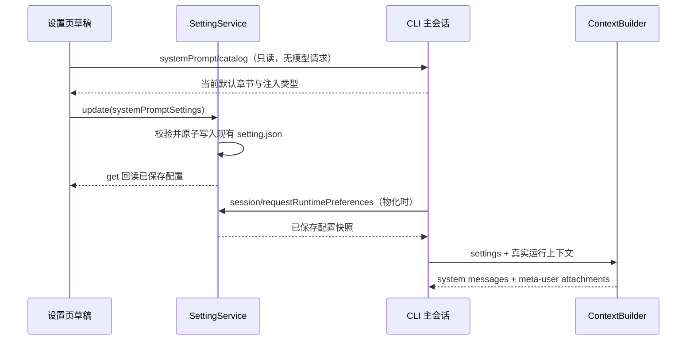

# 系统提示词设置

## 产品规则

设置侧栏在“记忆”旁增加“系统提示词”。用户可查看当前程序的默认规则，按章使用默认、追加、替换、关闭，或整体替换主会话 system 正文；可追加自定义章节。配置保存到现有 AppSettings 的 `systemPromptSettings`，唯一写入者仍为 SettingService。第一版针对交互式主会话；子智能体、工作流角色、后台任务保持原契约。

保存后，新建或重新物化的主会话读取设置；已经常驻的会话保持创建时的快照，包括正在执行的请求。页面明确显示这一生效时机。当前版本不提供运行中热更或模型级、项目级覆盖。主会话 fork 继承父 runtime 的快照，冷恢复重新读取当前 Host 设置。

逐章模式将角色、安全规则、Harness、沟通、执行确认、上下文管理、持续执行分别呈现；桌面说明、记忆指导和技能调用指导也可定制。环境信息、Git 状态、技能清单、用户指令/记忆索引、日期是运行时生成内容，只提供是否注入。提示词开关不改变工具注册、权限检查、记忆存储和自动压缩的真实配置。

整体替换模式替换所有默认 system 段（包括 CLI prefix），仍保留既有 meta-user 的技能清单、AGENTS.md/记忆索引和日期。页面显示保留范围。该模式独立于原有内部 `customSystemPrompt` 契约，不改变 legacy workflow 调用。章节配置在切换模式时保留，切回逐章后恢复；附加章节仅在逐章模式应用。

章节目录与默认文本由 CLI 的纯 ContextBuilder 辅助函数通过 `systemPrompt/catalog` 返回，UI 不复制默认文本。UI 使用共享纯函数生成本章预览。目录中动态章节使用占位说明，明确不作为当前会话的完整请求预览。记忆和桌面模板可使用 `{{memoryRoot}}`、`{{genUiOutputDirectory}}`，由 runtime 在组装时替换；不存在的功能条件保持关闭，用户定制不能凭空启用 Memory/Skill/Gen UI。

编辑器有明确保存、取消修改和恢复本章默认操作；切换章节保留草稿。未保存的内容不影响运行。保存失败保留草稿并给出错误。跨窗口刷新不能覆盖未保存草稿，检测配置冲突后要求重新加载，避免静默丢失编辑。保存时记录该章默认文本，后续默认变化可对照旧/新默认。未知章节、错误模式和超大内容在 schema 边界拒绝。

## 归属和事件顺序

桌面和手机 Web 使用同一个 Host 设置服务；远程执行沿现有 runtime preferences authority 回传控制端设置，不读取远端另一份全局配置。UI 不写 Repo；Host 不拼接提示词；CLI 不将完整提示词记录到普通日志。已有配置缺席时逐字保持默认提示词。旧 CLI 不认识目录方法时，编辑器显示升级错误，不能提供假默认或声称保存已生效。

## Impact Brief

| 字段 | 决定 |
|---|---|
| 模式/层级 | implementation-handoff；presentation、validation、persistence、commit-effect |
| 输入与授权 | 用户“你认为最该怎么做，做出来看看”；按推荐交付可用首版 |
| UI surface | SettingsPage 的 local Host 上下文；共享桌面/Web 响应式编辑器 |
| 草稿/默认 | React 草稿；默认来自 CLI catalog，持久配置来自 useSettings |
| 校验/提交 | shared schema；useSettings → SettingService.update → setting.json |
| runtime owner | 每个 AgentRuntime 保存创建时快照；ContextBuilder 唯一组装 |
| must-inspect | shared settings/schema、node runtime-preferences、CLI bootstrap、ContextBuilder、设置导航 |
| should-inspect | 用户指令、Memory、Skill 条件、输出风格、fork/子代理隔离、Web 同步 |
| invariant-only | 工具权限、原生操作、队列/stream、owner/lease、workspace identity |
| evidence-only | builder UT、Host 回调 UT、设置交互和文件回读 E2E |
| graph drift | 现有图没有主会话提示词能力；新增节点和公开 code seeds |
| 调用链证据 | codegraph 不可用；精确 rg + 源码读取，展开至 Host → bootstrap → runtime |
| 开放问题 | 无阻塞项；运行中热更、每项目/模型配置后续独立设计 |

## 验收与剪枝

| ID | 场景与动作 | 断言 | 层级 |
|---|---|---|---|
| SP01 | 默认配置/空配置 | 默认 system/meta-user 内容逐字不变 | core UT |
| SP02 | 追加、替换、关闭一个章节 | 仅本章改变；其他章及原注入角色不变 | core UT |
| SP03 | 整体替换 | 默认 system 退出，meta-user 保留；切回逐章配置仍在 | core/UI |
| SP04 | 关闭 Memory/Skill 条件后配置对应章 | 定制不启用缺席的功能；生成数据不可伪装为静态事实 | core UT |
| SP05 | 新建主会话/父子/工作流/fork/重新物化 | 主会话采用 Host 快照，子代理不继承定制，fork 继承快照 | bootstrap/core |
| SP06 | UI 编辑、取消、保存、重新打开 | 草稿隔离，文件回读相符，默认恢复生效 | pending E2E |
| SP07 | 保存失败/跨窗口刷新 | 保留草稿；失败可重试；不覆盖迟到快照 | UI UT |
| SP08 | 手机宽度、深浅主题、中英文 | 章节切换、编辑、保存及预览可用 | UI/browser |
| SP09 | 保存模板后默认更新 | 显示保存时默认和当前默认，用户覆盖保留 | UI UT |
| SP10 | 非法章节/非法模式/过大文本 | 保存/协议解析拒绝；无默认值静默吞错 | schema UT |

多模型、费用、真实第三方 API 不改变本功能语义，使用合成数据剪枝；所有验证无推理费用。手机复用同一编辑组件的窄屏验证，远控传输复用既有服务并由 runtime preference 单测验证配置投影；不宣称真实远端主机已验收。E2E 候选保留在 manual-review/pending，不自动转正或加入 Docker/CI。
