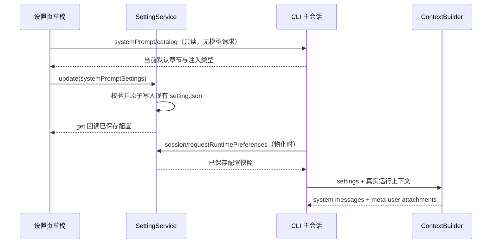

# 系统提示词设置

## 产品规则

设置侧栏在“记忆”旁增加“系统提示词”。用户可查看当前程序的默认规则，按章使用默认、追加、替换、关闭，或整体替换主会话 system 正文；可追加自定义章节。配置保存到现有 AppSettings 的 `systemPromptSettings`，唯一写入者仍为 SettingService。第一版针对交互式主会话；子智能体、工作流角色、后台任务保持原契约。

保存后，新建或重新物化的主会话读取设置；已经常驻的会话保持创建时的快照，包括正在执行的请求。页面明确显示这一生效时机。当前版本不提供运行中热更或模型级、项目级覆盖。主会话 fork 继承父 runtime 的快照，冷恢复重新读取当前 Host 设置。

逐章模式将角色、安全规则、Harness、沟通、执行确认、上下文管理、持续执行分别呈现；桌面说明、记忆指导和技能调用指导也可定制。环境信息、Git 状态、技能清单、用户指令/记忆索引、日期是运行时生成内容，只提供是否注入。提示词开关不改变工具注册、权限检查、记忆存储和自动压缩的真实配置。

整体替换模式替换默认行为规则（包括 CLI prefix），保留运行时能力说明、记忆位置与检索方式、当前输出风格，以及环境、Git、技能清单、AGENTS.md/记忆索引和日期。五类动态数据的注入开关在两种模式下均生效；切换模式保留章节配置，规则覆盖与附加章节仅在逐章模式应用。页面在整体替换输入框下提供动态数据开关。该模式独立于原有内部 `customSystemPrompt` 契约，不改变 legacy workflow 调用。

章节目录与默认文本由 CLI 的纯 ContextBuilder 辅助函数通过 `systemPrompt/catalog` 返回，UI 不复制默认文本。目录区分可编辑规则、自动保留的运行内容和纯动态数据。桌面章的可编辑默认值不含 Gen UI 可用性与真实路径；记忆章不含记忆位置和随检索分支变化的索引要求；输出风格章编辑补充规则，当前选中的风格仍自动注入。关闭这些章节仅关闭可编辑规则，运行内容仍保留。Skill 指导只在工具已注册且存在技能时生效；Memory 只在提供 memoryRoot 时生效，桌面说明只在桌面 surface 生效。

目录提供合成运行情景：桌面有/无可视化目录、终端、记忆启用/关闭、Skill 可用/不可用、输出风格有/无。UI 可切换本章情景预览，预览与 runtime 共用纯解析函数；示例路径使用 `/example/`，不读取真实用户目录和会话数据。此预览不表示当前会话的完整请求。仅配置缺席或使用默认时，system/meta-user 保持原有字节；追加保留当前完整默认，替换/关闭规则保留当次运行内容。记忆和桌面自定义文本继续支持 `{{memoryRoot}}`、`{{genUiOutputDirectory}}`；默认值不再用变量伪装能力条件。

2026-10-25 动态修正：旧目录将 `buildDesktopContextSection("{{genUiOutputDirectory}}")` 的启用分支当成默认模板；用户原样替换后，未提供目录也会宣称支持 Gen UI。回归要求在无目录时明确不可用、有目录时使用当次目录，不能保存预览情景的状态。目录版本升为 2，携带严格校验的情景模板；持久化设置仍为 version 1，本功能尚未发布，不引入迁移或第二份设置。

编辑器有明确保存、取消修改和恢复本章默认操作；切换章节保留草稿。未保存的内容不影响运行。保存失败保留草稿并给出错误。跨窗口刷新不能覆盖未保存草稿，检测配置冲突后要求重新加载，避免静默丢失编辑。保存时记录该章默认文本，后续默认变化可对照旧/新默认。未知章节、错误模式和超大内容在 schema 边界拒绝。

## 归属和事件顺序

桌面和手机 Web 使用同一个 Host 设置服务；远程执行沿现有 runtime preferences authority 回传控制端设置，不读取远端另一份全局配置。UI 不写 Repo；Host 不拼接提示词；CLI 不将完整提示词记录到普通日志。已有配置缺席时逐字保持默认提示词。旧 CLI 不认识目录方法时，编辑器显示升级错误，不能提供假默认或声称保存已生效。

## Impact Brief

| 字段 | 决定 |
|---|---|
| 模式/层级 | implementation-handoff；presentation、validation、persistence、commit-effect |
| 输入与授权 | 用户“你认为最该怎么做，做出来看看”；按推荐交付可用首版 |
| UI surface | SettingsPage 的 local Host 上下文；共享桌面/Web 响应式编辑器 |
| 草稿/默认 | React 草稿；默认来自 CLI catalog，持久配置来自 useSettings |
| 校验/提交 | shared schema；useSettings → SettingService.update → setting.json |
| runtime owner | 每个 AgentRuntime 保存创建时快照；ContextBuilder 唯一组装 |
| must-inspect | shared settings/schema、node runtime-preferences、CLI bootstrap、ContextBuilder、设置导航 |
| should-inspect | 用户指令、Memory、Skill 条件、输出风格、fork/子代理隔离、Web 同步 |
| invariant-only | 工具权限、原生操作、队列/stream、owner/lease、workspace identity |
| evidence-only | builder UT、Host 回调 UT、设置交互和文件回读 E2E |
| graph drift | 现有图没有主会话提示词能力；新增节点和公开 code seeds |
| 调用链证据 | codegraph 不可用；精确 rg + 源码读取，展开至 Host → bootstrap → runtime |
| 开放问题 | 无阻塞项；运行中热更、每项目/模型配置后续独立设计 |

## 验收与剪枝

| ID | 场景与动作 | 断言 | 层级 |
|---|---|---|---|
| SP01 | 默认配置/空配置 | 默认 system/meta-user 内容逐字不变 | core UT |
| SP02 | 追加、替换、关闭一个章节 | 仅本章改变；其他章及原注入角色不变 | core UT |
| SP03 | 整体替换 | 固定规则退出，实时能力与动态数据保留，数据开关生效；切回逐章配置仍在 | core/UI |
| SP04 | 关闭 Memory/Skill 条件后配置对应章 | 定制不启用缺席的功能；生成数据不可伪装为静态事实 | core UT |
| SP05 | 新建主会话/父子/工作流/fork/重新物化 | 主会话采用 Host 快照，子代理不继承定制，fork 继承快照 | bootstrap/core |
| SP06 | UI 编辑、取消、保存、重新打开 | 草稿隔离，文件回读相符，默认恢复生效 | pending E2E |
| SP07 | 保存失败/跨窗口刷新 | 保留草稿；失败可重试；不覆盖迟到快照 | UI UT |
| SP08 | 手机宽度、深浅主题、中英文 | 章节切换、编辑、保存及预览可用 | UI/browser |
| SP09 | 保存模板后默认更新 | 显示保存时默认和当前默认，用户覆盖保留 | UI UT |
| SP10 | 非法章节/非法模式/过大文本 | 保存/协议解析拒绝；无默认值静默吞错 | schema UT |
| SP11 | 桌面默认原文替换；切换 Gen UI 有/无、终端 | 动态事实由当次运行决定，无空目录支持声明 | core UT |
| SP12 | Memory 默认/追加/替换/关闭 × 根目录有/无 | 规则可改，位置和索引策略保留，无根目录不出现章节 | core UT |
| SP13 | 输出风格规则替换后切换风格 | 新风格来自当次配置，旧风格不固定进规则 | core UT |
| SP14 | 切换本章情景；替换默认；保存与重进 | 预览显示当次合成条件，情景不持久化，规则保存 | UI / pending E2E |
| SP15 | 整体替换时关闭环境/用户上下文后切回 | 两模式共用同一数据开关；规则草稿保留 | core/UI |

动态修正的影响层为 presentation、draft-default、validation、commit-effect；唯一持久化 owner 与调用路径不变。must-inspect 为 shared 解析/目录 schema、CLI context builders、设置编辑器；should-inspect 为输出风格与 Skill/Memory 条件；工具注册、权限、压缩、fork/子代理身份为 invariant-only。没有 codegraph 工具，沿现有 seeds 通过精确源码检索核对到深度 2。真实远端、推理模型和供应商组合不改变纯文本语义，剪枝为合成数据；原有创建期快照与并发保存测试复用。图谱补充运行事实始终由 CLI 决定的不变量。

多模型、费用、真实第三方 API 不改变本功能语义，使用合成数据剪枝；所有验证无推理费用。手机复用同一编辑组件的窄屏验证，远控传输复用既有服务并由 runtime preference 单测验证配置投影；不宣称真实远端主机已验收。E2E 候选保留在 manual-review/pending，不自动转正或加入 Docker/CI。
