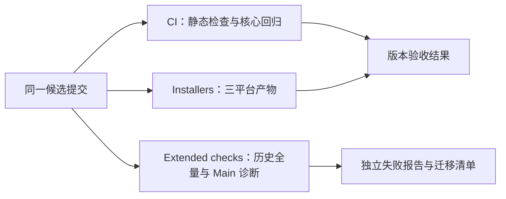
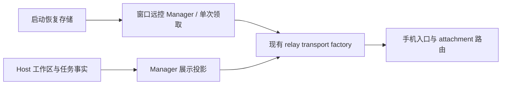
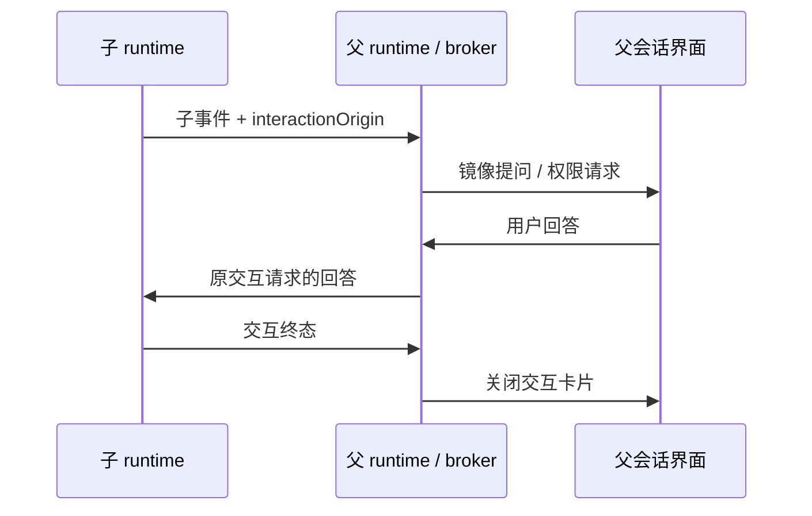
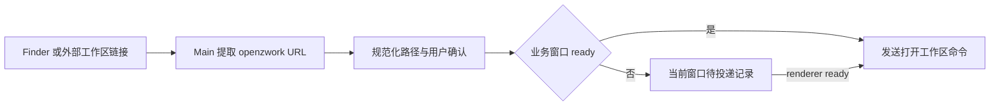
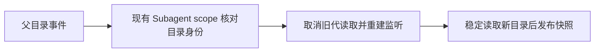

# ZCode v3.15.1 整合验收

## 范围与产品规则

- 上游基线固定为 `aac47556`，后续 v3.16.1 单独同步。
- 官方登录、套餐、遥测、分享和 CUA 沿用已有移除范围；保留标准 MCP、Browser Use、node_repl、远程工作区、动态工作流和 GenUI/MCP Apps。
- 混合测试仅移除已取消功能的用例与 fixture；远程连接、Host 服务装配、进程生命周期等保留能力仍需覆盖。
- 桌面和远端资产清单仅引用仓库实际保留的模块。CLI 产物从当前 TypeScript 源码构建，旧编译文件不得遮蔽本次新增行为。
- CLI 使用 `--workflow-mode disabled|onDemand|alwaysOn`；已退役的 `--enable-workflow` 在创建会话前作为未知参数拒绝。帮助中只列出保留的命令和参数。
- Desktop Main 复用共享构建定义，不注入官方遥测配置。生产压缩、开发 sourcemap 与 E2E coverage 构建约定保留，配置模块必须能独立加载。
- GenUI 固定版本资源及许可原文按 Git blob 字节保存；Windows checkout 不转换其换行，构建继续执行清单的 SHA-256 校验。
- 连接作用域测试只调用当前服务合同；已取消的进程资源、MCP 遥测和 CUA 观察接口不进入测试 mock。现存 conversation fact 和各 topic 的连接归属断言保留。
- 工作流侧面板不读取已移除的官方灰度源；保留运行状态、命令、产物和用户交互的回归覆盖。
- 已退役输入的协议拒绝测试集中在现有清理测试入口，直接加载真实 schema；全仓残留扫描的范围和现有豁免保持不变。
- 外部 relay transport 保留握手、配对、心跳和重连状态机及本地日志，不导入已移除的网络遥测模块。远程重连测试仅传递当前平台合同中的目标和工作区身份。
- 打开本地工作区的 deep link 保留路径规范化、编码与单实例转发；共享的路径处理不依赖已移除的官方登录回调。
- MCP 用户配置和远端同步使用 OpenZWork 的 `.openzwork/cli/config.json` 数据根；测试使用隔离 home，继续验证读取、禁用状态迁移、写权限、密钥保留、路径改写和重名冲突。
- 插件 MCP 参数保持模板替换语义。路径参数在平台路径规范化后比较，Windows 上混合斜杠不能被误判为目标文件变化。
- 远端服务只代理当前保留的 RPC channel，媒体预览仍需逐连接注册；工作流侧面板保留只读嵌套会话和 focus 传递，测试不要求已取消的客户端配置和遥测接口。

## CI/CD 验收口径

- 本版本以核心自动化 CI 与三平台 Installers 成功为完成条件，不要求人工 UAT、试装、真实用户或历史用户数据升级验收。
- `CI` 保留根类型检查、lint、架构检查、Agent 类型检查、CLI 真实构建产物检查、清理约束和核心功能回归。核心用例清单按保留能力维护，缺少清单中的文件直接失败，不能自动跳过。
- 核心回归覆盖协议、会话状态和恢复、Host 装配与生命周期、标准 MCP、Browser Use、node_repl、工作流和 GenUI/MCP Apps。已损坏的核心混合测试先恢复保留场景，不通过删除测试降低门禁。
- `Extended checks` 独立运行完整历史测试和 Desktop Main 基线诊断。失败保持真实状态、日志与产物，不作为本轮合并或发布的前置条件；发现保留能力的实际回归后，将其修复和定向回归纳入核心 CI。
- 完整历史测试按包分组执行（`scripts/run-full-suite-groups.mjs`）：每组独立进程、独立 JSON 报告与组级时限，超时或崩溃的组标记 cancelled 后继续跑其余组，job 级超时预算覆盖分组总和加余量。任何一组的失败不再让整个 job 的诊断全部丢失。
- 净化合并中产生的孤儿/损坏用例按移除范围清理：`e2eBeforeSessionSetup.test.ts` 在 v3.15.1 合并冲突解决时被截断为语法错误，且其唯一依赖 `e2e/helpers/e2e-before-session` 已随账号/套餐 mock 链移除，按孤儿用例删除，不作为保留能力回归。
- 需要真实 Electron 的扩展测试使用完整安装环境；核心检查继续采用不执行安装脚本的轻量安装。真实 Electron 断言不能以空模拟对象代替。
- Installers 与核心、扩展检查独立并行。当前 CI 内已有的路径、远端 bundle 和本地传输自动化测试仍保留，其结果不扩大表述为真实 SSH/WSL/Docker 人工验收。
- 额外 Main 类型诊断作为排查输入，不自动增加新的发布条件。候选检查不会自动合并、打 tag 或发布，也不修改仓库权限或分支保护。

## 所有者和接口

- `createLocalServices` 创建并注册 GenUI、Plugin UI Bridge、Sampling 和 App Tools；调用方通过现有 RPC 服务描述符访问。
- GenUI 的输出文件、持久状态和沙箱注册继续遵循 `gen-ui-service/CONTRACT.md` 的本地与远端边界。
- OpenZWork 没有官方账号；MCP App 使用稳定的空账号上下文摘要。真正的实例归属仍由 Agent 签发的 runtimeId、generation、token 和 workspace/session scope 校验，不接收页面提供的账号。
- 子 runtime 写入自己的事件流；父 runtime 只镜像交互事件，保留 origin，回答由现有父会话 broker 路由回子 runtime，不复制业务队列。
- 远控 Manager 持有窗口对应的工作区与任务展示投影、启动恢复的单次领取状态，并通过现有 factory 创建 relay transport；移除遥测时保留这些业务初始化。

## 验收场景

1. 真实 `createLocalServices` 经 RPC 可调用 `gen-ui/listState`、`gen-ui/readDocument` 和 `plugin-ui-bridge/prepareSandbox`。仅 Agent 和 Main 原生边界使用 fixture，不以字符串注册断言代替调用验证。
2. Server 连接保持 desktop-continuous 与 web-remote-replayable 两种交付语义，并验证一次性 Host capability 和资源回查归属。外部 relay 的真实 socket transport、Manager 启动恢复、bridge attachment、历史重连与手机版本处理独立进入三平台 CI。
3. 工作流子代理提问与权限请求可在父会话显示、回答并终结；沿用 bootstrap 的行为测试，失败必须进入 CI 结果。
4. 实际生成的 CLI 接受 `--workflow-mode`，并继续拒绝未知参数；验证入口必须使用产物或能证明产物输入来源的构建测试。
5. Node 24.14.0 / pnpm 11.28.6 的干净安装执行根类型检查、lint、架构检查、Agent 类型检查和核心单元测试；完整历史套件在独立扩展工作流中报告。安装仅依赖 lockfile，不搬回本机历史 `.ignored` 内容。
6. 三平台安装包通过独立 Installers 工作流构建；核心 CI、扩展检查、打包、合并和发布分别记录结果。候选验证不自动合并或发布。
7. Host 服务装配、远端权威和 Server 连接回归在全量单元测试之前独立执行，使关键连接能力的失败可直接定位。

## 首次 MCP OAuth 授权

保留的标准 MCP OAuth 在第一次写凭据前即可申请授权租约。租约模块负责先异步创建凭据父目录，再执行原有互斥抢锁；目录不可写时继续上报 IO 错误，不进入 follower 等待。核心 CI 固定执行尚无凭据目录的回归，不依赖开发机已有配置。

## 历史测试迁移与协议 fixture

- fake Agent 是其测试协议响应的唯一所有者：每个请求 ID 只返回一次结果或错误，通知和反向请求的响应不再触发响应。订阅的 ACK 与后续 frame 通知保持顺序；延迟 unsubscribe/resync 也遵守单次响应。回归通过真实子进程的完整 stdout 验证，不以客户端忽略重复包作为通过依据。
- 保留能力的测试遵循当前用户数据根、严格 schema 和启动协议；用户级路径使用 `.openzwork`，项目 `.zcode`、插件 manifest 和 ignore 约定保持现状。mock 按方法返回对应协议结果，业务断言保留目标调用次数、顺序和状态所有权。
- 退役功能的专属用例按已有移除范围逐项清理；混合文件保留通用功能与拒绝旧输入的断言。公共 helper 仅迁移保留能力的依赖，不恢复官方账号、遥测或分享链。
- 修复后的保留能力回归纳入核心清单；扩展套件继续保留真实失败与分组产物，不通过排除未解释失败或放宽产品 schema 消除红灯。

- Provider 同步沿用上游 `aac47556` 的默认偏好语义（见 `docs/remote/provider-provisioning.md`）：默认模型、Provider 或 reasoning 失效不阻断完整配置复制，也不改写持久化偏好；目标 Host 使用现有推荐逻辑。Target 继续独占写入、Registry 刷新、幂等提交与 CAS 回滚，真实失败返回对应阶段码。账号 settings 与 OAuth 依赖保持既有净化范围。

- WP-05 已移除的 telemetry/ARMS 发送、采样、上报与其 UI hook 专属测试随该领域清理；混合 IPC、URL 校验、通用协议与本地日志导出断言保留。物理删除约束继续由 `tests/private-cleanup/cleanup.test.cjs` 验证，核心清单不减少。

- E2E 通用依赖按各自固定上游版本恢复，用户数据根使用 `.openzwork`；工作区、ToolSearch、冷恢复与手机远控场景保留。测试准备使用当前本地职业设置、Personal Provider 和设备配对协议，不恢复官方账号、套餐连接、账号锚定引导记录或账号 relay。

- 根单元测试统一注册到 Vitest：新增的本地路径、记忆迁移、命令改名和本地使用统计回归不再在 Vitest worker 中启动另一个 Node test runner。断言、隔离目录和平台跳过条件保留，文件系统观察改用等价的 Vitest spy。

- WP-04/06/07 已移除的官方账号、套餐、Client Scenes、分享、云端反馈和自动更新专属回归随对应实现退役；包含性能模式、本地反馈 CAS、workspace deep link、IPC URL 验证或协议 ACK 的混合文件保留这些场景。

- Provider 分发沿用上游 v2 防误删合同：新 Source 只发送 Personal Config，独立 Credential Store 不属于 OpenZWork 同步范围；新 Target 兼容接收 v1 的历史 account-provider 字段但不读取、应用或删除这些 Key。v2 非空历史凭据直接拒绝。旧 Target 必须在写入前拒绝 v2；Personal 文件的 Key、默认偏好、原子替换和 CAS 回滚保持原合同。

- 3.16.1 保留的 Skill 事实字段沿用固定上游安全标识规则：限定字符与长度，并拒绝密钥形态；只恢复协议校验，不引入已移除的遥测发送或账号依赖。

## 保留 UI 测试合同修复

- 自动化、工作流中枢、终端链接和启动门禁保留当前入口与断言；净化时截断的测试从固定上游恢复完整结构。工作流按 fork 本地开放规则验证，不恢复官方灰度状态源。
- 内存诊断保留本地日志及采样门控；不测试已删除的外部采样上报。Provider 表单与模型选择使用 Personal Provider fixture，旧账号/套餐专用断言按既有移除范围清理。
- 资源管理器保留 CPU/内存/存储切页与在途请求不叠加测试，网络遥测页已移除。Prompt 历史仍验证发送前持久化、失败回滚和草稿保护，使用当前 submission 合同。

## Desktop 构建与保留测试

- macOS Dev bundle 的来源指纹仍由既有构建脚本在副本同级写入。补齐 Node path 导入，避免首次准备和指纹校验时抛出 ReferenceError；不改写原 Electron runtime。
- Desktop 用户日志、临时附件、工作流产物和 bootstrap setting 的测试使用 `.openzwork`；深链注册和安装包身份使用 OpenZWork 标识。
- 自动更新、官方 OAuth/购买、远端遥测的专用用例按已有移除范围清理；保留窗口退出、附件回收、远程重连和本地导出日志能力测试。

- Main 的 `OpenExternal` 对 `file:` URL 复用 `openFileUrlInDefaultApp`，解码后交给 `shell.openPath`；非法编码记录失败，不交给外部 URL launcher。HTTP(S) 仍交给 `shell.openExternal`。该分流与固定上游一致，保留共享路径入口及异步错误处理。

- 深链提取与 workspace 路由使用已注册的 `openzwork:` scheme，保留编码、分隔符、冷启动与单实例转发规则；官方账号/购买/分享回调仍不注册。原 `zcode:` 属于上游产品，不作为本 fork 的注册入口。

- Finder “在 OpenZWork 中打开”写入独立的 `Open in OpenZWork.workflow` 与 bundle ID，生成 `openzwork:` 工作区链接。已有 `Open in ZCode.workflow` 文件原样保留。
- E2E 构建缓存纳入当前编译配置读取的 `ZCODE_CDN_BASE_URL`；切换自管资产地址后不能复用旧桌面产物。

## E2E 基础设施入口恢复

- WDIO 复用固定上游版本的 Electron service、renderer preflight、按 run/cid 隔离的应用副本、进程回收与报告流程。before 只记录 worker 身份，Mocha root hook 在 service 完成后执行实际 preflight。
- 隔离用户根为 `.openzwork`。Provider seed 仅写当前 Personal Config，必须由显式 E2E Provider 参数提供；普通 smoke 不需要账号或真实模型调用。官方登录、套餐、遥测、远端灰度、Client Scenes fixture 不进入入口。
- 初始化失败交由 Mocha root hook 终止用例；清理完成后保留报告，禁止将无法启动当作通过。该恢复通过类型与基础设施单测验收；实际桌面/SSH/手机全流程需单独运行已有 E2E。

- 核心 CI 提供 `workflow_dispatch`，当分支更新没有自动触发 PR checks 时，可对当前候选 head 显式执行同一套三平台门禁；验收必须回读 run 的 head SHA。

- compact ACK 回归保留真实子进程响应，直接验证请求使用 5 分钟专用超时；进程启动与工作区同步使用正常超时，不把 runner 调度延迟当作 compact 行为。浏览器 LocalStorage 快照回归显式禁用可执行文件发现，避免 CI 的 `CHROME_PATH` 改变用例前提。

- Subagent 配置目录被替换后，单个 scope 必须取消旧代读取并重建监听；目录身份由 `dev`、`ino` 和 `birthtimeMs` 共同判定，不能在 Linux 复用 inode 时接纳旧读取结果。普通子文件更新不改变目录出生时间，仍按原增量路径处理。

- 跨平台回归使用规范化临时目录，与 CLI 的 canonical Server root 保持同一 IPC 身份；文件链接和 ESM 预加载用 `file:` URL。流式下载回归保证总耗时长于单次空闲时限，同时给 Windows 建连与调度留出实际余量。

- 组件归档的 tar 列表校验必须等子进程 `close`（stdout/stderr 完整结束），才判断路径和链接类型。`exit` 先于输出收尾时不能把不完整列表当作安全归档，也不能开始解压。

- Subagent E2E stdio 代理只允许一层子进程。预加载自身使用 file URL，移除时同时兼容原路径形式；子进程携带显式已代理标记，任何重复预加载都不得再 spawn。代理测试的子进程有 10 秒退出上限，并在每项测试结束时回收，验证失败不能留下后台进程。

- Windows NSIS 快捷方式 smoke 继续验证有效链接保留参数、失效链接修复、用户删除的链接不重建。隔离夹具编译时启用目标读取诊断，记录环境变量设置与 PowerShell 退出结果；正式安装包不启用此诊断，不能以空读取结果放宽断言。
