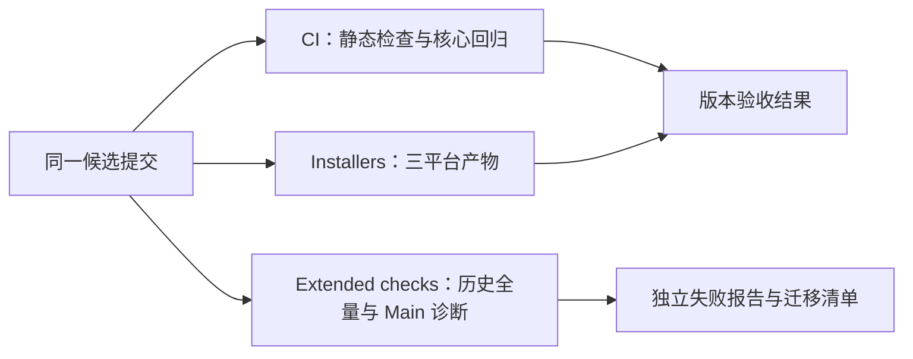
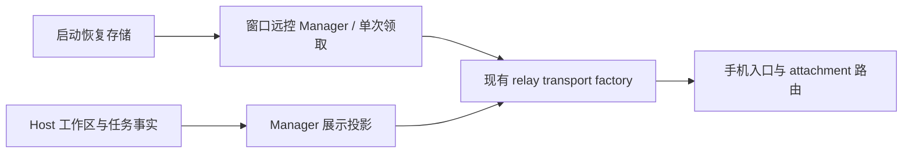
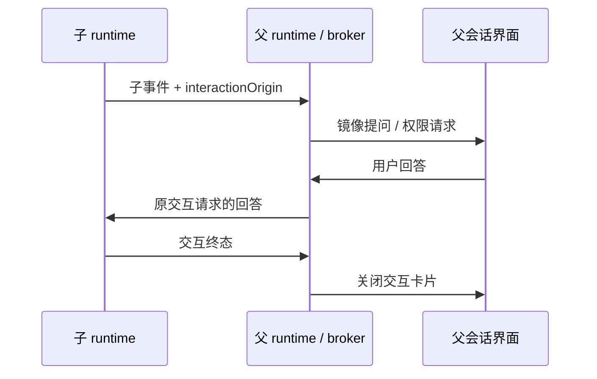

# ZCode v3.15.1 整合验收

## 范围与产品规则

- 上游基线固定为 `aac47556`，后续 v3.16.1 单独同步。
- 官方登录、套餐、遥测、分享和 CUA 沿用已有移除范围；保留标准 MCP、Browser Use、node_repl、远程工作区、动态工作流和 GenUI/MCP Apps。
- 混合测试仅移除已取消功能的用例与 fixture；远程连接、Host 服务装配、进程生命周期等保留能力仍需覆盖。
- 桌面和远端资产清单仅引用仓库实际保留的模块。CLI 产物从当前 TypeScript 源码构建，旧编译文件不得遮蔽本次新增行为。
- CLI 使用 `--workflow-mode disabled|onDemand|alwaysOn`；已退役的 `--enable-workflow` 在创建会话前作为未知参数拒绝。帮助中只列出保留的命令和参数。
- Desktop Main 复用共享构建定义，不注入官方遥测配置。生产压缩、开发 sourcemap 与 E2E coverage 构建约定保留，配置模块必须能独立加载。
- GenUI 固定版本资源及许可原文按 Git blob 字节保存；Windows checkout 不转换其换行，构建继续执行清单的 SHA-256 校验。
- 连接作用域测试只调用当前服务合同；已取消的进程资源、MCP 遥测和 CUA 观察接口不进入测试 mock。现存 conversation fact 和各 topic 的连接归属断言保留。
- 工作流侧面板不读取已移除的官方灰度源；保留运行状态、命令、产物和用户交互的回归覆盖。
- 已退役输入的协议拒绝测试集中在现有清理测试入口，直接加载真实 schema；全仓残留扫描的范围和现有豁免保持不变。
- 外部 relay transport 保留握手、配对、心跳和重连状态机及本地日志，不导入已移除的网络遥测模块。远程重连测试仅传递当前平台合同中的目标和工作区身份。
- 打开本地工作区的 deep link 保留路径规范化、编码与单实例转发；共享的路径处理不依赖已移除的官方登录回调。
- MCP 用户配置和远端同步使用 OpenZWork 的 `.openzwork/cli/config.json` 数据根；测试使用隔离 home，继续验证读取、禁用状态迁移、写权限、密钥保留、路径改写和重名冲突。
- 插件 MCP 参数保持模板替换语义。路径参数在平台路径规范化后比较，Windows 上混合斜杠不能被误判为目标文件变化。
- 远端服务只代理当前保留的 RPC channel，媒体预览仍需逐连接注册；工作流侧面板保留只读嵌套会话和 focus 传递，测试不要求已取消的客户端配置和遥测接口。

## CI/CD 验收口径

- 本版本以核心自动化 CI 与三平台 Installers 成功为完成条件，不要求人工 UAT、试装、真实用户或历史用户数据升级验收。
- `CI` 保留根类型检查、lint、架构检查、Agent 类型检查、CLI 真实构建产物检查、清理约束和核心功能回归。核心用例清单按保留能力维护，缺少清单中的文件直接失败，不能自动跳过。
- 核心回归覆盖协议、会话状态和恢复、Host 装配与生命周期、标准 MCP、Browser Use、node_repl、工作流和 GenUI/MCP Apps。已损坏的核心混合测试先恢复保留场景，不通过删除测试降低门禁。
- `Extended checks` 独立运行完整历史测试和 Desktop Main 基线诊断。失败保持真实状态、日志与产物，不作为本轮合并或发布的前置条件；发现保留能力的实际回归后，将其修复和定向回归纳入核心 CI。
- 需要真实 Electron 的扩展测试使用完整安装环境；核心检查继续采用不执行安装脚本的轻量安装。真实 Electron 断言不能以空模拟对象代替。
- Installers 与核心、扩展检查独立并行。当前 CI 内已有的路径、远端 bundle 和本地传输自动化测试仍保留，其结果不扩大表述为真实 SSH/WSL/Docker 人工验收。
- 额外 Main 类型诊断作为排查输入，不自动增加新的发布条件。候选检查不会自动合并、打 tag 或发布，也不修改仓库权限或分支保护。

## 所有者和接口

- `createLocalServices` 创建并注册 GenUI、Plugin UI Bridge、Sampling 和 App Tools；调用方通过现有 RPC 服务描述符访问。
- GenUI 的输出文件、持久状态和沙箱注册继续遵循 `gen-ui-service/CONTRACT.md` 的本地与远端边界。
- OpenZWork 没有官方账号；MCP App 使用稳定的空账号上下文摘要。真正的实例归属仍由 Agent 签发的 runtimeId、generation、token 和 workspace/session scope 校验，不接收页面提供的账号。
- 子 runtime 写入自己的事件流；父 runtime 只镜像交互事件，保留 origin，回答由现有父会话 broker 路由回子 runtime，不复制业务队列。
- 远控 Manager 持有窗口对应的工作区与任务展示投影、启动恢复的单次领取状态，并通过现有 factory 创建 relay transport；移除遥测时保留这些业务初始化。

## 验收场景

1. 真实 `createLocalServices` 经 RPC 可调用 `gen-ui/listState`、`gen-ui/readDocument` 和 `plugin-ui-bridge/prepareSandbox`。仅 Agent 和 Main 原生边界使用 fixture，不以字符串注册断言代替调用验证。
2. Server 连接保持 desktop-continuous 与 web-remote-replayable 两种交付语义，并验证一次性 Host capability 和资源回查归属。外部 relay 的真实 socket transport、Manager 启动恢复、bridge attachment、历史重连与手机版本处理独立进入三平台 CI。
3. 工作流子代理提问与权限请求可在父会话显示、回答并终结；沿用 bootstrap 的行为测试，失败必须进入 CI 结果。
4. 实际生成的 CLI 接受 `--workflow-mode`，并继续拒绝未知参数；验证入口必须使用产物或能证明产物输入来源的构建测试。
5. Node 24.14.0 / pnpm 11.28.6 的干净安装执行根类型检查、lint、架构检查、Agent 类型检查和核心单元测试；完整历史套件在独立扩展工作流中报告。安装仅依赖 lockfile，不搬回本机历史 `.ignored` 内容。
6. 三平台安装包通过独立 Installers 工作流构建；核心 CI、扩展检查、打包、合并和发布分别记录结果。候选验证不自动合并或发布。
7. Host 服务装配、远端权威和 Server 连接回归在全量单元测试之前独立执行，使关键连接能力的失败可直接定位。
