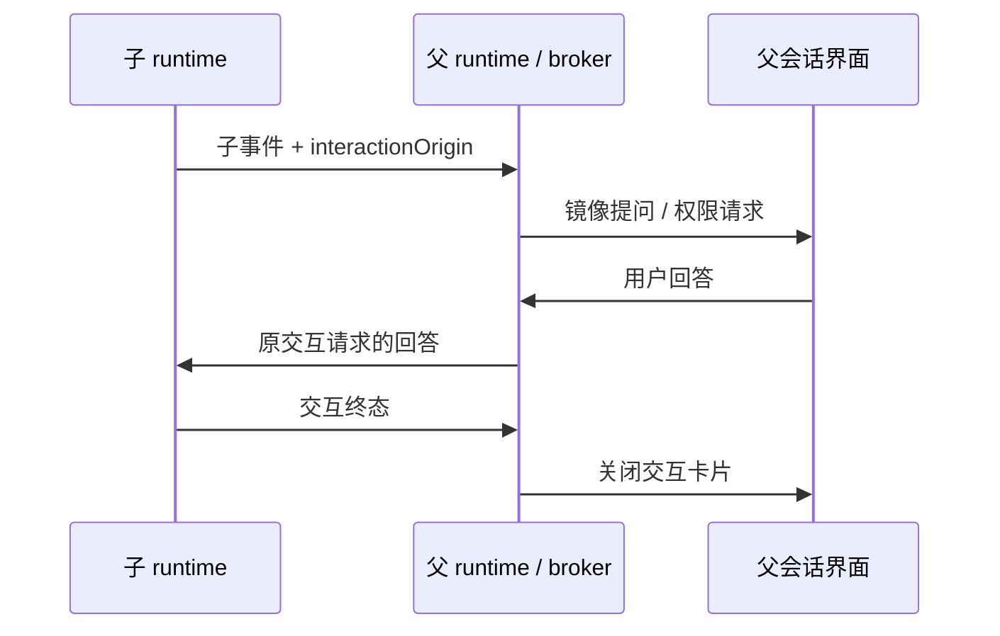

# ZCode v3.15.1 整合验收

## 范围与产品规则

- 上游基线固定为 `aac47556`，后续 v3.16.1 单独同步。
- 官方登录、套餐、遥测、分享和 CUA 沿用已有移除范围；保留标准 MCP、Browser Use、node_repl、远程工作区、动态工作流和 GenUI/MCP Apps。
- 混合测试仅移除已取消功能的用例与 fixture；远程连接、Host 服务装配、进程生命周期等保留能力仍需覆盖。
- 桌面和远端资产清单仅引用仓库实际保留的模块。CLI 产物从当前 TypeScript 源码构建，旧编译文件不得遮蔽本次新增行为。
- CLI 使用 `--workflow-mode disabled|onDemand|alwaysOn`；已退役的 `--enable-workflow` 在创建会话前作为未知参数拒绝。帮助中只列出保留的命令和参数。
- Desktop Main 复用共享构建定义，不注入官方遥测配置。生产压缩、开发 sourcemap 与 E2E coverage 构建约定保留，配置模块必须能独立加载。
- GenUI 固定版本资源及许可原文按 Git blob 字节保存；Windows checkout 不转换其换行，构建继续执行清单的 SHA-256 校验。
- 连接作用域测试只调用当前服务合同；已取消的进程资源、MCP 遥测和 CUA 观察接口不进入测试 mock。现存 conversation fact 和各 topic 的连接归属断言保留。
- 工作流侧面板不读取已移除的官方灰度源；保留运行状态、命令、产物和用户交互的回归覆盖。

## 所有者和接口

- `createLocalServices` 创建并注册 GenUI、Plugin UI Bridge、Sampling 和 App Tools；调用方通过现有 RPC 服务描述符访问。
- GenUI 的输出文件、持久状态和沙箱注册继续遵循 `gen-ui-service/CONTRACT.md` 的本地与远端边界。
- OpenZWork 没有官方账号；MCP App 使用稳定的空账号上下文摘要。真正的实例归属仍由 Agent 签发的 runtimeId、generation、token 和 workspace/session scope 校验，不接收页面提供的账号。
- 子 runtime 写入自己的事件流；父 runtime 只镜像交互事件，保留 origin，回答由现有父会话 broker 路由回子 runtime，不复制业务队列。

## 验收场景

1. 真实 `createLocalServices` 经 RPC 可调用 `gen-ui/listState`、`gen-ui/readDocument` 和 `plugin-ui-bridge/prepareSandbox`。仅 Agent 和 Main 原生边界使用 fixture，不以字符串注册断言代替调用验证。
2. Server 连接保持 desktop-continuous 与 web-remote-replayable 两种交付语义，并验证一次性 Host capability 和资源回查归属。
3. 工作流子代理提问与权限请求可在父会话显示、回答并终结；沿用 bootstrap 的行为测试，失败必须进入 CI 结果。
4. 实际生成的 CLI 接受 `--workflow-mode`，并继续拒绝未知参数；验证入口必须使用产物或能证明产物输入来源的构建测试。
5. Node 24.14.0 / pnpm 11.28.6 的干净安装执行根类型检查、lint、架构检查、Agent 类型检查和单元测试。安装仅依赖 lockfile，不搬回本机历史 `.ignored` 内容。
6. 三平台安装包通过独立 Installers 工作流构建；CI、打包、安装后体验、合并和发布分别记录结果。候选验证不自动合并或发布。
