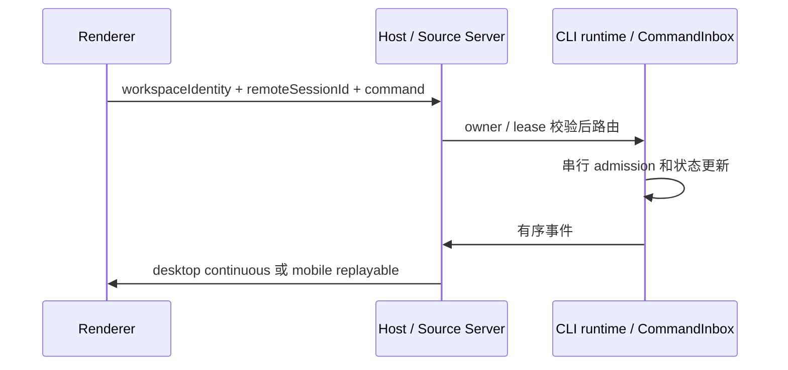

# ZCode v3.16.1 整合验收

## 基线与范围

- 上游固定为 `0a1fc56d279fd1001f78387bd81aec1c26767411`（v3.16.1），从已提交的 v3.15.1 候选 `2f6ba3e8` 继续。v3.15.1 通过核心 CI 与三平台 Installers 后，才交付此上层候选；下层追加修复必须同步。
- 版本整合保留标准 MCP、ToolSearch、node_repl、Browser Use、动态工作流、GenUI/MCP Apps、本地和远程工作区。
- 官方账号、套餐、云端分享与反馈、遥测、原生 CUA 产品链及其专属新模块沿用既有移除范围。保留通用日志导出、MCP OAuth、浏览器页内控制、MCP App 实例隔离和第三方模型配置。
- 用户级数据继续写入 `.openzwork`；项目级 `.zcode` 和通用 `.agents` 约定不随产品身份变更。
- Built-in Provider 生产与测试配置使用同一份净化目录，保留现有 16 个第三方模板，吸收上游 Xiaomi MiMo 新模型规则；目录 revision 更新为 34，防止旧本地 revision 33 遮蔽本次内容。

## 保留与迁移规则

- ToolSearch 使用上游标准 MCP `alwaysLoad`、native/local/deferred schemas 和 hydration 逻辑；运行偏好默认 `off`，不依赖官方套餐自动开启策略。
- MCP Apps 首次连接等待后，重新校验 session、connection generation 和 lease。GenUI 路由保持 desktop-continuous，不能进入手机 replayable 频道。
- 工作流子 runtime 继承父 runtime 已解析的 shell selection，继续通过父会话 broker 传递交互。
- Host 下发模型相关 V4 命令前，等待 `provider/refreshRegistry` 让目标 Worker 从自己的 Personal Config Store 完成现有串行刷新；只发送 reason，失败则拒绝命令。顺序为 `Host → Worker Registry refresh 完成 → V4 command → CommandInbox admission/ACK`，桌面 continuous 与手机 replayable 共用此屏障。
- Browser zoom 补偿、CSS 像素截图和一致 origin 权限策略随上游升级；浏览器 `cua*` 页内操作保留。
- Host 使用新的 Source Server 身份、连接生命周期和 Duplex 传输；远程 RPC 必需 channel 与当前 IServiceAccessor 保持一致，不要求已移除的服务。
- 共享 relay 模块统一保存 HMAC wire、证明向量与二维码合同；根协议入口继续公开同名导出。账号 V2 的 HTTP 注册/一次性 token 合同与专属 fixture 退役，通用 heartbeat、retry、不可变 payload 序列化保留；共享 testing 配置检查实际 HMAC contract example。Desktop relay 模块仅拥有凭据存取与 proof adapter，不保存任务状态。
- 远控配对沿用无账号 HMAC 认证合同。上游依赖官方 JWT 的云端设备发现不引入；通用重连、任务展示和恢复语义按当前配对入口适配，不能伪造账号材料。
- HMAC transport 独占 KICKED 恢复窗口，复用上游 retry policy：首次冲突在 2–5 秒内恢复一次，60 秒内再次冲突时终止连接并报告 `session-conflict`；认证 ACK 只清普通错误退避，不清冲突窗口。窗口关闭或停止会撤销待恢复任务，普通网络断开继续沿现有重连路径。
- 新远程 project 使用单个不可变 root，task 必须属于对应 project；不恢复多 root / additionalDirectories 远程规避路径。
- SQLite 迁移采用共享 runner 的异步 MigrationResult、备份、checksum 和 schema 账本，业务转换仍由对应持库进程执行。现存 DB DDL 兼容边界沿用原规范，退役业务的运行时、UI 和调度不得恢复。
- 混合测试按完整声明和场景边界适配；共享辅助文件及保留能力不按关键词删除。新增上游模块同时检查生产注册、协议、构建资产及测试引用。

## 所有者、接口与顺序

- CLI/runtime CommandInbox 是已接纳输入的唯一 admission 所有者；Renderer 只保留草稿与 optimistic overlay。
- Local Host / Source Server 持有相应 workspace/session 运行时；Main 与 relay 只做进程、连接和转发，不复制业务队列。
- SQLite runner 独占迁移账本；启动 composition 在取得迁移 admission 后重读版本、备份 touchedTables、执行转换并返回完成帧，失败不能报告完成。

## CI/CD 验收

- 核心 CI 和同一候选提交的 macOS arm64、Windows x64、Linux x64 Installers 必须通过，不要求人工 UAT、试装或真实用户。
- 保留上游 3.16 新纳入常规 typecheck 的 Main、remote Main、shared testing；只移除已退役模块的检查目标。
- 根 `typecheck` 检查应用源码与共享测试基础设施。历史 E2E 脚本的类型检查使用原 `tsconfig.e2e.json` 在独立扩展工作流执行，保留错误退出码和诊断产物，不让缺失的历史 E2E 辅助文件阻断应用构建。
- PR 架构检查显式使用真实 base SHA，checkout 保留可解析的 Git 历史；本地对照已通过的 3.15.1 基线。
- 新 schema 合同、架构检查和受影响测试入口按当前模块与产品范围接线，不自动更新错误基线压低门禁。
- 核心回归加入 ToolSearch、MCP Apps 连接竞争、GenUI 远端路由、工作流 shell 继承、Duplex 传输、controller identity 和 SQLite 迁移等保留的新行为。
- 本地 pre-push 与核心 CI 使用同一核心测试清单；继续执行 Lint、SQLite schema 与架构检查，历史 affected suite 交由独立扩展任务运行。
- 扩展历史测试继续独立运行，失败保留退出码、原始诊断与 artifact，不成为核心 CI 或 Installers 的前置依赖。
- 完整历史测试按包分组执行（`scripts/run-full-suite-groups.mjs`）：每组独立进程、独立 JSON 报告与组级时限，超时或崩溃的组标记 cancelled 后继续跑其余组，job 级超时预算覆盖分组总和加余量。任何一组的失败不再让整个 job 的诊断全部丢失。
- 依赖按新 lockfile 与固定 Node 24.14.0 / pnpm 11.28.6 安装；不复制旧依赖或 ignored 运行配置。
- 候选提交、PR 与云端结果分别记录。完成候选不自动合并、打 tag、发布或部署。

- 手机 E2E 的 Web 开发代理以隔离 relay 的 origin 为目标，入站 `/ws` 路径只转发一次；验证经实际 Vite WebSocket 代理的注册握手，避免 helper 自测通过而移动端无法连接。

## 扩展回归恢复边界

- Provider 真实磁盘事务继续验证 Personal 写入、Registry 刷新、ACK 重放和 CAS 回滚；独立 Credential Store 与本地 Settings 为保留哨兵，v1 历史账号凭据不应用，v2 非空历史凭据在写入前拒绝。
- MiMo 回归按已约定的 16 模板目录验证 API 模板及新模型；用户显式填写的第三方 Token Plan 地址、禁用状态与 API Key 保留，不额外加入模板。
- 扩展测试保留当前桌面、远程连接与插件状态合同；已移除的账号、云端分享、反馈、遥测和原生 CUA 专属场景随实现清理。通用 E2E helper 按固定 3.16.1 源码恢复，并保持隔离用户目录。

- WDIO 配置由 `desktop-e2e-runner` 模块登记，合同测试属于 Vitest 的 `test/runner`，不混入真实 Electron E2E。测试直接执行入口中的隔离目录初始化，验证未显式配置 Provider 时不注入凭据，普通场景与 Compact 场景的上下文配置分别保持正确。
