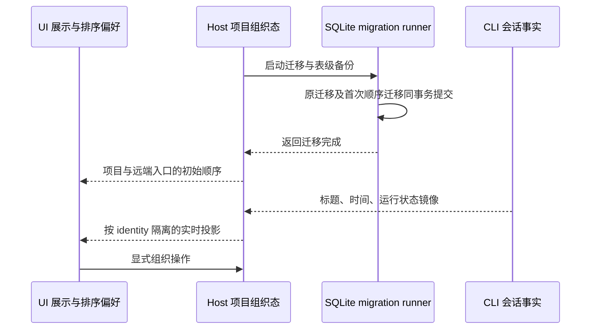

# ZCode v3.16.2 整合验收

## 基线与保留范围

- 上游固定为 `3c5b227649371507ddc4eb46ac5133afe6db1cab`，根版本为 3.16.2；从 OpenZWork `c105cd06` 与 Provider 测试清理修复 `9ce9d0a2` 继续，以 merge commit 保留上游历史。
- 延续 [3.16.1 的产品边界](upstream-v3.16.1-integration.md)：标准 MCP、ToolSearch、node_repl、Browser Use、动态工作流、GenUI/MCP Apps、本地/远程工作区和第三方模型配置继续保留。
- 官方账号、套餐、云端分享与反馈、遥测、原生 CUA 及其专属注册、资产和测试保持移除；上游对已退役文件的修改逐项审查，不恢复整文件。
- 用户级目录继续为 `.openzwork`，项目 `.zcode` 与通用 `.agents` 约定不变；沿用既有无账号 HMAC 配对、远端身份、owner/lease 和 stale run 防护。

## 吸收的功能增量

1. 侧栏完整会话模块、会话 tab 与主区域布局变化随上游整合；订阅仍按 workspaceIdentity 和 remoteSessionId 隔离，UI 不新增已接纳输入或会话事实的所有者。桌面 continuous 与手机 replayable 语义保持。
2. 旧 workspace 首次迁移保留本地/远程混排顺序。新增 `0007_initial_workspace_order` 只增加可空列，首次顺序回填仅在同事务执行 `0005_projects` 时发生；已有迁移账本的用户不能被旧 settings 重新排序。旧 migration SQL/checksum 不改写，备份只触及声明的表。
3. 同库 Desktop 与 Source Server 启动时幂等补齐各自 Host 行，保持已有任务身份、cwd、项目归属及 CLI 事实不变。
4. 吸收工作流并发调度、子进程执行、会话流式呈现、插件商店目录及桌面未读徽标修正。动态工作流继续使用本地偏好与现有默认值，不恢复官方远端开关来源。
5. 远端探测、部署和进程服务修正按现有无账号链路适配。上游 HTTP 中止兼容性仅用于官方设备发现与一次性 token 接口，当前 HMAC 链路不消费这些接口；对应 adapter 与专属测试保持退役。
6. 同步上游通用回归和交互场景；已退役专属用例继续移除。保留本轮真实文件锁控制的 Provider 清理回归，不通过增加时限或跳过用例消除失败。
7. node_repl 宿主 seed 版本与仓内 package/manifest 的 0.6.1 对齐；源码、清单与缓存目录使用同一版本。
8. 补齐现有默认名单中 `skill-creator`、`plugin-creator`、`zcode-guide`、`visualize` 的本地注册。它们使用仓内已有源码和 manifest，通过本地 bundled seed 分发；注册版本、必要文件与 Settings 默认启用集合逐项核对。用户已有启停与卸载抑制配置继续优先，恢复操作复用现有安装锁。官方远端市场、图标 CDN 和 CUA 保持退役。

## 验证与交付

- 先检查合并差异、架构受控上下文和退役模块引用，再完成代码适配。README、版本、第三方来源清单及必要 spec 与最终实现一致。
- 必须执行 `pnpm typecheck`、`pnpm lint`、架构检查与 schema 合同检查；针对首次升级、已升级、双 Host、侧栏会话、远控与工作流执行保留回归。
- 核心 CI 明确执行 Bash 输出完成/关闭、工作流并发与配额停止、协议 transport、辅助会话冷恢复回归；根核心清单加入完整视图、辅助会话身份与 Provider 清理屏障场景。
- 同一候选提交需通过 macOS arm64、Windows x64、Linux x64 核心 CI、七组完整 Extended、Main/E2E 类型审计与安装包构建。真实 runner 失败保留原始结果并定位，不以单个定向绿灯替代完整验收。
- 使用现有测试配置和依赖；只有依赖清单实际改变才更新锁文件。类型错误不通过排除现有检查范围处理。
- 交互场景维护已有 E2E 合同；候选交付沿用上一版自动化验收范围，人工试装和真实用户 UAT 独立记录。
- 交付可审查的 PR 与源码/运行编号证据。合并、正式 tag、Release 和部署按用户明确授权执行，不移动现有发布 tag。
