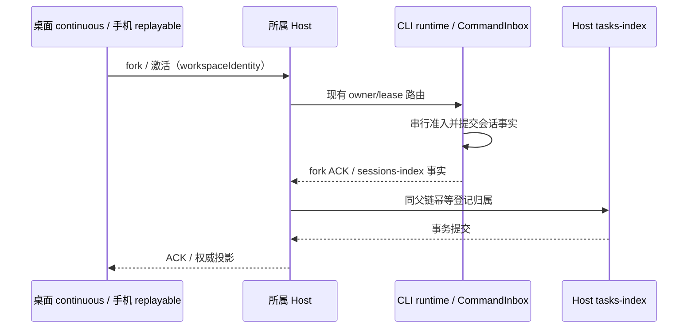

# ZCode v3.17.2 整合

## 基线与产品范围

- OpenZWork 从 `e48ed9266e1a38e61d72060e8f943b170bd910ac`（`3.17.1+openzwork.2`）继续；上游固定 tag `v3.17.2`，合并基为 `a60ba6a7e5a06742270ca605f5d2cc2766afa7e1`（v3.17.1）。使用 merge commit 保留上游历史，应用版本更新为 `3.17.2+openzwork.1`。
- 延续 [v3.17.1 的保留与裁剪范围](upstream-v3.17.1-integration.md)：标准 MCP/OAuth、Browser Use、node_repl、GenUI/MCP Apps、本地和远端工作区保留；官方账号、套餐、遥测、自动更新、原生 CUA、官方网关与 `zcode_official` 身份头依赖继续移除。
- 保留 `.openzwork` 用户级数据根、项目 `.zcode` 配置、标准 Provider 模板、系统提示词编辑器、模型能力规则、远控多入口与现有下游补丁。原始目录中的未提交内容和未合并的其他功能分支不属于此次升级。

## 吸收的行为

1. Subagent 继承父权限服务；插件 permissionMode 只收紧父权限，恢复子会话按当前父权限重算。执行 cwd 变化不改变 workspaceIdentity。
2. Plan 作为基础权限之上的限制，需审批的只读工具继续按原模式判断；普通模式下非只读 MCP 需询问，Guarded 危险命令保持单次确认。沿用上游权限回归与模型可见提醒。
3. 草稿完全访问授权在尚无 session 父行时只更新 runtime；首次持久化使用当前授权状态。在途保存先完成，重试复用同一授权事件，不能覆盖用户后续选择。
4. 自定义命令的 `!` shell 块统一转换为模型可见 Bash 步骤，由工具权限服务执行准入；不在解析阶段运行 shell。参数替换不能把用户参数重新识别成 shell 块。
5. 桌面本地 HTML 使用 `zcode-html://`。Main 独占进程内签名密钥和导航准入，单个真实目录为授权边界，拒绝原始 file 请求、越界、隐藏文件及网络共享；Web/手机不注入本机文件能力。
6. Host 在 fork ACK 返回 UI 前继承父任务组织态；CLI 事实与 ACK 到达顺序可交换。同 workspace、Host、root 精确校验，已有归属和本地合法 NULL 不重算。远端历史 NULL 归属使用上游 `0010_remote_task_ownership` 迁移，沿用迁移备份与 checksum 约束。
7. 生命周期 ensureReady/restart 携带 workspace，检查 `sessionLifecycleWorkspace` 能力；旧 CLI 缺失能力时返回既有 unsupported 错误，不丢弃 workspace 后重试。全局最低版本保持原配置，由操作能力检查区分支持范围。
8. 保留通用 MCP 失败提示、macOS 文件应用图标修复与平台打包改进。官方 MCP 身份头专属实现、夹具和文档不引入。Windows x64 依赖裁剪沿用上游显式环境开关，不扩大默认启用范围。

## 所有者与时序

CLI 继续独占会话事实和已接受输入队列；Host 独占项目、归档、置顶等组织态；Renderer 只保留草稿、预热绑定和展示投影。桌面 continuous 与手机 replayable 复用原 shared-host runtime，不新增会话或持久化队列。预热 binding 的 retain/release 使用原生命周期，异步旧结果不能接管新任务。

## 验证场景与门禁

- 权限：父/子模式组合、插件试图提权、恢复旧子会话、Plan MCP 审批、Guarded 单次确认。
- 草稿：未落库授权、在途保存、授权发布失败重试、页面保活释放；自定义 shell 的 App/CLI 入口、参数与插件变量。
- 会话：远端 fork 后立即打开、事实/ACK 两种顺序、重复 ACK、同路径不同 identity、旧 CLI 能力缺失、本地未归类和用户已移动任务保持原归属。
- 浏览器：相对资源、中文与空格路径、父目录/符号链接/隐藏文件/伪造签名拒绝、导航竞态、刷新与外部打开。
- 打包：现有 afterPack native 资源规则与新增 Windows 裁剪接线共同验证。
- 执行根 typecheck/lint、CLI typecheck/lint、架构与 schema 检查、净化扫描、下游补丁门禁、固定核心套件及受影响 CLI 测试。桌面交互沿用上游候选 E2E，按实际执行证据记录，不以文件存在代替通过。
- 下游补丁以 [登记表](../upstream/downstream-patches.yaml) 为事实源，逐项核对未撤销条目；原样未变的上游缺陷仍保留本地修复与回归。
- 提交可审查的升级 PR；本地结果、云端 CI、三平台安装包和实机验收分别记录。
