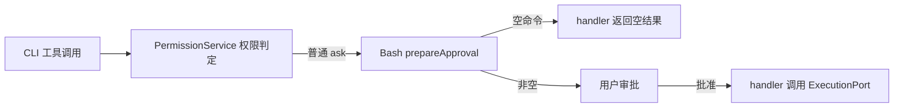

# 空 Bash 命令的审批边界

在 Build 模式中，空字符串或纯空白会通过 Bash 输入校验，但权限服务仍判定需要询问。Bash handler 对这类输入只返回空输出，不发起进程。审批窗口对这种空操作没有可确认的副作用；而当 Bash 未建议项目规则时，协议层的默认选项会把空输入回退为工具级规则。

## 规则与调用链

- Bash handler 是空操作语义的所有者；工具的审批门用相同的 `command.trim().length === 0` 条件识别空操作。仅短路普通询问，不更改权限服务的拒绝、Guarded 单次确认、Plan 判定或规则优先级。
- 合法空命令不发出审批事件、不调用 broker、不写项目或会话授权、不进入执行端口。非空命令仍走既有审批与执行路径。
- 工具 schema、模型描述、协议、授权建议格式、已保存规则含义不变。本修复不实现新 sudo 字面规则。

## 验收

`apps/zcode-cli/packages/core/tests/bash-empty-command-approval.test.ts` 通过 Core executor 注入测试 broker、规则存储和执行端口：空字符串和纯空白返回空结果，三处均无副作用；拒绝非空命令仍触发审批且不执行；权限服务自身仍对空命令返回 `ask`。
