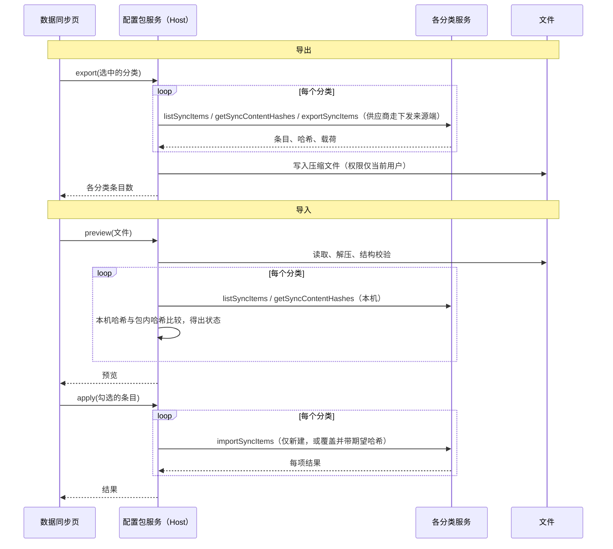

# 多机配置包

## 产品规则

用户可以把本机的配置导出成一个文件，在另一台电脑上导入。导出和导入都由用户手动发起，应用不在后台同步，不为此访问网络。

### 范围

| 分类       | 导出内容                                 | 说明                                                                         |
| ---------- | ---------------------------------------- | ---------------------------------------------------------------------------- |
| 模型供应商 | 个人层的供应商、模型规则、顺序、默认模型 | 含 API Key，明文                                                             |
| 系统提示词 | 系统提示词设置                           | OpenZWork 自有功能                                                           |
| 子智能体   | 用户级子智能体文件                       | 原文件字节                                                                   |
| 命令       | 用户级命令文件                           | 原文件字节，保留子目录                                                       |
| 钩子       | 用户级钩子定义                           | 每条定义一项，含完整命令                                                     |
| MCP 服务器 | 用户级服务器配置                         | 含环境变量与请求头，明文                                                     |
| 技能       | 用户技能目录                             | 沿用技能服务的单项内容、归档总量及解压总量限制；当前上限需从实际装配参数读取 |

不在配置包里：会话与记忆、Bot 配置与凭据、远控接入档案、远端设备列表、MCP 的 OAuth 令牌、插件、项目级配置、界面偏好、最近项目。

### 导出

1. 入口在设置 → 数据与统计 → 数据同步页的"导出配置包"。
2. 选择要导出的分类，默认全选。
3. 确认框列出本次将明文写入文件的敏感内容种类：模型 API Key、MCP 的环境变量与请求头、钩子命令。用户确认后选择保存位置。
4. 写出的文件权限为仅当前用户可读写。
5. 完成后显示每个分类导出的条目数。命令根可以尚未创建；已发现的普通命令或目录读取失败时，中止导出并指出命令分类。
6. 两个技能根里的独立目录在归档中使用独立落点。相对路径重叠时，保留 OpenZWork 技能路径，将该兼容根子树放在可用的 `agents/` 前缀下；前缀已被使用时使用 `agents-2/` 等。v1 清单仍记录最终相对目录和原有内容哈希。

### 导入

1. 入口在同一页的"导入配置包"，选择文件。
2. 应用校验文件后显示预览。每个条目有一个状态：

| 状态     | 含义                                                     | 默认             |
| -------- | -------------------------------------------------------- | ---------------- |
| 新增     | 本机没有                                                 | 勾选             |
| 一致     | 本机已有且内容相同（包内记录的哈希与本机算出的哈希相等） | 不可选           |
| 差异     | 本机已有但内容不同                                       | 不勾选           |
| 不可导入 | 超过大小上限、格式不合法等                               | 不可选，显示原因 |

3. 用户调整勾选后确认。勾选"差异"项表示用包里的内容覆盖本机。
4. 导入永不删除本机独有的条目。
5. 完成后显示每个条目的结果：已新增、已覆盖、冲突未写入、失败及原因；并提示重启应用，使导入的配置全部生效。

### 各分类的导入规则

- **子智能体、命令、钩子、MCP、技能**：沿用数据同步的规则。新增带来源端的启用状态，覆盖保留本机的启用状态；MCP 配置里来源机器的 home 路径改写成本机 home。
- **MCP 的一致性判断偏保守**：两台机器的 home 目录不同时，内容相同的 MCP 条目也显示为"差异"。它默认不勾选，保留本机内容即可。
- **模型供应商**：按供应商 ID 合并，比较整项配置及其个人模型规则；相同为“一致”，不同为“差异”。勾选后整项以包为准，本机独有与未勾选项保留。普通、手动模型规则与供应商内模型顺序一起处理，合并顺序见下文。默认模型只在本机没有设置且对应供应商成功导入或已存在相同配置时采用包里的。
- **系统提示词**：本机没有自定义设置时按"新增"；本机已有且不同按"差异"，勾选后整体以包为准。
- 已发出的模型请求继续使用发出时的凭据。CLI 的 Provider 注册表读取导入结果后，旧会话的后续请求使用更新后的供应商配置。系统提示词在会话创建时确定，当前会话继续使用原提示词。重启应用后，新会话与设置页完整读取导入配置。

### 校验与兼容

- 命令、子智能体的设置编辑与导入共用跨窗口写锁。每个选中项提交时重新读取目标字节并比较预览哈希。拿锁或重读失败只计入该项，发生变化的项报告冲突。回执保留此前成功的条目，后续项继续尝试。
- 钩子的预览和结果显示事件、匹配条件与可辨识的程序名。同一摘要有多项时按包内顺序标注序号。显示名称由 Host 从 v1 载荷生成，完整命令和参数留在 Host。
- 预览列出本机缺省时可采用的来源默认模型。确认导入时，供应商配置一致或已勾选且成功导入、模型可解析，才采用该默认值。预览后本机已设默认模型时保留本机值，回执显示未采用。只有默认模型变更的操作也显示确认按钮与模型名称，成功回执在注册表刷新后返回供应商 ID 和模型 ID。
- 父技能目录会连带写入子技能。成包和读包时按技能发现规则枚举归档内的实际路径，每个技能目录必须在清单里恰好出现一次。同名副本导致清单遗漏路径时，拒绝该包。覆盖前按实际路径检查目标子树；子项未选、目标存在需要保留的嵌套技能，或子项在预览后发生冲突时，保留受影响子树的原文件，继续处理独立技能。
- stdio MCP 的 `args` 单个参数、`cwd` 和 `env` / `environment` 的单个值，只有整个字符串是来源 home 本身或其下的绝对路径时才迁移。命令程序、URL、请求头、普通文本、相似前缀和 home 外的路径原样保留。HTTP 与 SSE 配置原样迁移。
- 在 Windows 上替换目标前，先保留可恢复的原文件。最终 DACL 校验失败时撤回本次文件，已有目标恢复到原位置，首次导出撤销新文件。回执在最终权限核验成功后报告成功。
- v1 的子智能体分类按用户 Markdown 原始字节导出、比较和写入。导出和预览只读，包括旧版模型标识和启用状态文件；取消时保持原文件。设备同步继续按其既有规则迁移旧标识及内置智能体模型覆盖。

- 包头记录格式版本、导出时的应用版本、来源平台、来源 home 目录和导出时间。每个条目带导出时由来源机器算出的内容哈希。
- 格式版本高于本机支持的版本时整体拒绝，提示升级。
- 文件损坏、解压失败或结构校验不通过时整体拒绝，不写入任何内容。
- 应用版本或平台与本机不同只提示，不阻止。
- 跨操作系统导入时，含绝对路径的 MCP 配置和钩子命令在预览里标出，由用户决定是否导入。应用只改写 home 前缀，不转换可执行文件路径和分隔符。

### 写入与回执

- 命令和技能写入者核验目标根内的实际父目录，拒绝经目录链接或 junction 落盘。技能文件在 POSIX 上保留归档中的可执行位。POSIX 同平台比较包含可执行位，Windows 来源或目标按内容比较。
- 技能导入在持锁后建立一次目标索引，入锁时检查预览后的同名新增，逐项提交时复核当前目录的占用和实际内容。文件和启用状态一起成功才返回成功；单项读写失败时保留已完成项并继续独立项。同路径且仍符合预览期望的子技能可以在父项拒绝整体覆盖后独立更新。
- 采用来源默认模型须通过新会话的默认选择规则，包括供应商可见、模型可用和推理档位有效。简单 shell 钩子的预览显示可识别的程序名，参数留在 Host。

### 安全

- 配置包明文包含 API Key 等敏感内容，这是用户的明确选择。导出确认框和文档都要写明。
- 日志只记录分类、条目数量和结果，不记录条目内容、密钥、环境变量或请求头。
- 导入不执行包里的任何内容。钩子和 MCP 在导入后与本机手工配置的条目遵守同样的信任与授权流程。

### 平台

仅桌面端提供。手机远控端不显示入口，对应通道不进入手机白名单。

## 所有者与事件顺序

| 状态                   | 唯一所有者                                                        | 其他层                         |
| ---------------------- | ----------------------------------------------------------------- | ------------------------------ |
| 各分类的配置内容       | 各自现有的服务与文件                                              | 配置包服务只通过它们的接口读写 |
| 配置包的格式与校验     | Host 上的配置包服务（新增，自有模块）                             | Renderer 不解析文件            |
| 导入预览（条目状态）   | 配置包服务计算：包内记录的哈希与本机分类服务算出的哈希比较        | Renderer 只展示并回传勾选      |
| 模型供应商的写入       | 个人层配置仓库的 `update`（文件锁内读、合并、写），随后刷新注册表 | 合并规则是配置包服务里的纯函数 |
| 导入对话框的选择与进度 | 对话框的状态 hook                                                 | 不持久化                       |
| 文件选择与保存         | 平台服务（`IPlatformService`）                                    | UI 不直接调用原生接口          |

- 预览与应用之间本机配置可能变化。覆盖操作带预览时算出的本机哈希，分类服务写入前重新计算，不一致的项返回冲突且不写入。
- 应用按分类串行执行。一个分类失败不回滚已完成的分类，结果逐项如实显示。
- 模型供应商经个人层配置仓库的 `update` 写入：读、合并、写在同一把文件锁内完成。刷新注册表失败时写回合并前的内容；此时如果有其他写入者已改动配置，保留新值并报告回滚未完成，与下发目标端的处理一致。

## 文件格式

- 单个文件，内容是 gzip 压缩的 JSON。
- 顶层：包头（格式版本、应用版本、平台、来源 home、导出时间）和按分类分组的载荷。
- 载荷沿用各分类已有的载荷结构，二进制字段编码为 base64；每个条目附导出时的内容哈希。
- 结构用运行时校验描述，导入时先整体校验再做任何处理。
- 列表、哈希和载荷来自不同调用。导出对所选条目在读取载荷前后各取一次哈希并复查条目存在性，检测到变化则中止成包并提示重试；不把这些调用描述为跨分类的原子快照。CP-13 覆盖该情形。

## Host 契约与文件边界

本机桌面 Host 注册 `config-package`。Main 只选择保存路径，Renderer 从本机服务集合取得描述符。HTTP Server、SSH、WSL、手机远控 attachment 均不提供此通道。

- `exportToFile(path, categories)` 导出所选分类并返回计数与文件字节数。
- `previewFile(path)` 整体校验后返回预览 ID、分类、稳定条目键、名称、状态及风险提示。载荷与本机期望值只保留在此 Host。
- `applyPreview(previewId, selected)` 只接受预览中可选的键，按分类顺序处理。同一预览的重复调用复用首次回执。
- `releasePreview(previewId)` 在取消、关闭时释放载荷。完成后仅保留有限数量的结果摘要，Host 退出清空。

建议文件名以 `.openzwork-config.gz` 结尾。顶层字段为 `formatVersion: 1`、`appVersion`、`sourcePlatform`、`sourceHomeDir`、`exportedAt` 和 `categories`。每个所选分类含条目键、名称、SHA-256 与分类载荷。未知分类、重复条目、无效 base64、载荷清单与声明不匹配均导致整体拒绝。压缩文件上限 50 MiB，JSON 上限 200 MiB。技能沿用同步服务装配的 20 MiB 限额。导出以私有同目录临时文件原子替换目标。POSIX 文件模式为 0600；Windows 写入前设置仅当前用户的 DACL，并核验最终文件。

个人层用正式 codec 归一化。比较单元包含供应商配置、该供应商的普通和手动精确模型规则及模型顺序。个人仓库持锁 `update` 内按预览期望值复核每个选择，整组替换；目标已有供应商保持相对顺序，新 ID 按来源顺序追加。本机尚无默认模型，且来源默认所指供应商成功导入或内容一致、模型可解析时采用该默认。刷新失败通过同一仓库比较本次提交版本后回滚，其他写入者已提交时保留其内容并报告。系统提示词通过 SettingService 比较预览时的设置后写入。

## 验收用例

| ID    | 设置与动作                                        | 必须断言                                                                                                                  | 验证层                             |
| ----- | ------------------------------------------------- | ------------------------------------------------------------------------------------------------------------------------- | ---------------------------------- |
| CP-01 | A 机有七类配置，全选导出；B 机为空，导入全部      | B 机各分类条目与 A 机一致；模型可用；文件权限仅当前用户                                                                   | 场景回归（往返）                   |
| CP-02 | B 机已有同名子智能体且内容不同                    | 预览标为差异、默认不勾选；不勾选时本机内容不变；勾选后被覆盖                                                              | 场景回归                           |
| CP-03 | 预览后、应用前修改本机同名条目                    | 该项返回冲突，不写入；其他项正常                                                                                          | 场景回归                           |
| CP-04 | B 机有 A 机没有的供应商和命令                     | 导入后仍然存在                                                                                                            | 场景回归                           |
| CP-05 | 两机都有同一 ID 的供应商，Key 不同                | 默认保留本机；勾选后以包为准；默认模型在本机已设置时不变                                                                  | 场景回归                           |
| CP-06 | 截断的文件、非法结构、过高的格式版本              | 整体拒绝，零写入，错误信息说明原因                                                                                        | 场景回归                           |
| CP-07 | 来源 home 与本机 home 不同的 MCP 配置             | 导入后 home 前缀被改写，其余路径原样；本机已有同名同内容条目时预览显示为差异                                              | 场景回归                           |
| CP-08 | macOS 导出、Windows 导入，含绝对路径的 MCP 与钩子 | 预览标出这些条目                                                                                                          | 场景回归                           |
| CP-09 | 导出与导入全过程                                  | 日志不含 Key、环境变量、请求头和条目正文                                                                                  | 场景回归（边界）                   |
| CP-10 | 导入供应商与系统提示词后                          | 已发出的请求沿用原 Key；注册表刷新后旧会话后续请求使用新 Key 并沿用原提示词；重启后新会话使用新 Key 与新提示词            | Bootstrap 协议/运行时测试          |
| CP-11 | 手机远控端                                        | 直接请求配置包通道被拒绝；入口隐藏由界面用例检查                                                                          | 场景回归（通道）与界面验收（入口） |
| CP-12 | 桌面端完整操作一遍导出与导入                      | 确认框列出敏感内容；预览、勾选、结果与重启提示正确；取消选择零写入；切到远端设置仍只作用于本机 Host；中英文与窄窗口不溢出 | 桌面 E2E（候选）                   |
| CP-13 | 导出读取载荷期间，同一条配置被修改或删除          | 中止本次成包并报告配置已变化；不输出哈希与载荷可能不一致的成功结果                                                        | 场景回归（冲突）                   |

"场景回归"使用真实服务和隔离数据根，一个文件覆盖一组用例，登记在核心套件的 `config-package` 条目下。CP-01 至 CP-10、CP-11 的通道部分与 CP-13 进入核心 CI；CP-11 的入口部分与 CP-12 由界面验收覆盖。运行时用例由 Bootstrap 的 config-package-runtime 测试承载。

## 不做

- 后台自动同步、云端存储、WebDAV。
- 密钥加密或口令保护。
- 插件、会话、记忆、Bot、远控档案、界面偏好的迁移。
- 跨操作系统的可执行文件路径转换。
- 合并同一条目的内容；差异项只有"保留本机"和"以包为准"两种结果。
- 导入后免重启的即时刷新。

## 使用方式

在旧电脑：设置 → 数据与统计 → 数据同步 → 导出配置包，保存文件。把文件拷到新电脑。在新电脑：同一页 → 导入配置包，选择文件，核对预览后确认。

配置包里有明文的 API Key，用完后删除，不要放进会同步或共享的目录。
