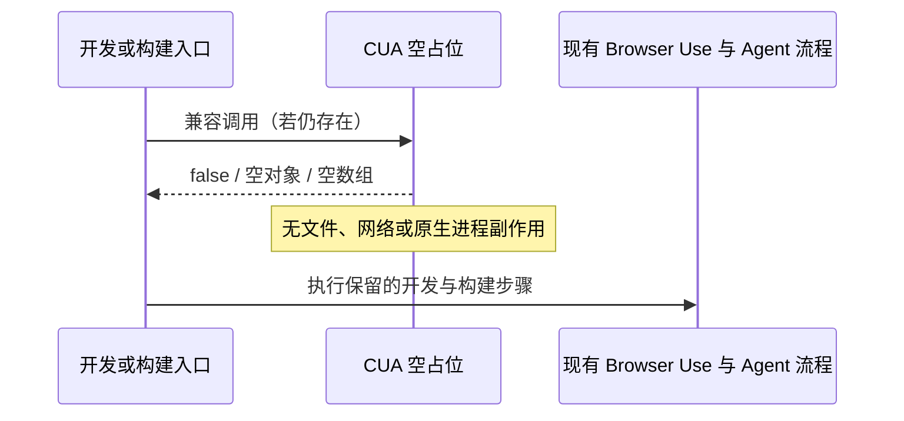

# CUA 空占位边界

## 产品决定

OpenZWork 不提供原生 Computer Use（CUA）能力。现有兼容入口保留为空实现；UI、官方插件目录、技能发现、Host 和构建发布流程均不接入 CUA。该边界适用于 macOS、Windows、Linux、本地桌面、Web 和手机远控。

Browser Use 的 `cua` / `dom_cua` 属于浏览器页内操作，继续保留。标准 MCP 和用户自行配置的第三方插件沿用通用发现、权限与执行机制，不按名称封禁，也不获得官方 CUA 的专用接线。

## 保留与移除

| 对象                                 | 规则                                                                                   |
| ------------------------------------ | -------------------------------------------------------------------------------------- |
| `readComputerUseProducer`            | 固定返回未安装的占位结果；不扫描目录，不读取 producer 清单                             |
| `isRealComputerUseProducerInstalled` | 固定返回 `false`                                                                       |
| `resolveDevDesktopWindowsCuaEnv`     | 返回空对象，不生成或注入 Helper 环境变量                                               |
| `stageDevCuaPluginRuntime`           | 返回空数组，不读取插件清单，不复制 Sharp 或原生依赖                                    |
| 历史 Helper 准备命令                 | 保留可成功退出的空入口，不启动编译器、不读取后端、不生成文件                           |
| 开发启动与本地资源准备               | 不执行 CUA Helper、macOS 权限浮窗定位辅助程序或 CUA 原生依赖准备                       |
| 正式打包                             | 不携带 CUA Helper、权限浮窗定位辅助程序；不保留 CUA 专属签名例外                       |
| UI                                   | 无 CUA 设置、授权引导、Composer 入口、不可用卡片或专属动画；资源管理说明不宣称包含 CUA |
| CLI / Host                           | 不注册 CUA runtime、broker、工具或内置 Skill；`node_repl` 继续服务 Browser Use         |
| 历史数据                             | 保留既有数据和通用工具结果展示，不迁移或删除用户文件                                   |

本机残留的真实 producer、占位包或旧开发环境变量均不能改变上述结果。兼容函数的参数继续接受旧调用形式，返回值不提供后端路径、manifest 或可用能力。

## 所有者与执行顺序

占位策略由构建兼容入口直接表达，无 CUA 可变状态、连接或持久化。Main、Host 和 Renderer 不增加 CUA owner。现有 workspace identity、桌面 continuous 和手机 replayable 链路不变。

## 验收场景

| ID      | 条件与动作                                       | 预期                                                           |
| ------- | ------------------------------------------------ | -------------------------------------------------------------- |
| CUA-001 | 未安装、安装占位包、安装真实 producer、清单损坏  | 均返回不可用，不读取清单                                       |
| CUA-002 | 设置旧 CUA dev 变量，调用环境解析与插件暂存      | 返回空结果，不要求插件目录，不新增文件                         |
| CUA-003 | 直接运行保留的 macOS / Windows Helper 准备入口   | 成功退出，不调用编译器，不生成资源                             |
| CUA-004 | 正常 dev、runtime 资源准备与本地资源自检         | 无 CUA / 权限浮窗定位辅助步骤；普通 Agent 与浏览器相关步骤保留 |
| CUA-005 | 读取正式打包配置                                 | 无 CUA 资源与专属签名例外；其他原生资源规则保留                |
| CUA-006 | 检查设置、Composer、官方插件声明与中英文资源说明 | 无 CUA 产品入口或支持声明；Browser Use 仍可发现                |

验证范围与证据见 [CUA 占位验证计划](../testing/cua-placeholder-boundary-openzwork.md)。此项落实产品边界，不登记为上游缺陷补丁。
