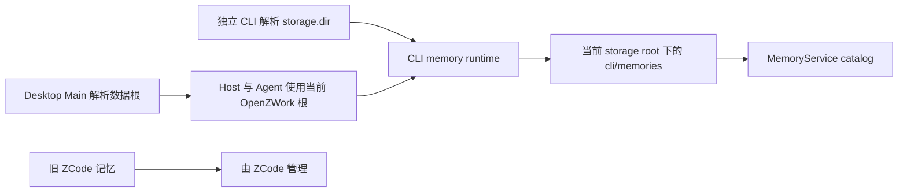

# 旧 ZCode 记忆隔离

## 产品规则

OpenZWork 与 ZCode 可以由同一用户同时使用。旧 `~/.zcode/cli/memories` 的存在不表示用户选择了迁移。Desktop、独立 CLI 和 Desktop 启动的 Agent 均不得在启动时探测、复制或清理这棵旧记忆树；默认目录与自定义数据目录遵守同一规则。

2026-11-06 取消 WP-E1a 的启动自动迁移。旧实现把产品数据根隔离视为同一产品升级，导致安装过 ZCode 的用户首次启动 OpenZWork 时自动获得另一产品的记忆。移除两个启动入口、专用复制实现、完成标记处理及自动迁移提示。

OpenZWork 记忆仍由现有 memory runtime 写入当前 storage root 下的 `cli/memories`，设置页通过 MemoryService 读取同一根。修改数据目录继续使用既有 OpenZWork 业务数据迁移流程。

- 已存在于 OpenZWork 根内的记忆保持原样，包括以前复制进来的内容。
- 不删除旧记忆、旧迁移标记或用户数据；不根据文件同名或时间推断归属并自动回滚。
- 不新增启动开关、旧根 fallback 或后台同步。
- 本次不提供旧 ZCode 导入入口。后续若提供导入，必须由用户选择来源、范围并显式执行。

## 所有者与边界

不改变会话 ID、workspaceIdentity、项目目录 hash、记忆开关或现有文件格式。桌面与手机仍访问既有 Host；远端记忆由远端 runtime 的存储根管理。

## 验收

| ID     | 前置与动作                                           | 断言                                               | 证据层               |
| ------ | ---------------------------------------------------- | -------------------------------------------------- | -------------------- |
| MISO01 | 旧根有记忆，OpenZWork 没有迁移标记，完整启动 Desktop | 不复制旧记忆、不创建标记，旧文件字节不变           | Desktop E2E 文件回读 |
| MISO02 | 保存自定义数据目录并完整重启                         | 自有记忆随 OpenZWork 数据迁移；旧 ZCode 记忆不混入 | Desktop E2E 文件回读 |
| MISO03 | 默认及自定义 storage 根分别创建真实 CLI app          | 不复制旧记忆、不创建标记，旧文件字节不变           | CLI 回归             |
| MISO04 | 新旧根存在同名记忆及历史迁移标记                     | 新旧内容与历史标记均保留                           | CLI 回归             |

Desktop 候选沿用 `openzwork-data-directory.test.ts`，结果记录到会话覆盖矩阵。CLI 回归进入核心 CI；结构门禁检查已移除的启动迁移入口不被重新接入。Windows 安装包首启结果须独立记录，不由 macOS 运行结果代替。

## 实施与验证（2026-11-06）

Desktop 与 CLI 启动迁移入口、专用复制实现和完成标记处理已移除。旧迁移工具的专用测试退役，由真实 CLI 启动隔离测试及 Desktop 冷启动/数据目录 E2E 取代。新回归进入独立核心 CI 步骤。

CLI 隔离 4/4、完整协议 121/121、净化门禁 46/46 通过；Desktop macOS arm64 默认/自定义根验收通过。桌面运行产物及未覆盖平台集中记录在[覆盖矩阵](../testing/conversation-session-e2e-coverage-matrix-openzwork.md#旧记忆隔离与提示词重新应用2026-11-06)。
