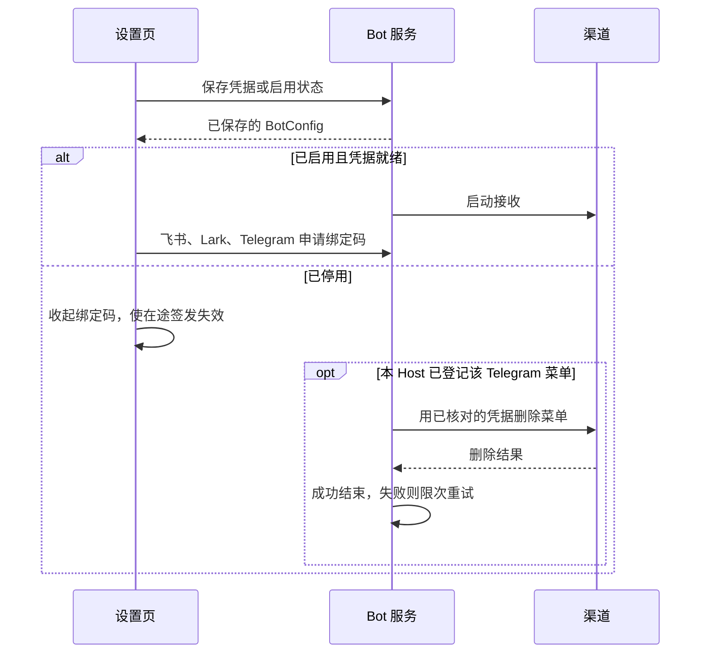

# 本地首次引导偏好规格

- 范围：桌面 / Web 共用的 occupation onboarding 首次展示、保存与关闭行为。
- 状态：净化后本地偏好规则；供 E1 本地 Memory 默认值与 WP-E7 Bot 渠道边界复用。

## 产品规则与状态所有者

1. 首次引导只负责把职业和用户选择的本地偏好写入既有本地设置；不创建独立 onboarding 记录文件。界面模式维持既有 `zcode-interface-mode` 本地存储与跨窗口广播所有者，不由引导复制为第二个 AppSettings 字段。
2. `AppSettings` 是职业（`onboardingOccupation`）、Memory 开关（`memoryEnabled`）、主动推荐开关（`proactiveSuggestionsEnabled`）和首次引导关闭标记（`occupationOnboardingDismissed`）的唯一持久事实源。引导、设置页和推荐面板均通过 `ISettingService.update` 写该同一设置对象；界面模式仅由既有 store 的 `setInterfaceMode` 持久化。
3. `occupationOnboardingDismissed` 只是本机 UI 去重位，不含 `deviceMid`、`userId`、渠道/账户身份或 `pending/uploaded` 标记；只保存在本地 `~/.openzwork/v2/setting.json`，不添加远端 RPC、账户服务、settings sync、遥测或上传调用。
4. 已有职业设置时不自动重开引导；首次关闭把本地去重位设为 true；完成或跳过均按现有规则保存职业/偏好，并同时设为 true。用户显式从快捷键再次打开时，`requested` 仍优先显示引导，关闭仍只写本机去重位。
5. 旧 `onboarding-record.json` 是未使用的历史文件：新版不解析、不上传、不同步、不自动迁移或删除它。引导保存和关闭只增量更新 `AppSettings` 关联字段，`settingService` 必须保留无关设置键，不得覆盖整个设置对象。用户此前已保存的有效偏好仍以 AppSettings 为准；不得从旧文件恢复设备或用户身份。
6. 既有设置同步仅导入显式选定的 providers / skills / commands / plugins / MCP server 资源（`SettingsSyncCategory`）；不上传、导出或同步 AppSettings、onboarding 标志或第三方 Bot secret。

## 单一数据路径与事件顺序

```text
OccupationOnboarding / SettingsPage / proactive panel
  → ISettingService.update(AppSettings patch)
  → 本机设置服务原子写 ~/.openzwork/v2/setting.json
  → renderer 刷新本地设置快照
  → onboarding visibility 读取 onboardingOccupation + occupationOnboardingDismissed

OccupationOnboarding / SettingsPage / WorkspaceSidebarFooter
  → setInterfaceMode(interfaceMode)
  → store 写入 zcode-interface-mode 并广播 UI 模式
  （不复制 interfaceMode 到 AppSettings）
```

引导展示只读取当前本地设置，不查询 TaskIndex / task 历史，也不发起 RPC 获取用户或设备身份。远端 Host、relay、conversationTelemetry 不承载该偏好对象。

## 失败语义与验收

- 设置写失败：既有设置更新错误路径仍显示/记录失败；引导关闭的本轮 UI 先隐藏，若去重写入失败，下次启动可重新提示，不创建第二持久化状态。
- 本地 AppSettings 有 occupation 或 dismissed=true：首次启动不自动弹引导；两者都缺失：展示引导；显式快捷键请求始终可显示。
- 保存 Memory 或主动推荐偏好后，只更新 AppSettings。Settings、Onboarding 和推荐关闭入口对同一值的写入结果一致；无独立 onboarding JSON/RPC。
- 结构扫描确认新逻辑没有 `deviceMid`、`userId`、`uploadState`、`getRecords`、`dismissOnboarding` 或上传/HTTP 客户端依赖。

## 外部 Bot 渠道端点边界（WP-E7）

- 本仓净化禁区里的“官方端点”指 ZCode 官方产品服务域及其登录、套餐、遥测、官方 MCP、商店 CDN、更新链；不含用户显式配置的第三方聊天渠道必需 API。 用户显式选择的官方 V1 无 OAuth 远控 relay 也按独立规格保留，见 `docs/web-remote-control/v1-connection-modes-openzwork.md`。
- Feishu/Lark 的 `accounts.feishu.cn`、`accounts.larksuite.com`、`open.feishu.cn`、`open.larksuite.com`，Telegram Bot API/BotFather 与微信 iLink 端点是 Bot 渠道业务流量目标。域名须在源码中清晰可见；不得混淆或构造隐藏 endpoint。它们不得夹带遥测、统计或应用偏好上报。
- Bot token、Feishu/Lark App Secret 与 Webhook secret 只能通过 host `ICredentialService` 写入本机加密 `credentials.json`（`packages/services/src/credential/credentialService.ts`）；key 使用 `openzwork-` 前缀，Bot JSON 仅保留 secret reference。旧 Bot 引用 `bot:<id>:credential` / `bot:<id>:webhook-secret` 在本地 Bot storage 初始化时复制到新 key，先原子保存新引用，再删除旧 key；复制或 config 保存失败时旧引用仍可用并允许重试，旧 secret 缺失会记录本地 warning 并保留旧引用，旧 key 清理失败仅告警且不回滚新配置。禁止把 secret / Bot 事件上报、settings-sync 或写入 relay；runtime 锁只保存在本机 `.openzwork/v2/bots-runtime-locks`。
- 新建 Bot 默认禁用；用户显式配置渠道凭据并启用后，provider runtime 才连接渠道 API。Bot 偏好配置加载时只调度关闭态，不发 API 请求；扫码注册必须用户显式点击，不得自动注册第三方应用。连接恢复只允许对已启用且已有凭据的 Bot。
- 渠道第三方端点是消息收发和显式注册业务流量，不承载遥测/统计。明确域名包括：Feishu/Lark accounts 注册、open API，Telegram `api.telegram.org` / `t.me/BotFather` 和微信 iLink；不得混淆或动态隐藏 endpoint。
- Feishu/Lark OAuth device-code 应用注册属于渠道厂商的 Bot 应用 onboarding，不是 ZCode 官方用户账号登录；禁止把它扩展为 ZCode 身份/Entitlement、支付或账号配置同步。
- SDK 配置依赖必须与源码动态 import 的 `@larksuiteoapi/node-sdk` version 对齐并写入 `pnpm-lock.yaml`。在依赖 manifest 和 lock specifier/版本一致前，typecheck/release 不能验收通过。
- 合并中 `packages/services/src/node.ts` 的 `hasExistingLocalTask` 不能为 UI onboarding 读 task repo；引导只读取 AppSettings。本 spec 的关闭位只由本地用户动作写入，不以 task 历史创建设备锚点决策记录。

```text
用户点击 Feishu/Lark 扫码 → Bot UI 服务调用渠道 accounts device-code API → 用户扫码授权创建渠道应用
  → polling 取回 App ID/App Secret → host 加密 credential store 存 Secret
  → Bot JSON 保存 credentialRef、disabled 状态
  → 用户显式启用 → 本地 provider runtime 连接渠道 API
  （device-code 注册结果仅在显式流程中暂存于 Bot UI 当前内存，随后由 UI 调用 host `saveBot` / `ICredentialService` 加密写入本机；Bot JSON 只存 credentialRef，secret 不进 settings-sync、遥测或 relay）
```

### 停用、绑定与旧凭据

- Host 迁移旧凭据时，保留损坏条目以及由另一种来源密钥加密的条目和旧引用，其余可读凭据继续迁移。系统密钥与托管密钥共存时，由凭据所有者在成功取得当前密钥后识别条目的来源。密钥库未解锁、同来源密钥指纹不符、整库读取或提交失败均向调用方报错。
- 混合来源库还含旧格式时，凭据服务先验证本端已有的 v2 密文。验证成功后保留整库的原格式，由调用方读写各自的条目。无法验证本端密钥时，整库预检失败。Desktop 私有凭据桥保留既有错误码和载荷格式。
- 设置页以已保存的 `BotConfig.enabled` 决定是否展示聊天动作。关闭时仍可配置、替换或移除凭据。已有凭据的飞书、Lark、Telegram 机器人启用后才签发并展示绑定码；停用即收起绑定码。已保存微信凭据的机器人启用后才提示发送首条激活消息。
- 停用、切换机器人或更改允许的工作区后，设置页丢弃前一次绑定码请求的回包。重新启用时立即按当前工作区范围签发新码，手动签发与自动续码使用同一条请求路径。
- Telegram Host 冷启动时只读取已停用的配置。运行中停用时，仅清理该 Host 已为同一凭据登记的菜单。收到 Telegram 成功回执后结束清理，失败时记录告警并退避重试，连同首次请求最多三次。每次重试复核启用状态和凭据，Host 退出时取消重试。显式移除凭据、删除机器人沿用原来的清理入口。

| 验收场景                                                               | 核心回归                                                 |
| ---------------------------------------------------------------------- | -------------------------------------------------------- |
| 四个渠道开关控制绑定或激活提示，飞书在停用后收到旧绑定码时保持停用状态 | `packages/ui/test/botLocalBoundaries.test.ts`            |
| 冷启动、重复读取停用配置、同引用更换 token 和菜单登记失败时都不清菜单  | `packages/services/test/telegramDisabledRuntime.test.ts` |
| 单条旧凭据无法解密时保留旧引用并迁移健康凭据，整库读取错误仍然上抛     | `packages/services/test/botCredentialKey.test.ts`        |


