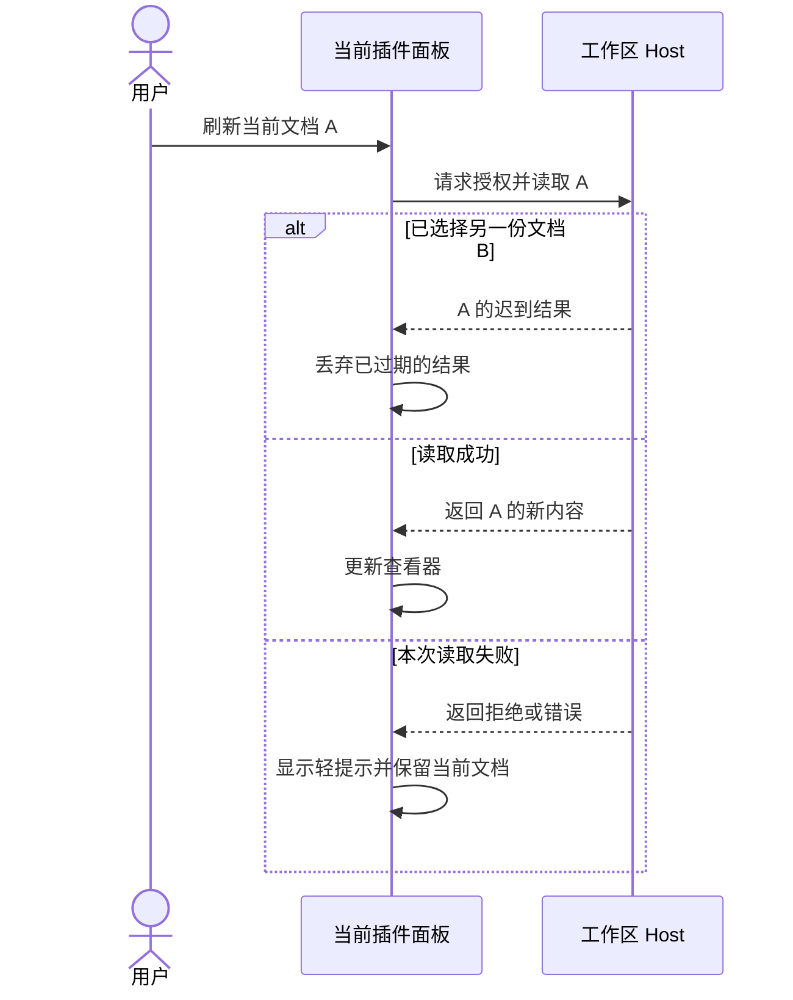

# 插件文件查看失败后的预览

从文件树或聊天链接打开本机工作区文件时，客户端优先使用已匹配的插件查看器。插件接管后，若面板未就绪、打开工具报错或运行时断开，仍在查看该插件标签的用户会看到原文件的内置预览。原插件标签保留。

回退沿用原文件来源、工作区和父会话。重复回退复用该会话的同一文件预览。用户已切换标签、关闭失败标签或离开会话时，迟到的结果不得抢占当前预览。插件工具仍执行原有权限检查。

该行为细化上游 Office 文件预览场景 OFP-16。回归分别检查失败时留在面板、切换到其他标签以及重复打开同一文件。

## 办公插件面板的手动刷新

Word、PDF、演示文稿和电子表格的内置插件面板显示最近一次加载的文档。用户点击右上角「更多 → 从磁盘重新加载」时，查看器通过原有的 `load_document` 授权流程重新读取当前工作区文件。通过面板的文件选择器导入文档时，刷新目标是导入的工作区副本。

停留在文档、选择内容、切换界面语言或重新聚焦窗口均不触发文件重读或磁盘版本检查。当前页码和选区仍通过已有的视图上报流程提供给会话。

逐一在四种插件面板打开文档，在磁盘上修改对应工作区文件，等待至少两个原轮询周期。此时面板保留原内容，`check_document` 调用数为零。点击菜单并选择「仅允许这一次」后，面板显示修改后的正文、页面、幻灯片或工作表。升级前已安装的四种插件也应满足这些条件。

等待手动刷新时，面板继续显示已打开的文档。读取被拒绝或失败时，保留原文、阅读位置、选区和「更多」入口，以面板语言提示可以继续查看原内容。再次点击刷新时重新请求授权。用户已选择另一份文档时，只接纳最新选文操作的结果。

