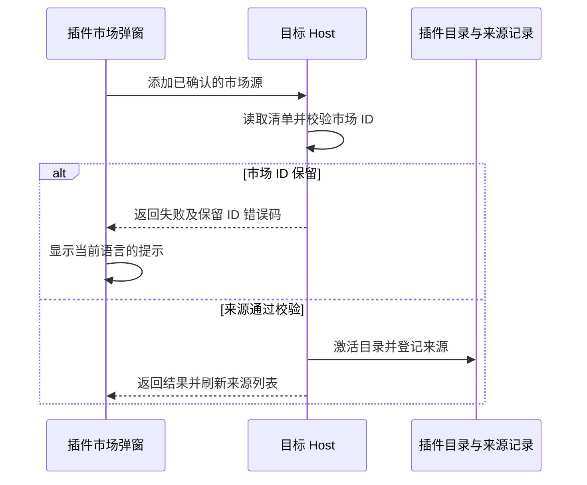

# OpenZWork 插件市场来源

- 新配置及升级配置首次读取商店时，目标 Host 补登记缺失的 Claude Code 公开市场源，保留已有来源。登记只写本地来源记录，联网获取目录由现有刷新或按需安装触发。
- OpenZWork 内置插件使用随应用交付的目录。商店「市场源」列出可刷新的目录。
- 商店用完整插件 ID 关联随包的展示信息。已发现的内置插件在列表、详情和搜索中使用当前语言的名称和说明，缺少译文时使用默认文案。卸载的内置插件使用已有的恢复入口。只有运行时用途的宿主不作为商店条目展示。
- Claude Code 市场条目优先展示清单提供的 HTTPS 图标。远程图片加载失败时，卡片和详情按完整插件 ID 尝试已有的随包品牌图标，缺少素材或素材加载失败时显示通用图标。旧目录中的相对路径也使用随包或通用图标。清单 URL 或插件身份变化后重新选择图片。
- 两处「添加」复用同一菜单和翻译。商店入口打开添加来源弹窗，用户设置入口进入商店后打开同一弹窗。
- 添加来源时由目标 Host 读取清单并校验保留市场 ID，校验通过后才激活目录和更新来源记录。使用保留 ID 时，`plugins/marketplace/add` 仍返回失败，沿现有错误响应在 `error.data.code` 携带 `ZCODE_PLUGIN_MARKETPLACE_RESERVED_ID`。消息保持通用客户端可读。
- 弹窗保留错误码和原始消息，在显示时按当前界面语言解释该错误。弹窗打开期间切换语言时，提示随语言更新，来源输入保留，用户可更换来源重试。缺少该错误码的旧 Host 及其他失败继续使用原有错误消息。

验收覆盖纯净配置、已有来源的旧配置、两处添加菜单、保留 ID 拒绝与普通来源重试。拒绝后本地内置目录和已登记来源保持原样。

[用户反馈 #79](https://github.com/BlueSkyXN/OpenZWork/issues/79)
