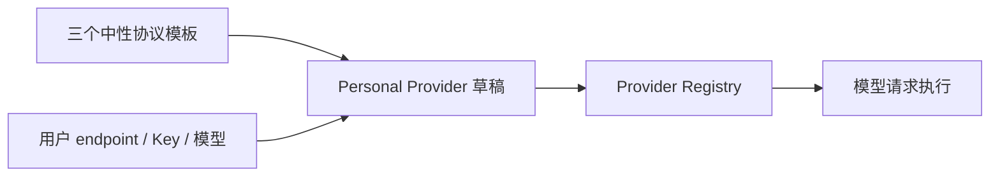

# 标准 Provider 模板

## 产品规则

OpenZWork 的内置 Provider 目录只提供三个中性协议模板：

| templateId                         | API type                  | 用途                             |
| ---------------------------------- | ------------------------- | -------------------------------- |
| `standard-anthropic-messages`      | `anthropic-messages`      | Anthropic Messages 兼容服务      |
| `standard-openai-chat-completions` | `openai-chat-completions` | OpenAI Chat Completions 兼容服务 |
| `standard-openai-responses`        | `openai-responses`        | OpenAI Responses 兼容服务        |

模板只预置协议类型和 API Key 接入方式；不预置厂商名称、Base URL、Logo 或模型目录。用户创建 Provider 时选择协议模板，随后填写自己的 endpoint、Key 和模型。模型能力与渠道适配独立维护，见[模型能力匹配](model-capability-matching-openzwork.md)。

内置配置允许保留：

- 三个中性模板；
- 通用模型默认值；
- 三个协议各自的通用请求参数映射；
- 三个模板的空模型目录。
- 已维护型号的能力、模型与协议联合映射，以及公共服务 endpoint 的差异规则。

内置配置不允许恢复：

- 第三方厂商模板或固定 Provider；
- 厂商 Logo、API Key 管理入口和默认连接地址；
- 随模板自动添加的厂商模型目录；
- 官方账号与套餐专用 Provider。

## 兼容边界

用户已有的 Personal Provider 记录不删除。旧厂商模板的连接和模型成员不迁移；移除模板后缺少协议、endpoint、Key 或模型的 Provider 仍需补齐。能力按当前模型 ID、协议和 endpoint 解析，用户显式保存过的模型覆盖与排序保持原样。

旧 `templateId` 不做隐藏兼容基线，避免厂商配置继续随产品分发。完整的 Personal Provider 遇到未知 `templateId` 时按无模板基线执行，保留 ID 和原记录；缺少必要配置时仍展示缺项并禁止执行。内置 Provider 的模板引用错误仍由目录完整性校验拒绝。

## 状态所有者

| 状态                           | 唯一所有者                                     |
| ------------------------------ | ---------------------------------------------- |
| 三个中性模板与模型能力规则     | `config/provider/zcode-builtin.json`           |
| Personal Provider 草稿与保存值 | Provider Config Service 的 personal config     |
| 协议选项展示                   | `ProviderApiTypeDataSchema` 与设置页协议选择器 |
| 模型事实                       | 目标 Host 的规则解析结果 + Personal 精确覆盖   |

## 验收

| ID    | 场景                                   | 断言                                                                                                    |
| ----- | -------------------------------------- | ------------------------------------------------------------------------------------------------------- |
| SPT01 | 解析正式与测试内置配置                 | 模板数量为 3，API type 分别对应三种协议，均无 Base URL、Logo 和内置模型                                 |
| SPT02 | 扫描内置配置                           | 不含厂商模板、账号 Provider、默认模型成员、模板模型规则或固定 Provider 模型规则；公共站点规则仅描述能力 |
| SPT03 | 创建协议模板实例                       | 生成 Personal Provider，默认待填写 endpoint，不带入任何模型                                             |
| SPT04 | 保存自定义模型并解析                   | 已知模型消费模型／协议／公共站点规则；未知模型保留现有通用开关与映射，明确展示通用配置                  |
| SPT05 | 旧 Personal Provider 携带旧 templateId | 完整显式配置及模型进入执行注册表，记录与排序不变；缺项仍不能执行；不继承旧厂商模板事实                  |
