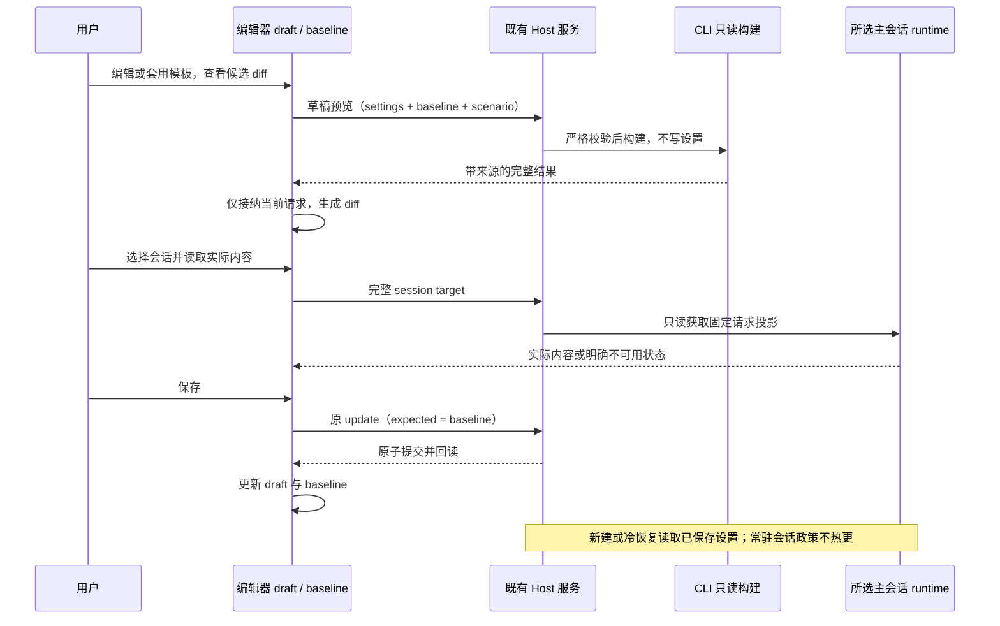

# 系统提示词编辑器：完整预览、差异与模板

状态：已实现，验证范围见[实施与验收记录](../testing/system-prompt-editor-plan-openzwork.md)。更新日期：2026-11-04。

本规格扩展[系统提示词设置](system-prompt-settings-openzwork.md)，交付可编辑、可解释、可比较的提示词页面。实施切片、技术边界与验收场景见[实施与验收计划](../testing/system-prompt-editor-plan-openzwork.md)。原有 SP01–SP15 和[设置页布局规则](settings-visual-polish-openzwork.md)继续作为回归基线。

## 1. 目标与范围

用户需要同时看到当前草稿的完整效果和所选会话实际使用的内容；需要展开动态上下文，理解各项来源；需要红绿 diff 判断正文及配置变化；需要全局 Profile、章节模板和自定义章节组成同一条编辑流程。

本期按以下方案设计：

- 完整预览分为“当前草稿”和“会话实际内容”，各自显示来源。
- diff 同时包含配置变化摘要和按章节组织的文本差异。新增为绿色，删除为红色，修改展示旧文与新文，辅以 `+ / −` 和文字标签。
- 自动生成的上下文可展开阅读；桌面悬浮仅用于简短摘要，点击、键盘和手机触摸均能打开完整详情。
- 全局 Profile 使用 JSON 导入／导出；章节模板应用到单章；自定义章节继续使用现有设置结构。
- 模板、导入与恢复默认先修改草稿，持久化沿用现有保存和并发比较。

暂不增加 Profile 目录扫描、个人模板收藏库、按模型／项目默认 Profile、运行中热切、命令面板入口、真实请求历史归档或出厂红蓝队正文。首批内置章节模板提供沟通简洁／解释、执行验证清单；不提供个人收藏。

“零新持久化所有者”继续成立。完整预览和会话实际内容需要扩展 CLI、服务和只读协议，原先仅做 Profile 时的“这些层零改动”不再作为本期约束。

## 2. 已核对的实现

| 事实                                                                          | 当前来源                                                                                                                     | 对设计的约束                                                |
| ----------------------------------------------------------------------------- | ---------------------------------------------------------------------------------------------------------------------------- | ----------------------------------------------------------- |
| 17 个内置章；5 个 generated 章只能 default／disabled                          | `packages/shared/src/system-prompt/contract.ts`                                                                              | 规则正文和动态数据开关分开呈现                              |
| settings 的顶层字段必填，只有 sections 的键可缺省                             | 同上                                                                                                                         | Profile 是完整 settings 结构中的稀疏章节覆盖                |
| 自定义标题、正文在 schema parse 时会 trim                                     | 同上                                                                                                                         | 合并校验不能顺便规范化未点名草稿                            |
| 草稿、baseline、dirty、conflict 在编辑器内；baseContent 由 changeChapter 设置 | `packages/ui/src/settings/system-prompt/SystemPromptSettingsSection.tsx`                                                     | 应用模板不能更新 baseline；导入需显式重记目标章 baseContent |
| 原 generated 单章预览只显示生成状态                                           | 同上；`SystemPromptContextSwitches.tsx`                                                                                      | 展开正文需要补充数据来源                                    |
| “已选择输出风格”使用 Example／Use short paragraphs. 合成内容                  | `apps/zcode-cli/packages/core/src/context/prompt-settings/runtime-template.ts`                                               | 改称模拟条件，不能显示成真实选中的风格                      |
| ContextBuilder 分别输出 systemMessages 和 metaUserAttachments                 | `apps/zcode-cli/packages/core/src/context/builder.ts`                                                                        | 保留消息分组和来源，不能简单连接 catalog 文本冒充完整请求   |
| session/debug 只观察统计、网络状态和有界 headers                              | `apps/zcode-cli/packages/bootstrap/src/zcode-protocol/session-debug.ts`                                                      | 会话实际正文需要专门的只读投影                              |
| 保存经 useSettings 到 SettingService，锁内比较 expectedSystemPromptSettings   | `packages/ui/src/settings/system-prompt/hooks/useSystemPromptSettings.ts`；`packages/services/src/setting/settingService.ts` | 保持唯一设置写入链和冲突处理                                |
| DiffViewer 接收完整 oldFile／newFile，支持 options 覆盖                       | `packages/ui/src/components/ui/diff-viewer.tsx`；[Diff Viewer](../ui/diff-viewer.md)                                         | 优先复用完整文本对比，不伪造 Git patch，不改其全局默认行为  |

## 3. 页面结构与概念

| 区域     | 主要内容                                             | 行为                                         |
| -------- | ---------------------------------------------------- | -------------------------------------------- |
| 页头     | 系统提示词；导入 Profile、导出草稿、恢复默认         | 无“当前 Profile”持久状态；导出明确取当前草稿 |
| 编辑区   | 按章节定制／整段替换规则                             | 切换方式保留现有章节草稿和开关合同           |
| 章节导航 | 规则章节、自动上下文、自定义章节                     | 桌面目录；窄屏复用选择器；标明已定制／关闭   |
| 章节详情 | 用途、内容起点、应用方式、正文、本章效果／与默认对比 | 模板入口属于内容起点；四种操作属于应用方式   |
| 完整预览 | 当前草稿／会话实际内容；完整内容／差异               | 独立对话框分两种来源；关闭后保留编辑草稿     |
| 保存区   | dirty、冲突、错误、取消修改、保存                    | 沿用既有唯一保存入口                         |

概念映射：Profile 配置多章和开关；章节模板提供单章内容及建议操作；default／append／replace／disabled 决定组合方式；模拟运行条件只改变预览输入；“系统提示词／附加上下文”标明输出所属分组。

章节按现有能力呈现：

- 9 个规则章：产品身份、角色、安全、运行约定、沟通、执行、技能调用指导、上下文管理、持续执行。角色与技能指导等仍可能受运行条件影响。
- 3 个混合章：桌面交互、记忆使用、输出风格。分别展示“可编辑规则”和“自动补充内容”；停用只影响可编辑规则。
- 5 个自动上下文章：环境、Git、技能清单、用户与项目指令、日期。提供注入开关与只读详情。

“模拟运行条件”移到预览区域。输出风格选项使用“无输出风格／示例风格：简短段落”等能辨认示例的名称。模拟条件不进入 AppSettings、Profile 或章节模板。

### 动态上下文详情

| 项目           | 展开内容                                                          | 来源说明                                                 |
| -------------- | ----------------------------------------------------------------- | -------------------------------------------------------- |
| 环境信息       | 工作目录、附加目录、Git 仓库标志、平台、Shell、系统版本、执行模型 | 示例环境或所选会话环境                                   |
| Git 上下文     | 分支、主分支、Git 用户、状态、最近提交                            | 会话开始时的工作区快照；非仓库说明缺席原因               |
| 技能清单       | 实际注入的技能名称和描述摘要                                      | 展示发现结果及已有截断状态，不将技能正文混入目录         |
| 用户与项目指令 | 指令来源及正文、项目记忆索引                                      | 按用户／项目／记忆来源组织；明确修改来源文件的入口或路径 |
| 日期           | 注入的日期文本                                                    | 所属示例或实际请求的日期                                 |

详情共用完整预览的数据，不另查一份环境再拼接。来源缺失、未注入、关闭、读取失败是不同状态。手机不依赖 hover；详情支持选择、复制、折叠和键盘打开。

## 4. 两种完整预览

### 当前草稿

“当前草稿”页签使用当前 draft 和明确标记的示例环境，可切换 Desktop／Terminal、记忆、技能、输出风格、Git、可视化条件。“会话实际内容”页签中的“与草稿比较”使用该请求可重放的上下文，显示模型和捕获时间。

CLI 使用同一 ContextBuilder 组装，返回章节、来源、注入分组、顺序、正文与可用性；UI 负责阅读和 diff。上下文快照作只读输入，构建草稿效果不得更改真实 runtime 配置、工具注册或历史。

正文编辑、模式切换和模板应用后刷新预览。请求关联当前草稿版本、上下文版本及目标身份；迟到结果不得覆盖较新的内容。需要 debounce 时仅作请求合并，正确性由版本校验保证。

无效草稿仍可编辑和查看配置文本差异。完整构建显示具体校验错误；若保留最近有效结果，应清楚标成旧结果，不能作为当前草稿的 diff 右侧。

完整输出分为“系统提示词”和“附加上下文”，按来源块支持展开、搜索和复制。导出 Profile 不读取这个输出。

### 会话实际内容

展示所选交互式主会话真实模型请求采用的应用提示词投影：系统提示词块以及技能、用户／项目指令、日期等附加上下文。对话历史、工具 schema、HTTP headers 和完整 provider payload 不纳入本页正文。

实施时必须证明采集内容来自实际请求构建路径。同步预览 getter 或根据最新磁盘文件重建的内容，不能标为会话实际内容。记录请求标识、会话／runtime 代次、模型、构建时间、内容来源边界和完整性；若 provider 改写消息角色／封装，不能宣称此视图与原始 HTTP payload 逐字相同。

每个常驻主会话仅保留最近一份不可变投影，随 runtime 生命周期回收，按需查询，不广播全文、不落普通日志、不新增正文数据库。每份预览文档最多 1 MiB／1024 块；超限返回 incomplete，不截断成貌似完整的正文。

会话选择后显式加载／刷新。切换会话、Host 或 remoteSessionId 后清除前一目标的展示绑定并拒收旧响应。尚无请求、快照过期、旧 CLI 不支持和内容不完整给出结构化状态；离线或 runtime 已回收显示读取失败及刷新入口；查看不启动模型、不创建或重新物化会话。

保存设置后，实际会话视图仍以它捕获的实际内容为准。主会话 fork、冷恢复、子代理和工作流的原有设置继承合同保持不变；子代理／工作流不新增此设置页编辑入口。

### 与同一会话比较

一次比较绑定固定的请求快照与上下文引用。左侧为这次请求实际采用的内容，右侧为当前 draft 使用同一构建上下文的反事实结果。比较携带 snapshotId；新请求已覆盖该快照时返回 expired，用户显式刷新后再比较。已加载正文不由后台请求自动替换。

比较复用捕获的 ContextBuilder 输入和实际动态原文，包含模型、输出风格、能力、环境、Git、技能和指令。原本未注入的 generated 内容重新启用、混合来源块无法精确拆分，或构建输入与已发系统消息不匹配时返回 comparisonUnavailable，保留实际原文及明确说明。缺失或截断的一侧不能当作空文，不能由此渲染整段新增／删除。

## 5. Diff 合同

### 比较对象

| 场景                    | 左侧                                 | 右侧                               |
| ----------------------- | ------------------------------------ | ---------------------------------- |
| 保存前检查              | 本次载入或最后成功保存的 baseline    | 当前 draft                         |
| Profile／章节模板应用前 | 当前 draft                           | 合并后的候选 draft                 |
| 与本章默认比较          | 当前程序默认规则，在相同条件下的效果 | 本章定制在相同条件下的效果         |
| 与会话比较              | 固定请求快照的实际内容               | draft 在同一快照上下文下的构建结果 |

外部设置更新不能替换脏草稿的 baseline；沿用 conflict 提示。旧 baseContent 可在“默认版本对照”中另行阅读，不悄悄取代“当前默认规则”的比较基准。

### 配置摘要与文本差异

先显示模式、章节操作、动态开关和自定义章增删／顺序变化，再显示具体文本。整体模式改变时列出未点名章节的生效变化；两种模式的切换均需覆盖。replacement 即使当前未启用，被改写或清空也要显示。

按稳定章 id 和注入分组对齐；自定义章按 id 对齐，重命名与移动独立展示。运行时聚合块若无法可靠拆分则按原块展示，不猜测标题分章。系统消息与附加上下文保持顺序和来源，不能跨角色配对。实际正文参与逐行比较，不以字符数、模式或标题相同判断无变化。

已有 DiffViewer 的完整 oldFile／newFile 入口优先用于可比较的完整文本对。主题、布局及标记使用调用方 options，沿用现有依赖。该入口拥有全量正文，未变化段可展开；不得伪造临时文件路径去触发文件读取或原生打开。

| 内容       | 视觉与交互                                         |
| ---------- | -------------------------------------------------- |
| 新增       | 淡绿色背景、`+` 标记及新增行语义                   |
| 删除       | 淡红色背景、`−` 标记，原文保持可读                 |
| 修改       | 旧文红、新文绿；词级突出变化，不按颜色评价内容好坏 |
| 未变       | 普通颜色；长段默认折叠，可展开                     |
| 模式／开关 | 明确“原状态 → 新状态”，高影响后果单独提示          |

复用 DESIGN 的 diff-added／diff-removed 语义色及现有主题适配；检查实际 diff 渲染器内部主题。宽屏支持左右对照与统一视图，窄屏默认统一视图。使用标记、左右标题、行号／文本标签辅助颜色；保证键盘展开、焦点、触摸与中英文可读。

security 被替换／停用、整体替换使默认安全规则退出，以及 generated 章关闭需在摘要中显著展示。request_user_context 关闭的后果包含用户／项目指令和项目记忆索引停止自动注入。提示词变化不改变工具权限。

## 6. Profile 与章节模板

### Profile 文件格式

```text
{
  schema: "openzwork.system-prompt-profile", // 必填字面量
  schemaVersion: 1,                         // 必填字面量
  id: string,                              // 仅文件元数据
  name: string,
  description?: string,
  settings: systemPromptSettingsSchema      // 逐字复用已有 settings 合同
}
```

外层 strict；id 为 1–80 位字母、数字、下划线或连字符，name 为 1–80 字符，description 最多 1000 字符。输入 JSON 最多 2 MiB，支持 UTF-8 BOM。未知 schemaVersion 与未知章节拒绝；不以静默跳过兼容旧客户端。新增 settings 章节不要求改变文件外壳，但旧客户端仍可能拒绝新章节。

settings 的 version、mode、replacement、sections、customSections 均必填。mode 与 replacement 成对接管；sections 中未点名键保留当前草稿。customSections 同 id 原位覆盖，新 id 按文件顺序追加；空数组不删除旧章。文件内部重复 id 仍由现有 schema 拒绝。

应用顺序：

1. JSON 解析，再校验 Profile；语法错误与 schema 错误分开显示，包含字段路径与第一个原因。
2. 从应用时当前 draft 生成候选，保留未点名字段原值。
3. 忽略文件携带的 baseContent，仅为此次覆盖的内置章记录当前 catalog 默认文本。
4. 用现有 schema 校验完整候选，包括 12 章和 256,000 字符总限额；校验成功不将整份 parse 结果回填未点名草稿，以免 trim 原文。
5. 展示配置摘要与文本 diff；应用时核对候选对应的草稿／catalog 版本。过期则更新预览，不能使用旧候选覆盖新编辑。
6. 应用仅 setDraft，不改变 baseline，也不调用 SettingService.update。

完整候选无效时整体拒绝，包括未点名但仍无效的草稿。导入失败、取消或超限均保留原稿，不能截断后应用。

导出取当前草稿，校验并在副本上按现有 schema 规范化，移除全部 baseContent；原草稿和 dirty 不变。模拟条件、实际会话内容、环境路径和捕获快照不属于导出字段。用户主动写入的规则正文按原设置合同处理。

往返一致以默认空白草稿为基准；应用到已有草稿按合并合同验收。恢复默认直接用 createDefaultSystemPromptSettings() 替换草稿，不能通过空 Profile 合并来清空覆盖。

Desktop 用 IPlatformService.selectFile／saveFile，文件内容由 hook 调用本机 Host 的现有 fileService 读取。readTextFile 单次最多 256KiB，合法中文文件可能更大；先用 readTextFile 的 totalBytes 取得长度，再按 1 MiB 分片调用 readFileRange，合并完整字节后统一 UTF-8 解码。空读和超出预期长度报错；文件字节上限与 settings 字符限额分别校验。

Web／手机提供粘贴导入、下载／复制导出；复制失败保留可选择文本或下载入口，取消文件选择不报导入失败。

### 章节模板与整段起点

内置章节模板声明目标 sectionId 和本地化名称／正文，首批均使用 append；与现有定制的冲突通过候选 diff 展示。选择模板先进入候选 diff，再应用到同一草稿；沿用目标章校验和 baseContent 处理。模板应用不建立 activeTemplateId 持久状态。

generated 章只接受开关，不接受文字模板。自定义章节保留现有标题、正文、id、顺序和数量上限；进入整段替换时保留配置但暂停注入。首批内置模板为沟通简洁、沟通解释和执行验证清单；个人模板收藏不在本期范围。

整段编辑提供“从默认规则开始”和“从当前定制规则生成”。转换只提取可编辑规则，不能从包含路径、Git、日期或指令原文的完整预览直接复制生成。默认规则、自定义章及条件规则按 catalog 顺序写入候选正文并出现在转换 diff 中。转换页说明：条件规则转为整段正文后始终生效，`{{memoryRoot}}` 等章节变量保留为普通文本，由用户检查和修改。64,000 字符等现有校验仍生效，超限整体拒绝。转换也仅进入草稿。

## 7. 所有权、接口与事件顺序

| 对象                            | 所有者                      | 本期变化                         |
| ------------------------------- | --------------------------- | -------------------------------- |
| draft、baseline、待应用 Profile | 现有 React 编辑器           | 增加临时导入与比较状态           |
| 预览选择、结果、diff 展示       | 编辑器及 hook               | 新增派生展示，不持久化           |
| settings                        | SettingService              | 写入接口和锁内 expected 比较保持 |
| 默认文本、拼接逻辑              | CLI ContextBuilder／catalog | 扩展只读完整预览                 |
| 运行政策                        | 主会话 runtime 创建期快照   | 生效与继承规则保持               |
| 实际请求提示词投影              | 所选会话 runtime            | 最近一份有界只读观测，非设置权威 |
| Profile 文件                    | 用户导入／导出              | 无应用数据库或后台扫描           |

### 新增只读能力

合同位于 `packages/shared/src/system-prompt/preview.ts`，由现有 zcode-agent 服务转发并在 CLI bootstrap 严格解析。

| 方法                   | 请求                                                | 返回与实现                                                                                                                                    | 路由                                            |
| ---------------------- | --------------------------------------------------- | --------------------------------------------------------------------------------------------------------------------------------------------- | ----------------------------------------------- |
| `systemPrompt/preview` | `settings`、可选 `baseline`、`scenario`             | `before?`／`after` 文档；`buildSystemPromptPreview` 复用 ContextBuilder                                                                       | 本机已有 catalog/plugin-management CLI          |
| `session/systemPrompt` | `sessionId`、可选 `snapshotId`、可选草稿 `settings` | available：snapshotId、sessionId、capturedAt、model、boundary、actual、comparison?；unavailable：no_request／expired／incomplete／unsupported | 完整 workspace target 的 `existing-only` 客户端 |

`SystemPromptPreviewDocument.blocks` 每块包含 `id/source/title/target/content`；target 为 system 或 meta_user。请求 revision 在 UI 闭包和输入 key 中关联，复用 RPC 的请求关联机制。快照标识来自 `model_request_started.requestId`；捕获内容来自本次 `buildProviderRequestMessages` 的真实投影，在折入工具结果之前仅保留提示词片段，并核对片段属于最终消息。普通聊天和完整工具结果不进入观察结果。

设置仍绑定本机 Host；会话查询沿现有 owner／lease 路由。远程透传 workspaceIdentity 与 remoteSessionId，不按相同路径合并目标。Desktop continuous 和手机 replayable 分别验收重连后按需重取；不把全文放进 stream 广播或业务恢复快照。

旧 CLI 的新增只读能力不可用时，保留原有可用的编辑／保存，相关预览显示升级提示。读取失败不卸载编辑器、不丢草稿。接口只接受已连接且有权查看的目标，不创建新 runtime 或借查询触发上下文初始化副作用。



## 8. Impact Brief

模式为 implementation；改动层为 presentation、draft-default、validation，以及只读查询边界。设置持久化格式和既有 commit-effect 保持。

| UI surface      | 草稿／默认来源              | 校验与动作                      | 权威与隔离                                       |
| --------------- | --------------------------- | ------------------------------- | ------------------------------------------------ |
| Desktop 设置页  | 编辑器／本机 CLI catalog    | 模板、Profile、预览；现有保存   | 本机 SettingService；远程当前 tab 不改变设置归属 |
| Web／手机设置页 | 同一编辑器和已连接 Host     | 粘贴／下载，统一 diff，点击详情 | 现有 attachment；不读取浏览器路径作为 Host 路径  |
| 会话实际预览    | 所选 runtime 的固定请求投影 | 按需读取／同条件比较            | session／Host／runtime 代次隔离，不提交输入      |

must-inspect：shared settings／新增预览合同、编辑器、保存 hook、CLI builder、实际请求采集边界与服务路由。should-inspect：动态构建器、文件读取、完整文本 DiffViewer。invariant-only：CommandInbox、owner／lease、权限、fork／冷恢复政策、provider 请求内容不被预览改写。evidence-only：已有 SP 单测和 pending E2E。

所有客户端共用 schema、合并和差异语义；文件入口、显示布局和实际会话读取目标按平台分开。复用 DiffViewer 时通过调用方 options 配置，现有 Git／代码预览默认不变。

功能图沿用 system-prompt-settings 节点，补充 Profile、预览和观测的实际代码入口。没有新增持久化模块或设置写入路径。

架构检查沿用 shared system-prompt-contract、system-prompt-ui 和 CLI system-prompt-context 模块边界。新 shared 文件通过已登记的公开入口暴露，UI 不跨层导入 CLI 实现。
