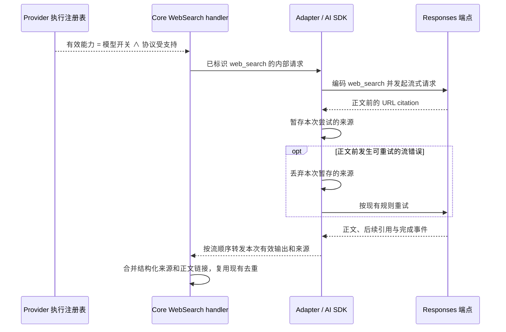

# OpenAI Responses 原生联网搜索

> OpenZWork 自有规范（OZ-C013）。上游 [WebSearch](../../apps/zcode-cli/docs/design/v2/tool/13-websearch.md) 描述原有行为；本规范记录下游差异。

## 产品规则

`WebSearch` 仍是主模型调用的客户端工具。执行注册表只有在模型开关打开、且协议支持时才启用它。内部请求只带一个供应商原生 `web_search`；主模型请求不会直接暴露服务端工具。

| Provider 协议           | 原生工具              | 域名过滤                                                                                           | `maxUses`          |
| ----------------------- | --------------------- | -------------------------------------------------------------------------------------------------- | ------------------ |
| Anthropic Messages      | `web_search_20260209` | 沿用允许及屏蔽域名                                                                                 | 沿用原行为，默认 8 |
| OpenAI Responses        | `web_search`          | 非空 `allowed_domains` → `filters.allowedDomains`；非空 `blocked_domains` 在编码阶段报错，不发请求 | 不发送             |
| OpenAI Chat Completions | 不支持                | 不适用                                                                                             | 不适用             |

`query` 写入内部请求的用户消息。执行能力无效时不暴露工具，直接调用也在发内部请求前报出既有能力错误。设置页仍显示原始开关，个人配置不被执行能力解析改写。服务端不支持原生工具时，继续走现有模型错误路径。

## 来源与事件顺序

| 所有者            | 职责                                                                                     |
| ----------------- | ---------------------------------------------------------------------------------------- |
| Provider resolver | 仅在构建执行注册表时合取协议白名单和模型开关                                             |
| Adapter           | 编码原生工具；仅对 Responses 内部搜索转发 SDK 的 HTTP(S) URL 来源，不转发文档来源        |
| CLI Core          | 从本次流收集来源到 `ModelTextResult.sources`，由现有 `buildWebSearchOutput` 构建最终结果 |

正文没有 Markdown 链接时仍可输出结构化来源；同一 URL 同时出现在 SDK citation 与正文时仅保留一项，优先结构化标题。正文、结果 schema 和现有去重规则不变。不用示例 URL 补缺失来源；不扩大到普通对话引用或其他 Provider，不改桌面/手机协议。

首个有效输出前收到的 URL 引用由 Adapter 暂存，随有效输出或正常完成一并释放。只有引用时，流错误仍按现有规则判定能否重试。失败尝试的暂存来源随该次尝试丢弃，下一次请求从空列表开始。

## 验收

| ID     | 验收条件                                                                                                                           |
| ------ | ---------------------------------------------------------------------------------------------------------------------------------- |
| WSR-01 | Responses 编码包含 `web_search` 与允许域名；`maxUses` 不进入请求。                                                                 |
| WSR-02 | Chat Completions 不暴露工具；直接调用以既有能力错误退出，内部搜索请求为零。                                                        |
| WSR-03 | Anthropic 的编码、域名过滤及 WebSearch handler 既有回归不变。                                                                      |
| WSR-04 | Responses 非空屏蔽域名导致编码错误，传输层零调用。                                                                                 |
| WSR-06 | 已授权真实 Responses 渠道：桌面至少返回一条来源，手机打开同一会话显示一致；与离线 CI 分开记录。                                    |
| WSR-07 | 真实 resolver 三协议 × 开关矩阵；有效能力、Core 暴露与调用一致，个人配置不被改写。                                                 |
| WSR-08 | SDK 用合成 Responses SSE 解析 `url_citation`；无 Markdown 时最终来源仍含 URL，重复来源只出现一次；普通对话和文档注解不新增流来源。 |
| WSR-09 | 第一轮只收到 URL 引用便断流时仍能重试，第二轮返回正文及自己的引用，第一轮的引用不进入结果。                                        |

Provider 的 `nativeWebSearchCapabilities.test.ts` 进入固定核心清单。Adapter 与 Core 各自的 `websearch-openai-responses.test.ts` 和既有 `websearch.test.ts` 在核心 CI 点名。
