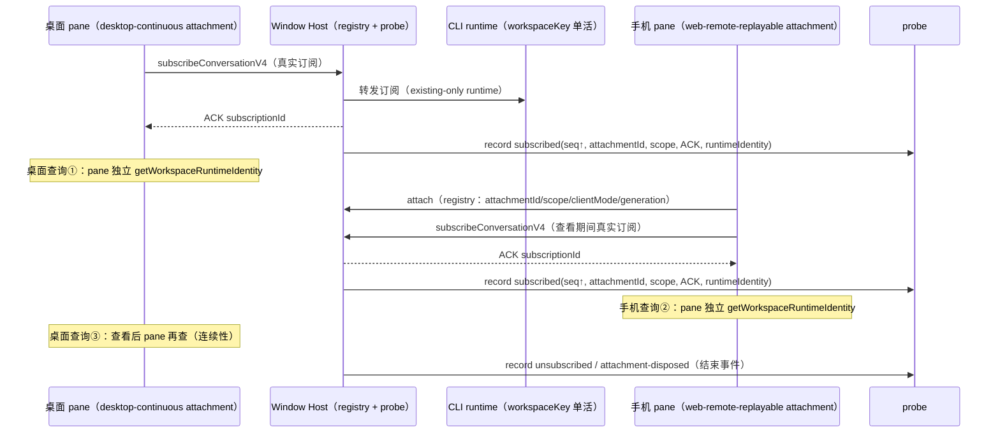

# WT04 direct runtime association（OpenZWork 自有合同）

状态：active（2026-11-16）。本文件是 OpenZWork 自有 spec，不是上游文档改写；上游
`docs/git/worktree.md` 的 WT-12 场景表保持上游原文不动。

## 目的

WT04（受管 worktree 冷恢复归属 + 手机查看）的「手机查看复用原 Host/CLI runtime」断言，
必须以**两端独立读取的真实 runtime 身份**与 **Host 真实 attachment/subscription 证据**
交叉核对成立。禁止用同一份读数赋给两端（历史 sharedInstanceKey 同值代填）、
禁止用 generation/state 相等替代实例身份（独立复核反例：两个独立 CLI 各自
`ensureReady` 后都是 generation=1/state=ready）、禁止以全局进程树计数作替代判据。

## 观察面（只读，不构造第二份业务状态）

| 观察面                            | owner                                                                         | 取值方式                                                                                                                                                                                                   |
| --------------------------------- | ----------------------------------------------------------------------------- | ---------------------------------------------------------------------------------------------------------------------------------------------------------------------------------------------------------- |
| 桌面 pane runtime 查询            | 被测 SessionPane 当前注入的服务（`useServices()` 返回的 pane accessor）       | `zcodeSessionService.getWorkspaceRuntimeIdentity({ workspacePath, workspaceIdentity, remoteSessionId? })`，remoteSessionId 取 V4 Provider 当前已解析 scope（`V4ConversationContextValue.remoteSessionId`） |
| 手机 pane runtime 查询            | 手机页同一 SessionPane 组件注入的服务                                         | 同上；手机 attachment 的 scope 由 workspaceConnectionRegistry 解析出真实 remoteSessionId                                                                                                                   |
| Host attachment/subscription 记录 | Window Host（`windowHostAttachmentRegistry` + `exposeServicesOnMessagePort`） | `subscribeConversationV4`/`unsubscribeConversationV4` 真实调用与 ACK 经 E2E-only probe 代理记录；attachmentId/scope/generation/clientMode 来自 registry attach 参数                                        |
| 进程树快照                        | WDIO 测试进程                                                                 | `ps -axo pid=,ppid=,lstart=,command=`；仅作辅助诊断输出，不参与判定                                                                                                                                        |

pane 查询与 Host probe 都只读取既有服务；不新增业务 RPC、不新增 probe port、
不发送测试 subscription、不由 Renderer 自报 Host attachment owner。

## 事件顺序（唯一 owner：Host；订阅生命周期归 connection scope facade）

判定输入只来自图中标注的观察面；测试把①②③与 probe 记录交叉核对。

## probe 启用合同（缺一不启用；关闭时零输出、零额外查询）

1. 专用 E2E bridge flag：`VITE_ZCODE_E2E_STORE_BRIDGE=1`（复用既有 E2E-only 开关）。
2. 非空 run ID：`ZCODE_E2E_RUN_ID`。
3. 有效 artifact 目标：`ZCODE_E2E_ARTIFACT_DIR` 存在且输出路径不逃逸该目录。

Host 侧 probe 记录写入 `<artifactDir>/host-probes/host-attachment-subscriptions-<hostPid>.ndjson`，
每行一条 JSON（seq 单调递增、recordedAt ISO 时间、event、attachmentId、clientMode、
scope、scopeMatchesTarget、sessionId、topic、subscriptionId、workspacePath/workspaceIdentity/
workspaceKey、remoteSessionId（scope 与订阅参数两列）、runtimeIdentity（Host 按
`getWorkspaceRuntimeIdentity` existing-only 语义查询；失败记 runtimeIdentityError，不拉起
dormant runtime））。写入串行化（write chain），诊断失败不改变产品 ACK/背压/路由语义。

## 判定合同（全部满足才算 direct 关联成立）

1. 桌面/手机 pane 查询均 status=ok，且各自返回 identity/generation/workspaceKey；
   查询不可用（服务缺失、错误、缺记录）一律判失败。
2. 两侧 sessionId 一致且与两条 Host 记录的 sessionId 一致；topic 与 sessionId 对应。
3. workspace key 一致：`workspaceIdentity?.trim() || workspacePath`；本地 workspace 两侧
   identity 同为空合法；同路径不同 identity 仍严格隔离（单侧不一致判失败）。
4. 桌面记录：clientMode=desktop-continuous、scope 与桌面 pane 解析一致（本地 workspace
   为 local）、scopeMatchesTarget=true、订阅在查看期间未收到 unsubscribed/attachment-disposed
   （订阅有效性以记录序列还原）。
5. 手机记录：clientMode=web-remote-replayable、scope 与手机 pane 解析一致——本地配对
   查看桌面 workspace 走 shared Host attachment（scope=local，attachmentId 形如
   `shared-host-attachment-*`）；查看远端 workspace 时 scope=remote 且 remoteSessionId 与
   registry scope 一致；订阅发生在查看窗口内（seq > 窗口起点）。
6. Host 侧 runtimeIdentity 与对应 pane 查询结果一致（identity、workspaceKey；generation
   仅辅助）。不同 runtime 即使 generation/state 相同也因 identity 不同被拒绝。
7. 反例回归必须能拒绝：同 generation/state 不同 identity、缺少一侧 attachment、
   scope/会话不匹配、订阅已结束、查询不可用、缺 artifact、E2E gate 未启用，以及
   旧「两侧赋同一 sharedInstanceKey」代填（无 Host 记录支撑即拒绝）。

## 验收入口

- 工程回归：`packages/desktop/test/directAttachmentAssociation.test.ts`（判定合同反例 +
  probe 启用矩阵 + 记录解析）。
- E2E：`packages/desktop/test/e2e/git/worktrees/manual-review/pending/git-worktree-remote-view.test.ts`
  （manual-review/pending，显式 fixture 候选运行；runId 与两端查询、Host artifact 记录在案）。
