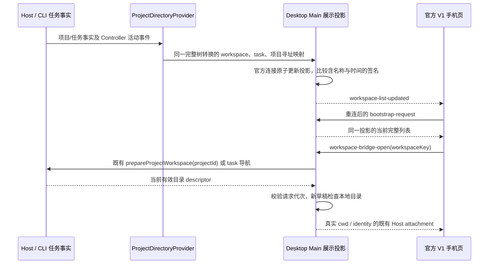
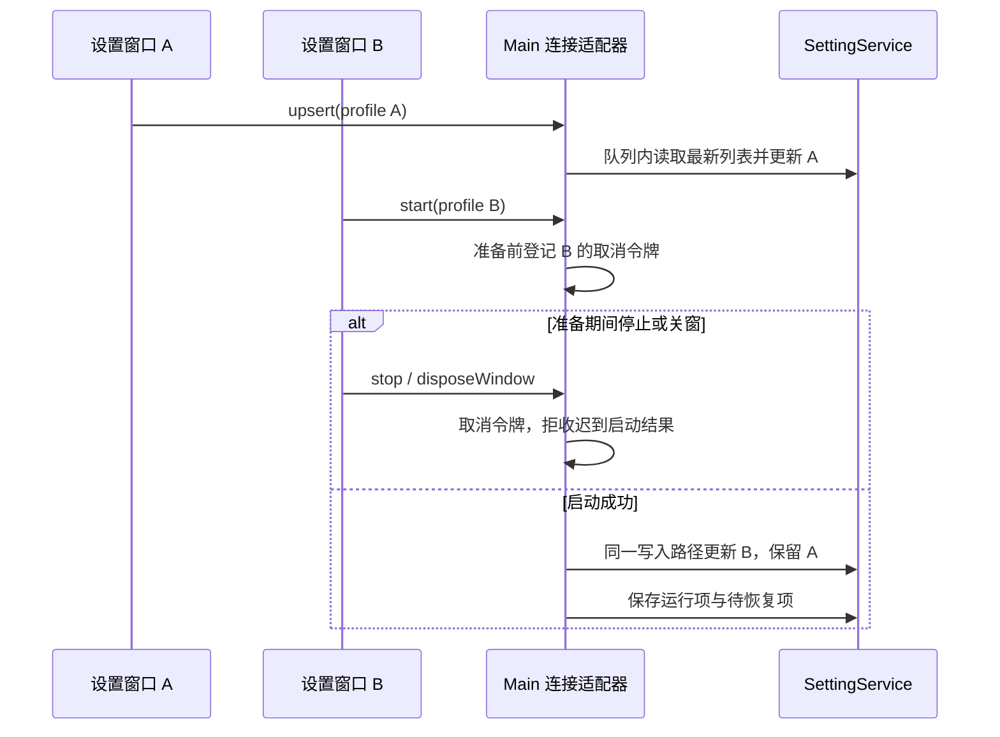
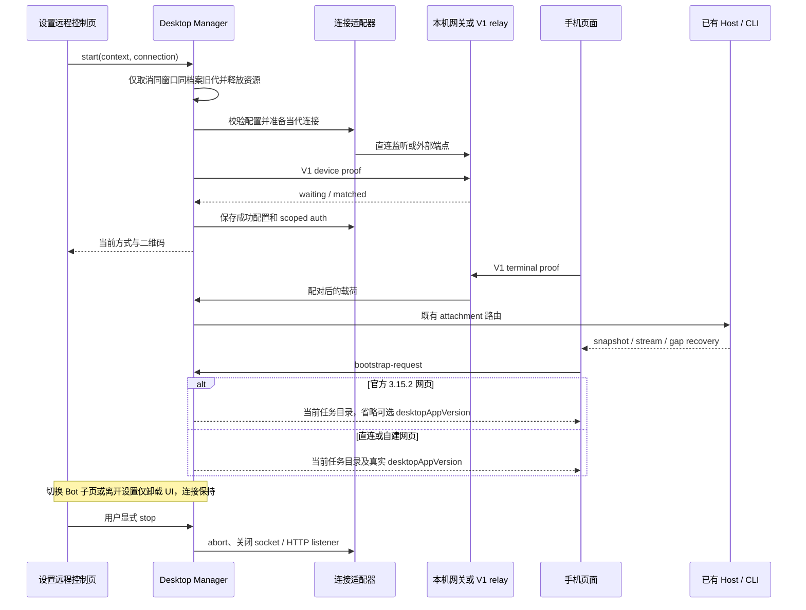

# V1 远程控制连接方式

## 产品规则

设置 → 远程控制中的手机连接卡片提供直接访问、自建 relay、官方 relay 三类 V1 接入档案。三者均使用 V1 `auth_init → auth_challenge → auth_response` 的 HMAC 配对，共用现有 Desktop transport 和窗口 Host attachment。官方预设为 `wss://zcode.z.ai/ws` 与 `https://zcode.z.ai/remote/v4`，仅在用户选择后连接；不接入 OAuth、V2 注册或云端设备发现。

手机接入档案保存为全局命名列表，运行态按窗口隔离。每个档案有稳定 `profileId`、名称和一种模式；同一窗口可同时运行多个档案，启动新档案不停止已运行档案，同一档案也可被不同窗口分别启动。外部 relay 凭据 scope 由端点、窗口和 `profileId` 组成；同端点的两个档案不共享配对身份。直连档案的每次运行各自监听端口并持有当次内存配对材料。局域网、VPN 和 HTTPS 隧道可通过 direct 的监听地址／访问地址复用同一 V1 合同；隧道部署本身不属于本功能。

每个运行档案独立持有 transport、二维码、bridge、buffer、恢复水位和错误状态。停止、重新配对或断线只影响对应窗口与 `profileId`；关闭窗口才释放该窗口全部手机接入。手机终端 owner 也按运行档案隔离，不能由新入口的页面会话回收另一入口的终端。所有入口继续 attach 到同一窗口 Host 和目标 workspace，不复制任务、队列或 Agent runtime。重启恢复按档案原子保存目标与连接配置，待恢复项按档案和工作区匹配到提供该工作区的窗口；单个档案恢复失败不阻止其他档案。

官方模式的二维码固定 `app_version=3.15.2`，选择支持 V1 及当前排队输入字段的手机网页。3.14.3 的 strict 输入校验会拒绝含 `inputOrigin` 的队列投影，造成 `fault.subscription.contentRejected`；重新获取相同快照无法解除拒收。切换网页资源版本，不改中继地址、不裁剪已接受的输入。`OFFICIAL_WEB_REMOTE_CONTROL_V1.pageVersion` 是网页资源版本，设备握手的 `meta.version` 仍为真实桌面版本。该网页会按 bootstrap 的 `desktopAppVersion` 重定向；仅官方模式省略这个可选字段，让它保留已选网页，不以网页版本代替真实桌面版本。直连和自建模式继续在链接及 bootstrap 中使用真实桌面版本。此策略按当前运行连接选择，离开官方模式后不保留兼容状态。

官方域名清理检查按文件与完整字面量登记保留的 V1 地址，公共二维码合同测试的 origin 断言纳入同一规则。该登记不豁免整个测试文件；新增路径、其他官方服务地址与无关文件仍由原检查拒绝。

首次打开只读取状态和连接档案，点击某个档案的“开启远程控制”才连接。旧单份配置迁移为 `default` 档案；已有环境变量成对配置时该档案默认自建 relay。成功开启后保存档案列表，重新打开显示所有档案和各自状态；查看或编辑另一个档案不影响正在运行的档案。运行档案折叠配置并显示当前方式，留出二维码空间；修改配置需要先停止该档案。离开设置或切换到 Bot 子页保留全部连接，“停止”只释放所选档案。刷新配对沿用该运行档案的完整工作区目标并废弃旧配对材料。

直接访问面向局域网 HTTP 和 nginx 转发。根地址跳转到 `/remote/`；打开完整配对链接直接连接，打开裸地址显示配对链接输入页。每个窗口启动独立 HTTP/WS 网关，默认监听 `0.0.0.0` 的可用端口，自动选择本机非回环 IPv4 生成链接；可填写监听地址、固定端口及浏览器访问地址。无可用 IPv4 时要求填写地址，不能生成手机不可达的 localhost 链接。反向代理需转发 `/remote/` 静态页面和 `/ws` WebSocket；公网使用 HTTPS/WSS。网关只持有当次随机配对材料，直接访问停止或重启后旧链接失效。

自建模式填写 V1 relay 的 WebSocket 地址及手机页面地址；页面可与 relay 分开部署。二维码可增加 `relay` 参数，当前 Web 客户端优先使用该参数，旧二维码继续从页面 origin 推导 `/ws`。HTTPS 页面不能使用 WS；地址拒绝 URL 用户信息、片段及非 HTTP/WS 协议。旧官方页面同源推导行为保持兼容。

手机页面随 Desktop 产物打包；开发时亦可单独构建。普通 HTTP 的浏览器通过已有密码库完成 HMAC/SHA-256，通过共享 UUID 工具生成草稿、Hook 和文档面板标识，文档指纹与面板状态键也使用同一 SHA-256 兼容实现，不依赖仅安全上下文提供的 API。

官方旧 V1 页仍读取 workspace / task 快照。仅官方模式运行时，Renderer 从常驻的 `ProjectDirectoryProvider` 读取与侧栏相同的完整项目树和活动投影，不另发受 tabs 限制的任务查询。目录包含未打开的本地项目、无任务项目和历史任务的实际 cwd；删除的任务不出现，软删项目的历史任务仍可读取。远端继续限定在当前窗口已有的 workspace identity / session 中，未连接或未保留的远端不能借本地目录扩展获得 attachment。

项目与任务事实由 Host / CLI 管理，Provider 是窗口唯一目录读取者。既有 `syncWebRemoteControlLegacyTasks` IPC 一次提交 tasks 和可选 directory（workspaces、workspaceKey 到本地 projectIds 的映射、windowControlSessionId）。Main 原子替换可丢弃投影后推送，不持久化项目映射。停止、窗口关闭、切换模式清除兼容快照；非官方连接及不匹配的会话快照不接收目录扩展。UI 的初始异步状态查询不能覆盖后到的连接事件。

旧页以 cwd 为工作区单位：有 root 的本地项目使用主目录，历史任务保留原 cwd；同一主目录的多个项目合并显示名称，新建遇到多个项目归属时提示从桌面选择项目，不能任意选第一个。无 root 项目使用 `JSON.stringify(["openzwork-local-project", projectId])` 作为临时目录寻址 identity，路径栏显示本地化“项目尚未添加源文件夹”。该键只存在于兼容投影，不能传给 Host、文件操作或持久化。Main 从当前快照解析 projectId，经既有 `prepareProjectWorkspace` / `prepareSession` 取得真实 cwd 后才建立本地 bridge。历史 task 导航经 Host 按真实 taskId / workspaceKey 解析，不初始化或重建目录。

已存在的本地目录在新建 attachment 前执行异步只读检查，目录不存在、路径是文件或无法访问均拒绝新草稿；修复目录后再次尝试可恢复。此检查不拦截带 initialTaskId 的历史恢复，保留已有历史只读语义。空项目首次分配目录仍由原生项目服务负责；旧目录失效不能通过 mkdir 自动复活。新建准备沿用现有 bridge generation、取消和迟到结果释放规则。

任务目录按 `updatedAt`、`createdAt`、taskId 降序排列。即使任务仍在运行、标题和未读状态均不变，活动时间变化也必须推送完整的新目录；活动时间相同时，创建时间变化也应更新排序。workspace 的 label、path、purpose 及 task 的 workspaceLabel 变化也必须推送。相同字段值的输入列表仅改变数组顺序时仍去重。bootstrap 与后续目录推送从同一展示投影生成，手机重新连接后读取当前排序。



## 设置页与导航

桌面侧统一配置页为“设置 → 远程控制”。详情页并列展示“手机连接”和“Bot Channels”卡片；较窄窗口改为纵向排列。主工作区侧栏底部提供远控快捷按钮，先设置 remoteControl section intent，再调用既有打开设置动作；设置侧栏的 back 模式不重复提供入口。快捷按钮不打开独立配置弹窗、不启动连接。底部保留个人菜单和设置按钮，默认名称显示本地用户。布局与入口验收见[设置页布局规格](../spec/settings-visual-polish.md)。

手机卡片保留接入档案列表、档案详情、显式开启、状态、停止、复制链接和重新配对。未开启的档案仅展示配置和开启动作，运行后展示二维码与连接操作；选择列表项只切换查看对象。重新配对需确认旧链接失效，并沿用当前运行档案的完整工作区目标，不能混入最近浏览的另一个工作区身份。导航返回、切换设置分区和关闭设置仅卸载 UI，不调用 stop。

连接方式下显示所选模式的网页来源与网络要求，运行后仍保留该说明。直接访问使用随桌面打包的 OpenZWork 网页，手机需通过局域网、VPN 或 HTTPS 反向代理访问电脑；自建模式使用用户填写的 V1 中继与手机网页，手机需能打开网页、两端需能连接中继；官方模式使用 ZCode 官方 V1 网页并显示 `pageVersion`，两端需能访问官方服务，扫码配对无需账号登录。版本号从共享常量传入中英文文案，不能在语言包中另存版本。

Bot 卡片的渠道入口和“管理机器人”在当前设置分区内打开管理子页，使用设置面包屑返回卡片页。复用现有 Bot 配置与注册流程，服务始终由本机 Host 提供；打开管理页不会主动启动第三方登录。渠道入口可按既有规则选择已有 Bot 或创建关闭态草稿。

设置导航沿用 SettingsPage 的 section intent 和上次分区偏好。该分区只在 Desktop 且远控功能可用时显示。手机目标沿用最近激活工作区的 path、identity 和当前仍存活的 remoteSessionId；设置 tab 本身不作为 workspace。没有工作区时禁止开启，Bot 管理仍可使用；远端会话已失效时不透传旧 session，手机继续沿用现有离线工作区展示；已有运行连接仍允许复制、重新配对与停止。

## 所有者与事件顺序

### 多档案并发与恢复

- 连接代次从异步准备前开始，键为 `windowId + profileId`。重新启动先取消该键的旧代；停止、暂停与关窗同时取消准备中和已经运行的实例。旧代只能释放自己创建的资源，不能覆盖新代状态。
- 全局档案列表仅由 Main 的连接适配器读改写。`updateWebRemoteControlConnectionProfile` 接收严格校验的单档案命令：`upsert` 携带 profile，`remove` 携带 profileId；在同一提交队列内读取最新列表后更新，至少保留一个档案。启动成功沿同一写入路径提交当前档案。UI 缓存用于编辑，不能作为整表替换依据。
- 恢复记录保存已运行项与尚未恢复项的并集。待恢复项只在启动成功或用户显式停止该项后移除；一次恢复由档案与工作区键认领，失败保留该项且不阻止其他项，其他窗口可以继续恢复自己的工作区。关窗取消当前尝试，但保留下次启动的恢复记录。
- 官方目录同步遍历窗口状态中的每个有效 official 实例，分别使用其 sessionId；direct/self-hosted 排在列表首位不影响后续官方实例。旧的单实例状态继续按同一规则处理。



| ID       | 设置与动作                                                         | 必须断言                                                        | 验证层                                       |
| -------- | ------------------------------------------------------------------ | --------------------------------------------------------------- | -------------------------------------------- |
| V1-MA-01 | 延迟连接准备，分别停止单档案、停止窗口、暂停、关窗或同档案再次启动 | 旧启动取消；新启动及其他档案保持独立                            | 可重复 runtime 回归                          |
| V1-MA-02 | 两个设置窗口持有旧列表，交错新增、启动、删除不同档案               | 只改变指定 profileId；失败保留 UI 草稿并显示错误                | 连接适配器回归、设置页回归、Desktop E2E 候选 |
| V1-MA-03 | A、B 位于不同工作区，先恢复 A，再重启或让 B 暂时失败               | 磁盘仍包含 B；后续可恢复；显式停止不再恢复                      | 可重复 runtime 回归                          |
| V1-MA-04 | direct + official 或两个 official 同时运行                         | 每个官方 session 均收到自己的目录同步；停止其中一个不影响另一个 | React hook 回归                              |

| 状态                          | 唯一所有者                                    | 其他层                                                      |
| ----------------------------- | --------------------------------------------- | ----------------------------------------------------------- |
| 设置分区 / Bot 子页           | SettingsPage / 远控页局部导航                 | 不持久化第二份连接或 Bot 事实                               |
| Bot 配置与运行状态            | 本机 Host 的 botsService                      | 设置页只复用已有管理组件                                    |
| 连接设置                      | Desktop Main 的 SettingService                | UI 只持有草稿，通过 platform 请求                           |
| 窗口连接代次、网关生命周期    | WebRemoteControlManager / AbortController     | stop、失败、窗口关闭均释放                                  |
| V1 配对凭据                   | CredentialService（外部 relay）或内存（直连） | 按规范化端点和窗口隔离；设置文件不保存秘密                  |
| Socket、心跳和重连            | 现有 device/terminal transport                | 网关只鉴权与转发                                            |
| 任务、输入、快照、owner/lease | 现有 Host / CLI runtime                       | 手机保持 web-remote-replayable；桌面保持 desktop-continuous |



启动恢复记录原子保存目标与当时的连接配置，避免多窗口交错保存后用另一种连接方式恢复旧目标。异步准备、凭据写入和注册回调均检查代次。迟到结果必须释放自己的资源，不能关闭新代连接。直连网关仅接受预置设备身份，禁止远程注册；device 连接限本机回环，terminal 通过一次性 nonce 与常量时间 proof 校验，错误连接和超时握手关闭。保留帧大小及发送背压上限。多窗口不复用同一个 SID。

外部 relay 的新凭据记录将 SID 与 passHash 一起存入 CredentialService，按端点及窗口构造 key。旧记录缺少端点归属，保留原记录、不推断迁移，新入口首次生成新配对。环境变量仅作为无已存配置时的自建默认值，显式选择其他方式优先。

## 验收用例与覆盖矩阵

| ID    | 设置、动作                                                                  | 必须断言                                                              | 验证层                  |
| ----- | --------------------------------------------------------------------------- | --------------------------------------------------------------------- | ----------------------- |
| V1-01 | 未配置打开设置远程控制页，选择三种方式                                      | 不自动联网；字段随选择变化；开启动作显式                              | UI E2E                  |
| V1-02 | 直连 loopback 测试端口，以解析到 loopback 的非 localhost 域名访问，手机配对 | 静态资源可读；正常 proof 成功；双向消息；未鉴权数据拒绝               | 网关集成、Desktop E2E   |
| V1-03 | 错 proof、重复 nonce、远程 device 注册、超限输入                            | 不转发，连接关闭                                                      | 网关集成                |
| V1-04 | 停止、刷新、取消启动、多窗口                                                | 监听释放；旧链接失效；另一窗口及新代不受影响                          | manager / provider 集成 |
| V1-05 | relay A/B、窗口 A/B、直连切换                                               | 凭据隔离；配置保存失败释放当代资源；旧存储未改写                      | adapter / manager       |
| V1-06 | 页面与 relay 异源、旧 QR、错误协议                                          | 新 relay 参数生效；旧 origin fallback；拒绝 HTTPS→WS                  | shared / Web            |
| V1-07 | HTTP 无 subtle/randomUUID                                                   | HMAC 与标准向量一致；新建草稿及附件摘要可用                           | Web / UI 单测及浏览器   |
| V1-08 | 自建 V1 fixture 与真实官方 V1                                               | 无账号正常配对和双向消息；失败显示连接错误                            | 集成 / 独立协议探测     |
| V1-09 | 桌面会话在手机恢复                                                          | 既有 owner、workspaceIdentity、bridge generation、replayable 测试通过 | 既有定向回归            |
| V1-10 | Desktop 构建与反向代理路径                                                  | out/web-remote 存在；/remote/ 引用有效；停止后资源不可访问            | build / HTTP            |
| V1-11 | 设置入口、首页快捷按钮、手机与 Bot 卡片、Bot 子页返回                       | 首页直达设置且不连接；页内导航不出现配置弹窗；Bot 使用本机服务        | UI 单测、Desktop E2E    |
| V1-12 | 进入 / 离开设置、同路径远端、失效 session、无工作区                         | 不自动连接或停止；identity 不丢失；失效 session 不透传；Bot 仍可管理  | UI 单测、Desktop E2E    |

V1-08 另验证实际加载的脚本来自 `/remote/v4/3.15.2/assets/`，bootstrap 未改报桌面版本，页面刷新后仍保持 `app_version=3.15.2`；该页可列出并打开未在桌面 tab 中的本地历史任务，显示无任务及无 root 项目，项目改名实时同步，失效目录新建失败且没有创建目录。列表来自共享 Provider。使用合成模型回放，让任务保持 running 后从手机发送排队消息；桌面确认入队、手机刷新后仍能读到队列、释放当前回合后收到排队回复、再次刷新保留正文，整个流程无 `fault.subscription.contentRejected`。

V1-01 同时覆盖三种说明随选择切换，官方网页版本与共享常量一致；在中英文、Zai Light / Zai Dark、1400px / 390px 下检查说明和表单无水平溢出。

任务目录回归须检查实际发出的 `workspace-list-updated`：仅时间变化时更新载荷与顺序，重复投影不重复推送，随后 bootstrap 返回相同的最新目录。官方网页验收显式设置 `ZCODE_E2E_VERIFY_OFFICIAL_V1=1`，同时检查打开历史会话和刷新恢复；未开启该开关的跳过结果不作为官方模式通过依据。

V2/OAuth 用例不进入此功能矩阵；真实公网部署、手机硬件与不同网络运营商的可达性另行验收。候选 E2E 放入 manual-review/pending，不自动提升为正式套件。

候选交互用例：`packages/desktop/test/e2e/conversation-session/manual-review/pending/web-remote-v1-connections.test.ts`。隔离 HOME、合成 relay、真实桌面与浏览器；不依赖真实模型请求。

从仓库根目录运行三种连接方式的候选验收（包含真实官方中继与网页）：

```bash
ZCODE_E2E_VERIFY_OFFICIAL_V1=1 pnpm --filter @zcode/desktop test:e2e:serial --spec ./test/e2e/conversation-session/manual-review/pending/web-remote-v1-connections.test.ts
```

官方用例读取合成历史会话，并向本地受控模型回放发送运行及排队消息；不请求付费模型。查看报告时确认三种连接方式全部执行，官方项没有跳过。

## 使用方式

打开桌面设置 → 远程控制，选择连接方式并点击开启。直接访问可使用生成的完整链接，或先打开 `http://电脑地址:端口/` 再粘贴配对链接。手机与电脑需处于可互访的网络。默认端口自动分配，nginx 转发时填写固定端口。

同机 nginx 转发示例：桌面监听 `127.0.0.1:8080`，访问地址填写 nginx 的 HTTP/HTTPS 地址。保持 `/remote/` 与 `/ws` 两个路径：

```nginx
location = / {
    return 302 /remote/;
}
location /remote {
    proxy_pass http://127.0.0.1:8080;
    proxy_set_header Host $host;
    # 配对参数在 URL 中；此路径不记录请求查询串。
    access_log off;
}
location = /ws {
    proxy_pass http://127.0.0.1:8080;
    proxy_http_version 1.1;
    proxy_set_header Upgrade $http_upgrade;
    proxy_set_header Connection "upgrade";
    proxy_read_timeout 75s;
}
```

自建模式使用兼容本项目 V1 合同的 relay：支持 `device_register_init`、HMAC challenge/proof、`waiting/matched`、心跳查询和双向 `data` 转发。手机页面可单独部署，构建命令为 `pnpm --filter @zcode/web exec vite build --base=/remote/`，输出在 `packages/web/dist/`。在手机连接卡片中分别填写 relay WS 地址和页面 HTTP 地址；HTTPS 页面需配套 WSS。本文提供客户端接入和静态页构建，不自动安装或部署 relay 服务。

官方模式直接选择官方 V1 preset。官方服务的停用或协议变化显示为连接错误，不切换到账号登录。

合并 3.16.2 后，CF-01 Bot 连接错误候选经设置卡片进入内嵌管理页，在页面保持打开时验证错误与绑定状态。该用例不启动手机 relay，也不调用真实第三方渠道。
